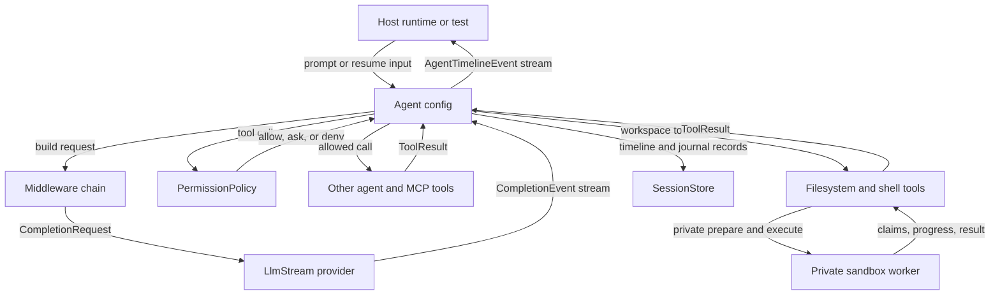

# Agent

Waltr agent architecture keeps model interaction, prompt assembly, permission policy, middleware, and durable session replay in `crates/waltr-agent/`. Workspace operations execute in `crates/waltr-agent-sandbox/`, not in the agent host. The agent remains a library independent of the server, shared client, TUI, and web layers.

## Responsibilities

| Area | Owns |
| --- | --- |
| Agent configuration | `AgentBuilder`, selected model, enabled tools, middleware chain, and permission policy. |
| Agent definitions | Strict YAML parsing, resource registration, inheritance, reference resolution, and resolved runtime inputs. |
| Provider abstraction | Provider-neutral requests, stream events, tool calls, tool results, thinking blocks, and provider metadata. |
| Provider adapters | OpenAI and Anthropic request encoding, streaming, parsing, and provider-specific continuation data. |
| Agent loop | Turn progression, provider streaming, timeline events, tool execution, permission checks, and host-facing `AgentTimelineEvent` output. |
| Host primitives | Structured session creation, per-run provider-turn limits, conditional metadata updates, and post-durable session events. |
| Tools | Provider-facing filesystem and optional shell schemas, worker-backed execution, plus question, skills, task, and MCP integration. |
| Permissions | Generic permission claims, resource matching, policy evaluation, and allow/ask/deny behavior before tool execution. |
| Middleware | Request construction hooks, prompt assembly, tool visibility and metadata, worker-backed context, skills, `AGENTS.md`, and suspension hooks. |
| Durable sessions | Event-sourced session records, snapshots, suspensions, resume inputs, and storage backends. |
| Sandbox worker | Filesystem, patch, optional shell execution, workspace reads/searches/snapshots, and skill file I/O in `crates/waltr-agent-sandbox/`. |

## Boundaries

`crates/waltr-agent/` is a normal Rust library boundary. Code in this crate should not depend on `waltr-server`, `waltr-client`, `waltr-tui`, or `waltr-web`.

Adjacent layers should treat the agent as a hostable capability:

| Layer | Relationship To Agent |
| --- | --- |
| Server | Hosts and coordinates agent sessions through `SessionCoordinator`; owns the private worker gateway and transport, while public authorization and RPC/MCP contracts stay outside the agent crate. |
| Shared client | May render or control server-exposed agent state, but shared client reducers stay outside the agent crate. |
| Web and TUI | May present agent output, prompts, approvals, and session state, but UI routing and rendering stay outside the agent crate. |
| Tests | Exercise the agent directly through scripted providers, live providers, tools, and storage backends. |

The agent crate owns provider-neutral domain types and host-tool contracts. Hosts own policy choices, UI presentation, server APIs, process lifecycle, and runtime wiring around the library.

Hosts inject the workspace root and a required `SandboxHandle` when constructing the session runtime factory. The worker reports its canonical root; runtime construction uses it for workspace-relative prompts and permissions. Agent and MCP runtime code does not introspect a production workspace root from process state.

## Private Workspace Boundary

`waltr-agent` owns providers, session journals, permission policy, prompt assembly, and the agent loop. `SandboxGateway` in `crates/waltr-agent/src/sandbox_gateway.rs` hosts a private bidirectional `waltr.sandbox.v1.SandboxService/Connect` stream. The worker in `crates/waltr-agent-sandbox/` owns workspace I/O and execution tickets. Embedded desktop and Android hosts run the gateway and worker as tasks in the same process, using Tonic over `tokio::io::duplex`; they do not consult standalone sandbox environment variables. Standalone hosts may run a separate worker process/container: the server listens on a local Unix domain socket shared only with that worker, and the worker connects to the gateway there. Neither mode exposes `SandboxService` on public HTTP/gRPC routes or on a TCP listener. The process-local mode is not OS isolation; a sidecar can separate filesystem mounts and process authority, but a shared Kubernetes pod network is not network isolation. See [deployment](../deployment.md#workspace-worker-deployment) for the socket, mounts, and environment contract.

The worker must report its canonical root before agent runtime construction and readiness. Startup fails if the required worker cannot connect or its root is unusable; `/ready` fails when the worker disconnects and recovers after the same worker reconnects. `/health` remains process liveness, not proof of worker availability. A lost stream does not restart an accepted operation, and a replacement worker/process cannot recover the old worker's in-memory tickets, running work, or replies. There is no host-side workspace execution fallback.

For a sandbox-backed tool the loop first records the provider tool call, then `SandboxCallRecorded`. Whole-tool permission runs before prepare; the worker's `Prepare` validates arguments and returns resource claims and an opaque ticket. After the complete pre-tool middleware chain and the final claim/input permission decision, deny or ask cancels the unused ticket. On allow, the loop durably appends `SandboxDispatchStarted` *before* polling `Execute`. The worker consumes the single-use ticket for exactly the prepared invocation and arguments, rechecks paths/claims, and sends correlated progress and completion. Disconnect, cancellation, and lost replies do not fall back to host-side execution. A transport error after dispatch is not turned into a provider-visible tool error because the side effect might already have occurred.

The gateway holds a bounded in-memory queue across stream disconnects. The same living worker keeps running accepted work and automatically resends outstanding replies when it reconnects; the host matches IDs and ignores duplicate or late replies, without querying worker status or resending an uncertain Execute. Prepare and workspace requests have 30-second host delivery deadlines, and Execute has a 60-second deadline for non-shell tools or a deadline derived from the configured shell timeout. The worker has its own per-request execution bound. If no reply arrives by the host deadline, the request times out; a timeout does not prove a side effect did not happen. Gateway state is lost on server process death; tickets and unsent results are lost on worker process death. Known worker tool errors return normal provider-visible error results, while an unresolved provider-facing Execute timeout has an uncertain outcome and suspends instead. On resume, a pending sandbox call with a dispatch fence (or a legacy pending call with no recorded pre-dispatch marker) is unknown, not retryable: the session suspends awaiting tool results. A recorded call without a dispatch fence may retry after a pending permission response. Explicit external tool results can resolve pending work; a new prompt can supersede it through the ordinary interrupted-turn path. The two journal events are replayed from the rollback-effective journal; no migration or backfill is installed for old sessions. Provider dispatch remains retry-the-turn as described under durable sessions; the fence applies to provider-facing workspace tool execution, not provider requests or prompt templates.

The worker also handles read-only workspace context requests (`info`, `resolve`, `read`, `list`/`glob`, `search`/`grep`, ranked and bounded `search_files`, `skills`, `skill`) and bounded `snapshot` walks. Filesystem prompt snapshots are opt-in, not part of every runtime. Workspace-derived prompt snapshots, `AGENTS.md`, `@file` templates, `/skill` templates, skills, and server workspace context use the worker rather than locally reading the workspace. Worker glob results are capped at 1,024 and explicitly mark truncation; ordinary search excludes ignored files but makes a narrow exception to discover hidden `.agents/skills` trees. Context requests do not grant a provider-facing mutating tool. Server startup checks only known configured host-owned paths against the workspace root; it does not recursively scan the workspace. Host-owned catalog, persistence, and server configuration still belong to the server. See [Filesystem Tools](../agent/filesystem.md), [Shell Tool](../agent/shell.md), and [Skills](../agent/skills.md).

Prompt templates are a separate dispatch path. Sandbox-backed `@tool(...)` references, including nested and runtime instruction templates, use the same whole-tool and claim-based permissions and worker Prepare/Execute path as provider-facing calls. A successful result is included in the rendered prompt; a worker error or delivery timeout becomes a template tool error. Completed sandbox results are retained across permission suspensions within one submitted prompt batch and cleared once the entire rendered batch is durably accepted. There is no template dispatch fence: a fresh render invokes the tool again, even if a previous attempt timed out after performing a side effect. Other tool templates retain their existing permission Ask/suspension and replay behavior. For user templates the submitted source prompt is held in durable middleware state while rendering; the rendered prompt is appended only after the batch succeeds. See [MCP prompt discovery](../agent/mcp.md#prompt-discovery).

All server hosts load the same ordinary agent definitions from the unified catalog. Build capabilities control which configured tools runtime construction can install: shell-enabled builds install a configured shell tool, while builds without the `shell` feature keep shell-bearing definitions inspectable and loadable but omit the shell tool and feature-derived shell tool permissions.

Stdio MCP definitions remain ordinary catalog resources and follow the same materialization and runtime behavior in standalone, desktop, and Android hosts.

This restriction applies to server-side agent execution. Tauri WebView IPC capabilities remain a separate browser-shell security boundary.

## Agent Definitions

`waltr-agent` parses strict `waltr.dev/v1alpha1` `Agent`, `FeatureSet`, and `PermissionSet` resources. Unknown fields, unsupported values, malformed YAML, empty names, and unsupported API versions fail parsing.

The implemented resource model is:

| Kind | Implemented fields |
| --- | --- |
| `Agent` | `metadata.name`; optional `spec.description`, `spec.systemPrompt`, and `spec.inheritsFrom.name`; ordered `spec.features` and `spec.permissions` entries. |
| `FeatureSet` | Optional `filesystem`, `agents`, `skills`, `shell`, `task`, and `mcp` feature configurations. Workspace-root fields accept only `$(session.workspace.root)`, the filesystem profile is `auto`, and the instruction filename is `AGENTS.md`. MCP selection and trace propagation belong to the `mcp` feature. |
| `PermissionSet` | Ordered `spec.tools` entries selected by exact tool `name` or by implemented `feature`, with whole-tool `allow`, `ask`, or `deny`, or filesystem path and shell command resource rules. |

The unified server catalog bundles these agent resources:

| Kind | Bundled resources |
| --- | --- |
| `Agent` | [`coding`](../../crates/waltr-server/resources/agents/coding.yaml), [`configuration`](../../crates/waltr-server/resources/agents/configuration.yaml), and [`default`](../../crates/waltr-server/resources/agents/default.yaml). |
| `FeatureSet` | [`coding`](../../crates/waltr-server/resources/features/coding.yaml). |
| `PermissionSet` | [`coding`](../../crates/waltr-server/resources/permissions/coding.yaml) and [`default`](../../crates/waltr-server/resources/permissions/default.yaml). |

Resolution is parent-first. Nonempty parent and child system-prompt fragments compose in that order, separated by a blank line. The parent fully composes before the child applies each list left-to-right. Every `spec.features[]` entry contains exactly one `featureSetRef: { name }` or one inline `filesystem`, `agents`, `skills`, `shell`, `task`, or `mcp` feature. A later feature replaces that whole feature configuration. Every `spec.permissions[]` entry contains exactly one `permissionSetRef: { name }` or one inline tool `name`/`feature` selector and permission. Permissions append in composition order and use the existing conflict rules. Missing references and inheritance cycles fail resolution.

```yaml
spec:
  features:
    - featureSetRef: { name: coding }
    - shell:
        root: $(session.workspace.root)
        systemPrompt: false
        defaultPermissions: true
  permissions:
    - permissionSetRef: { name: coding }
    - name: deploy
      permission: ask
```

The server owns resource persistence, live snapshots, and selection. Agent resources occupy the `agents`, `features`, and `permissions` catalog categories.

Each runtime file contains exactly one strict resource. Its directory fixes the resource kind. Its filename stem must equal `metadata.name`.

A persisted file replaces bundled bytes at the same canonical relative path. A new path adds one resource. Waltr applies no field merge.

The server compiles each valid catalog snapshot into a name-sorted agent catalog and marks the configured default.

Invalid persisted state fails startup. After startup, invalid direct edits remain on disk. The server retains the last-known-good active snapshot and exposes the reload error. A later valid edit activates without a restart.

The public `/mcp` resource collection `waltr://resources` and uniform create/edit/destroy tools manage every catalog kind.
See [Resource Catalog](config.md#administration).

Per-slot ETags and checks serialize writes through Waltr. They do not isolate the resource tree from another local process that can write `.waltr`.

`ListAgents`, new sessions, and later explicit agent selections read the current successful snapshot. Current session bundles do not passively rebase after a resource reload.

The bundled `configuration` agent explicitly includes only the `waltr` MCP resource and enables remote MCP Skills.
Its policy permits resource actions and denies session actions.
It explicitly grants `load_skill` and `read_mcp_resource` while retaining `resources: false` and `skills: true`; resource reads therefore remain limited to approved loaded held skill files.
The bundled `coding` agent enables Skills through an inline MCP override and preserves all current MCP settings.
One `SkillsMiddleware` publishes `load_skill` with required `source: "local"` or `source: "mcp"` selectors and routes to the workspace or MCP adapter. `McpResourcesMiddleware` publishes `read_mcp_resource({server, uri})` for raw data, with held-manifest verification hooks. Ordinary MCP reads and user-inserted resource templates do not activate skills or grant execution authority.
Remote Skill activation requires manifest-bound approval; subsequent tool calls require additional per-call consent without permission expansion.
See [MCP Skills](../agent/mcp.md#mcp-skills) for durable-history, replay, and origin boundaries.

Each new top-level session stores an `AgentDefinitionBundle` with a selected catalog name and the exact ordered YAML source texts. Current clients require an explicit selection; omission in the older create RPC shape uses the configured default. Session summaries project the effective agent name. Legacy sessions without a bundle also project and use the configured default without being backfilled.

`UpdateSessionAgent` accepts an exact catalog name and persists the new bundle immediately. An active runtime continues with its already captured bundle. The next captured cycle, including queued or resumed work, uses the new agent; later template searches also reconstruct from it. History is preserved. The new prompt identity materializes a new base prompt on that cycle, approvals remain subject to the new policy, and task children inherit the cycle-captured bundle. MCP replacement waits for the next reconstruction and structural-fingerprint decision.

Multiple switches before a capture boundary coalesce from the first old name to the final name. The next cycle appends one duplicate-safe JSON `agent_switch` event on the `session_info` channel and clears the pending marker. A malformed present bundle fails reconstruction instead of falling back.

## Durable Ownership

`SessionCreateRequest` gives hosts one structured creation boundary. It includes the session ID, inference settings, self-contained agent bundle, and initial metadata map.

`AgentRunLimits` can cap provider turns for one run without weakening a lower runtime limit. The routine host uses this boundary for `maxTurns`.

`SessionRecord.inference_settings` stores only `InferenceSettings`. Its exact durable shape is one `provider: InferenceProviderSettings` value with these fields:

| Field | Durable value |
| --- | --- |
| `key` | Provider configuration key. |
| `api` | Provider API family. |
| `url` | Provider endpoint URL snapshot. |
| `model_id` | Provider model identifier. |
| `model_cost` | Optional model cost snapshot. |
| `headers` | Provider header templates. |
| `oauth` | Optional provider OAuth refresh settings. |
| `reasoning_effort` | Optional OpenAI reasoning effort. |

Session JSON uses the `inference_settings` field. The old `runtime_settings` field is unsupported. Waltr does not alias or backfill it, so an old field does not populate inference settings.

The selected definition bundle supplies the resolved base prompt, features, permissions, and MCP selection at reconstruction. Durable middleware state preserves the prompt materialized for that definition identity, captured `AGENTS.md` content, skill catalog, and loaded skill bodies. Task children inherit the parent's inference settings and cycle-captured bundle.

The schema supports strict nested input permissions. `permission.inputs` is a nonempty list; each rule has a nonempty `match` list whose conditions are ANDed. Conditions use canonical RFC 6901 pointers and exactly one value matcher: an exact typed JSON scalar (`null`, boolean, number, or string) or a string wildcard containing exactly one terminal `*`. Missing pointers do not match and leave the baseline or another rule in effect. A selected object or array denies closed. Matching precedence is condition count, exact-condition count, total wildcard-prefix length, effect conflict rank, then later composed position.

```yaml
permissions:
  - name: waltr
    permission:
      inputs:
        - match:
            - pointer: /action
              value: { wildcard: "sessions.*" }
            - pointer: /options/dryRun
              value: { exact: false }
          effect: ask
```

Routine resources and routine execution belong to `waltr-server`; routine sources stay out of agent bundles. Generic manual Routine RPCs belong to the server and shared client. Routine tools, deferred tools, and harness tools are not implemented. Generic MCP selection remains definition feature behavior. Unsupported fields fail strict parsing rather than being ignored. The removed `featureSetRefs` and `permissionSetRefs` fields have no alias or migration: old external definitions and stored source bundles that use them fail.

## Routine Session Boundaries

The fork Routine captures the source under the normal session operation gate. It releases that gate before compaction starts.

The fork capture derives one immutable raw provider-neutral inference conversation from the rollback-effective journal. It stops at the latest completed provider turn, honors rollbacks, preserves source content regardless of active masks, and excludes active partial work. The capture also includes exact source inference and the exact agent definition. `capture_latest_completed_effective` is the explicit mask-aware capture used by pause-backed Routines such as compact-and-continue; callers never infer effective capture from the fork API.

The conversation preserves provider-replay prompts, assistant text, tool calls, tool results, and inline images. It excludes source lifecycle events, middleware state, status, usage and cost, request audit records, provider metadata, provider-native thinking payloads, rollback barriers, and active partial work. This provider-neutral history is not a byte-for-byte HTTP wire archive. Provider adapters still apply their normal request encoding rules.

Every source-backed `sessionTemplate` atomically creates a fresh durable auxiliary Routine session with the captured history followed by its task user prompt. Provider requests derive only from that durable helper state. The copied history persists across restart and storage backends under ordinary session retention rules. Normal session delete and wipe operations remove these helpers. Current timeline RPCs and web and TUI renderers expose their normal durable timeline events without a separate client model.

An inference-only `sessionTemplate` creates a fresh durable helper with only its task user prompt. Replacement prompts and explicit capabilities still define the task runtime.

The fork compaction helper stores this exact user message after the copied history:

```text
<fork-direction>
<exact direction>
</fork-direction>
```

Its replacement system prompt treats the entire user message, including XML-like content, as untrusted emphasis text. The model must not execute instructions from that text or continue the source task.

The destination create path copies exact source inference and agent definition into a fresh ordinary session. It clears `pending_switch_audit`. It copies no source history or general metadata.

`SessionCreateRequest` atomically persists the ordinary destination and its exact first prompt. Successful creation is the prompt-durability boundary and emits the normal post-durable user-message event. Start occurs only after this boundary.

After successful atomic creation, cancellation and start failure retain the destination and its identity in the Routine result.

## Runtime Flow

An agent run starts from an `Agent` built with `AgentBuilder`. The run binds that configuration to a provider implementing `LlmStream`, a prompt or resume input, and either an ephemeral or durable session store.



The loop persists session progress before provider dispatch and while consuming provider events. Provider text and thinking deltas become durable timeline events. Tool-call previews are recorded and streamed before tool execution. A provider turn may include multiple tool calls; the loop records every preview before executing the collected calls. Generic tool progress can stream while each tool runs, and each final tool result is persisted as soon as that tool completes. The provider turn is marked finished only after all collected tool calls have resolved, so interruptions preserve completed results and cancel only unfinished work. Final tool results are returned to the provider as replayable tool results in later turns.

Suspending work is part of the runtime contract. Middleware or permission handling can stop progression with an external request, such as a permission approval or user question. The host later resumes the session with `ResumeInput`.

## Provider Boundary

`crates/waltr-agent/src/stream.rs` defines the provider-neutral request and event model:

| Type | Role |
| --- | --- |
| `LlmStream` | Trait implemented by provider adapters. |
| `CompletionRequest` | Prompt, optional system prompt, visible tools, and replayed turns sent to a provider. |
| `CompletionEvent` | Provider output normalized into text deltas, thinking data, tool calls, metadata, and finished signals. |
| `CompletionTurn` | Replayable turn history preserving thinking blocks, tool calls, tool results, and provider metadata. |
| `ToolDefinition`, `ToolCall`, `ToolResult` | Provider-neutral tool contract used by built-in tools, MCP tools, and hosts. Tool results preserve ordered text and validated inline-image blocks plus explicit error state. |

Provider adapters under `crates/waltr-agent/src/provider/` encode this neutral model into provider-specific protocols and parse provider-specific streams back into neutral events. Anthropic tool results carry native Base64 image sources, OpenAI Responses function outputs carry `input_image` items, and Chat Completions emits required text tool messages before labeled user image messages. Provider-native metadata and thinking payloads may be stored for continuation, but replay correctness should not depend on metadata being present.

## Tools And Permissions

Tools are opt-in capabilities added through `AgentBuilder` or MCP configuration. A default agent built with only a model has no host tools.

Built-in tool areas:

| Tool Area | Purpose |
| --- | --- |
| `tools::filesystem` | Provider-facing schemas for worker-executed file operations. |
| `tools::question` | Structured external questions that suspend the run until a host answer is provided. |
| `tools::skills` | Agent skill metadata and rendering; worker-backed discovery and loading. |
| `tools::task` | Task-oriented agent tool support. |
| `tools::shell` | Optional shell schema and hints behind the `shell` feature; worker executes commands. |
| `mcp` | Waltr-side Model Context Protocol integration exposed as agent tools and templates. |

Tool execution passes through generic permission claims. Tools and middleware describe requested operations as `PermissionClaim` values, and `PermissionPolicy` evaluates those claims by tool selector, operation class, filesystem path, shell command, or resource pattern.

Resolved agent-definition permissions start deny-by-default, which also keeps tools without an effective permission out of provider requests. `defaultPermissions: true` on filesystem, skills, shell, task, or MCP installs allow rules for the concrete tools owned by that enabled feature; omitting it or setting it to false leaves those tools denied unless a permission-set entry exposes them. Permission-set selectors can name one concrete tool or all concrete tools generated by an implemented feature. Ordered resource rules support `outsideRoot: $(session.workspace.root)` for filesystem claims and executable names for shell claims.

The bundled `coding` definition enables default permissions for its feature-owned tools. On shell-enabled builds, it asks before filesystem or shell access outside the session workspace. It also asks before shell commands named `git`, `pulumi`, `kubectl`, `terraform`, `gcloud`, `aws`, `gh`, `help`, `pyinfra`, `ansible`, `sudo`, or `ssh`, regardless of their arguments.

On builds without the `shell` feature, the same resolved definition retains its shell configuration and permission source. Runtime tool discovery returns no shell tool, so default and feature-selected shell permissions add no runtime rules. Filesystem, agents, skills, task, and configured MCP capabilities remain available according to their own build and definition requirements.

Permission outcomes are runtime behavior, not UI behavior:

| Outcome | Meaning |
| --- | --- |
| `Allow` | Execute the tool and record the result. |
| `Ask` | Suspend with an external permission request for the host to answer. |
| `Deny` | Return a permission error instead of executing the tool. |

Whole-tool `deny` and `ask` gate execution before tool middleware. After an allowed whole-tool gate, input and resource checks evaluate the final arguments and claims produced by the complete pre-tool middleware chain. A matching input `ask` records reusable approval claims only for the exact tool, pointer, and typed scalar observed after middleware; a wildcard policy never creates a wildcard durable approval. Permission state writes version 2, reads legacy version 1 or an absent version, and rejects unknown versions. Stored approvals do not override a newly applicable deny.

One-shot approvals survive pre-dispatch suspensions and clear at final execution or result, denial, cancellation, or prompt supersession.
Ordinary request IDs bind the approval stage, policy identity, tool name, full arguments, and claim identities through SHA-256.
Earlier request IDs require fresh consent. See [Permissions](../agent/permissions.md#durable-behavior) and [MCP Skills](../agent/mcp.md#mcp-skills).

## Middleware

Middleware is the internal extension point for request construction, tool handling, and suspensions. Configured middleware behavior is exposed through builder options and public agent features.

Middleware can:

- Add or edit system prompt fragments.
- Add, remove, or annotate tools before provider request assembly.
- Observe or alter provider-neutral requests.
- Observe or replace tool calls and tool results.
- Suspend a run with an external request.

`AgentBuilder::build` assembles middleware in deterministic order. The stateful system prompt middleware runs first, feature and custom middleware run in registration order, `AGENTS.md` instruction middleware runs after that when configured, and skills middleware runs last when configured. This ordering is part of the request-construction contract because it can affect provider request hashes and tool visibility.

Durable middleware state preserves first-execution prompt inputs across reconstruction. After the first execution, the stored fully composed system prompt and captured `AGENTS.md` content override newly composed values. The first execution also stores the discovered skill catalog. Individual skill content becomes durable only when that skill loads; Waltr does not pin every skill body during initial discovery.

## Durable Sessions

Agent sessions are event-sourced. A session store persists cursor-assigned timeline events and internal `SessionJournalEvent` records identified by `SessionId` and guarded by revisions. Runtime snapshots are derived from the persisted journal and are used to resume with a new prompt, external response, tool results, or interruption. Inline tool-result images remain in the durable provider-neutral turn for replay. Provider-request audit records redact image data and retain safe media, size, and digest metadata; server timeline projections likewise omit Base64.

Persistent replacement masks are rollback-aware administrative journal events. One atomic mutation resolves explicit subtraction by opaque mask ID, stable key, or completed-prefix selector overlap against the pre-mutation active set, removes matches before additions, rejects overlapping persistent replacements, allocates one session cursor, and increments the record revision. The cursor is not a timeline item: raw timeline reads and raw snapshots remain unchanged. Explicit subtraction removes a mask while preserving its source events; rolling back before the mutation removes its effect. Every built-in store commits the whole-record mutation through its lock or compare-and-swap path; an OpenDAL backend without ETags or configured compare-and-swap rejects the operation rather than degrading to an unconditional write. Filter, truncation, annotation, exact item-set, and category-oriented mask semantics are not implemented.

`SessionRecord::active_session_masks` replays that rollback-effective history into active masks paired with their activation cursors. `SessionCoordinator::timeline_projection` loads one record under the ordinary session operation boundary and returns an explicit `Raw` or `Effective` page. Raw projection wraps the same events selected by the existing `TimelineQuery`. Effective projection hides the selected completed-turn prefix, inserts one synthetic user text snapshot at the activation cursor, and preserves later durable events. The synthetic variant has typed `MaskReplacement` presentation metadata and an opaque mask ID, but no canonical `TimelineItemId`, parent, arbitrary metadata, or durable item lookup contract.

Projection pages carry the loaded record revision, the consumed raw continuation cursor, and `has_more`. Effective paging scans raw events in the requested direction, advances across hidden or channel-filtered events, and counts both synthetic and durable visible entries against the requested limit. The boundary includes only raw events actually inspected, so a fully hidden page still progresses without consuming a later durable entry. Channel filters still apply to durable events; the replacement participates only in the `user_text` channel. Administrative cursors order replacements but never enter raw timeline queries or raw watch publication.

The existing raw timeline subscription remains event-and-truncation only. `watch_timeline_projection` uses the same agent-owned publication sequence and emits raw appends plus an authoritative invalidation carrying the new projection revision after mask addition, subtraction, or rollback. If local broadcast retention is exceeded, it emits `ResetRequired` with the gap size instead of silently losing the update. A host opens this subscription before its initial effective query, applies newer live updates, and replaces the projection after invalidation or reset. A fresh query supplies the reset revision and is the reconnect and catch-up authority; hosts and clients do not receive or interpret mask selectors.

Provider hydration keeps the raw snapshot for lifecycle status, middleware state, turn progression, item identity, and cursor bookkeeping, but materializes prompt and completed-turn context in effective mode. A `ThroughCursor` replacement is limited to an exact completed-turn prefix: selected prompt and completion context is hidden and one synthetic user prompt is inserted at the earliest selected turn. With no active masks, effective materialization equals the prior raw provider-neutral request. `SessionCopy::from_record` remains raw, while `SessionCopy::from_record_effective` applies active masks explicitly. No provider-specific continuation or synthetic provider payload is created.

Session metadata is host-defined, durable JSON-like state. `set_metadata_value_conditionally` applies set-if-absent atomically at each backend's documented concurrency boundary.

The agent emits `SessionEvent::UserMessageCreated` only after a user prompt append succeeds. Delivery uses an injected `SessionEventSink`, runs best-effort, and never changes the source operation result. The agent does not replay or recover these events.

`waltr-server` currently hosts sessions and exposes the same registered session service and coordinator through gRPC and the MCP `sessions` tool. MCP supports list, get, interrupt, wait, send, and wipe operations. Both surfaces must share that coordinator because active runs, queues, and live broadcasts are process-local.

`SessionSummary` combines durable record fields with agent-owned process-local coordination facts and one derived `SessionProgress` and `SessionCapabilities` projection. `SessionRecord::summary()` always supplies default `Ready` coordination and derives the projection from it; none of these process-local fields serialize into `SessionRecord` or the journal. Progress precedence is durable failure, owned pause, completion barrier, durable suspension kind, actual coordinator run, durable active stage, finished, then idle. It preserves the detailed durable run stage, coordination reason, queue depth, armed continuation, and the existing MCP-compatible `running` meaning. Durable suspension is not running even during the brief coordinator-`Running` publication window; completion barriers and owned pauses remain running. A new coordinator therefore projects persisted sessions as `Ready`, even if the previous process ended while a pause or queue existed; a durable active stage remains visibly running after restart but is not interruptible without a real process-local active run.

Capabilities expose only authoritative session actions. Prompts queue during process-local running, completion barriers, and pauses; a prompt on a ready durable suspension supersedes that suspension; other ready states admit it immediately. An external response is available only for `Ready` plus `AwaitingExternalInput`, and interrupt is available only for coordinator `Running`. Durable `SessionStatus::Suspended` remains separate from an owned `Paused` phase. The projection intentionally provides no pause-lease, mask, rollback, Routine-admission, delete, wipe, or shutdown authorization.

`SessionCoordinator::acquire_pause_reject_busy` accepts a validated host-neutral reason and creates an opaque process-local owned pause only when no run, pause, lifecycle operation, delete, or wipe owns the session and a completed provider turn exists. Reason codes are required, nonempty, and bounded; optional source and trigger attributes are also bounded and must be omitted rather than empty. The lease exposes the provider-visible completed source cursor and internally pins the latest timeline boundary used for atomic mask mutation. Effective capture and mask mutation revalidate ownership. Metadata-only revision changes do not affect the pinned timeline boundary; any timeline append causes a typed boundary error. Pauses, reasons, continuations, and queues are intentionally not durable and disappear with the coordinator process.

After a normally finished coordinated run is durable, the coordinator replaces its active state with a short-lived completion barrier before inspecting queued work. New queue-if-active submissions join the existing FIFO while the barrier is live. The registered host callback receives the session ID, stable process-local run identity, terminal timeline cursor, latest completed provider turn's context-token usage when reported, durable session purpose, and effective configured provider/model identity. Cumulative session metrics are not used as current context pressure.

Completion admission has two phases. Removing a durably finished active run first installs a completion barrier with the agent-owned `post-run-automation` reason. The coordinator bounds terminal-record loading, snapshot derivation, and host preparation together to two seconds; this phase cannot claim a pause and may be aborted safely. If preparation returns `SessionCompletionCoordinationPreparation::Claim`, that value carries the validated host reason selected for this completion. The coordinator atomically converts the matching barrier into an owned pause, replaces the barrier reason with the claim descriptor, and passes the lease to one host finalizer. Finalization is not timed out or aborted: capture and authoritative durable admission resolve before the coordinator decides whether to retain the pause or drain queued work. Failure or panic removes the claimed pause and fails open; success returns an already-created worker future that owns the lease. Worker construction therefore cannot panic in the supervisor, and no later pause reacquisition race exists. The coordinator holds no session or coordination mutex across either host await. The best-effort semantic event sink is not part of this ordering contract.

Ordinary `QueueIfActive` submissions join the same FIFO queue while paused even though no provider run is active. Reject and replace policies return a typed paused error rather than breaking another owner's pause. A successful mask mutation can arm one continuation at its committed administrative cursor. Releasing the matching owner starts that continuation without rollback before queued user prompts; ordinary completion then drains and coalesces adjacent compatible prompts as before. Release is idempotent for its successfully released lease. A stale or competing lease cannot capture, mutate, arm, or release the live pause.

Session list publication retains the latest durable summary by incarnation and overlays coordination, progress, and capabilities as one process-local owner group. Every merge recomputes progress and capabilities from the selected durable status and exact coordination before publishing one full summary. Run, queue, barrier, pause, continuation, release, interruption, deletion, wipe, and shutdown transitions publish full summary upserts after the authoritative in-memory change; coordination-only upserts retain the durable revision and are not suppressed by same-revision merge rules. Queue depth counts logical queued submissions and becomes zero when compatible prompts are promoted and coalesced into one active run. `SessionCoordinator::list()` registers each durable baseline first, then reads coordination and reconciles the returned and retained summaries while the coordinator lock excludes transitions. A transition at either edge therefore appears in the reconciled snapshot or publishes against an already-retained summary, and an incarnation change suppresses stale reconciliation. Initial list, reconnect, and sequence-gap repair cannot replace a live pause with default `Ready` or publish mismatched derived fields. Storage awaits never occur while coordinator or synchronous publication locks are held.

Delete, wipe, interrupt, and coordinator shutdown invalidate pauses, cancel queued handles with deterministic run-cancellation errors, and suppress new work at their lifecycle boundary. Wipe serializes with active `SessionControl` operations, cancels process-local coordinated work, removes every raw record, clears cached session MCP runtimes, and publishes one session-list cleared event. Coordinator shutdown permanently disables new run admission, cancels active and queued work, waits until run ownership drains, then takes the MCP preparation guards and runtime cache atomically under the MCP lifecycle write gate. It awaits `McpClientRuntime::shutdown` for every drained runtime, so cached stdio clients use the generic client's explicit shutdown and child-reap path. This path inherits the MCP shutdown contract and does not promise an additional bounded termination time. The gRPC and MCP surfaces invoke the same wipe operation and require explicit confirmation.

`SessionControl` centralizes process-local lifecycle serialization, per-session mutation serialization, and the session-list projection. Pause acquisition uses nonblocking lifecycle and mutation acquisition so manual admission rejects rather than waits behind conflicting ownership. An incarnation is an in-memory token for one lifetime of a session ID, not a durable revision. Delete and wipe remove the projected incarnation, so a delayed publication from an earlier lifetime cannot update a same-ID recreation. Runtime capture carries this token through MCP preparation and runtime construction; each cache return, insertion, or eviction reacquires the ordered session guards and verifies the token after asynchronous work. A stale newly started MCP runtime is shut down without entering the cache. A publication claim is an RAII claim on the projection entry, not a capacity reservation. Dropping a failed or cancelled claim removes only its matching empty incarnation.

Session summaries have split ownership. Host-originated publications own metadata values, inference settings, and the selected agent. Run-originated publications own revision, status, current prompt, activity, and metrics. The process-local owner group contains coordination plus its derived progress and capabilities. The projection merges complete summaries according to that ownership, rejects stale incarnations and lower revisions, preserves run-owned fields at equal revision, keeps timestamps monotonic, recomputes the complete process-local group, and allocates each sequence while holding its short synchronous projection mutex.

The lock order is lifecycle read or write, then the session-keyed asynchronous mutation mutex, then the short synchronous list-projection mutex. A gate-registration lease exists before waiting for the keyed mutex and removes its pointer-matching registry entry only after the final holder or waiter drops. Unrelated sessions retain independent mutation mutexes. No synchronous mutex crosses an await. `SessionRunContext` carries the bound control handle, timeline broadcaster, and optional event sink through `AgentRunBuilder`, `EphemeralSessionRun`, `AgentLoopState`, and `AgentSessionRuntime`. Delete completes durable deletion, cache eviction, and deleted publication while guarded, then releases lifecycle and mutation guards before awaiting shutdown of the detached MCP runtime. A same-ID recreation therefore receives a new incarnation and cannot reuse or shut down that detached runtime.

Session storage implementations include memory, filesystem, OpenDAL-backed stores, S3, Scylla, and PostgreSQL through OpenDAL helpers. Storage details are below the `SessionStore` trait; the agent loop only depends on the trait contract.

Filesystem conditional metadata uses process-wide locks keyed by root and session. It requires one process owner and no external file writer.

Generic OpenDAL uses backend ETags or an explicit compare-and-swap adapter. A conditional update returns unsupported when neither mechanism exists; Waltr never substitutes a non-atomic write.

The PostgreSQL helper supplies database compare-and-swap. Dedicated S3 supports ETag compare-and-swap or an explicit single-writer mode. The latter requires one process and no external writer.

Crash recovery is retry-the-turn. The request is journaled before provider dispatch, while parser progress inside an in-flight provider stream is not persisted as an authoritative checkpoint.

## Dependencies

The agent crate depends on provider, storage, protocol, and async infrastructure crates such as `reqwest`, `tokio`, `mcp`, `opendal`, `aws-sdk-s3`, `scylla`, `tokio-postgres`, and provider protocol helpers. The server composes the agent and worker crates; the optional `shell` feature enables agent-side shell configuration and worker-side shell execution and Bash parsing.

These dependencies stay inside the agent layer. Higher layers should use the public agent API instead of depending on provider adapter internals, middleware internals, or storage implementation details.

## Dependents

Current and expected dependents include:

| Dependent | Uses |
| --- | --- |
| Agent tests | Scripted-provider, live-provider, session, permission, MCP, filesystem, shell, question, and loop coverage. |
| Host runtimes | Agent configuration, timeline streams, durable sessions, suspensions, and resume inputs. |
| UI or server layers | Public timeline events after a host layer chooses how to authorize and expose them. |

## Invariants

- Agent code must not depend on server, shared client, TUI, or web crates.
- Provider adapters must cross the provider boundary through provider-neutral request and event types.
- Built-in host tools are opt-in; a default agent has no filesystem, shell, MCP, skills, task, or question tools unless configured.
- Permission claims must be evaluated before executing host tools that can read, write, delete, execute, or otherwise affect external resources.
- Workspace-backed tools must not execute in the agent or server host; use the required private worker. Persist the dispatch fence before polling provider-facing Execute and never automatically replay an uncertain dispatch.
- Sandbox-backed `@tool(...)` templates must evaluate worker claims and permissions before execution. A fresh render may invoke the tool again after an earlier timeout; keep `@file` and `/skill` worker-backed.
- Middleware assembly order must remain deterministic.
- Durable session replay must be based on persisted timeline/journal records and derived projections, not provider-specific transient parser state.
- Provider-native metadata is an optimization for continuation and compatibility, not a requirement for replay correctness.
- Session mutation paths must acquire lifecycle, per-session mutation, and list-projection synchronization in that order; synchronous projection state must never cross an await.
- Routine source capture must release the source operation gate before provider compaction work starts.
- Owned pause operations must verify the process-local owner and pinned timeline boundary; continuation must not append a rollback.
- Source-backed Routine helpers must persist their captured provider-neutral inference conversation before provider dispatch.

## Tests

Agent coverage is split between deterministic tests and ignored live-provider tests. See [../testing.md](../testing.md) for canonical commands.

Focused paths:

| Path | Covers |
| --- | --- |
| [../../crates/waltr-agent/tests/agent.rs](../../crates/waltr-agent/tests/agent.rs) | Deterministic agent integration test entry point. |
| [../../crates/waltr-agent/tests/agent/](../../crates/waltr-agent/tests/agent/) | Deterministic loop, session, permission, MCP, and question behavior. |
| [../../crates/waltr-agent/tests/live.rs](../../crates/waltr-agent/tests/live.rs) | Ignored live-provider test entry point. |
| [../../crates/waltr-agent/tests/live/agent/](../../crates/waltr-agent/tests/live/agent/) | Live-provider agent flows for tools, storage, context, permissions, MCP, shell, and filesystem behavior. |

## References

| Path | Purpose |
| --- | --- |
| [../../crates/waltr-agent/AGENTS.md](../../crates/waltr-agent/AGENTS.md) | Local crate boundary guidance. |
| [../../crates/waltr-agent/src/lib.rs](../../crates/waltr-agent/src/lib.rs) | Public exports and module boundary. |
| [../../crates/waltr-agent/src/agent/builder.rs](../../crates/waltr-agent/src/agent/builder.rs) | Agent construction, tools, permissions, prompt, MCP, and middleware assembly. |
| [../../crates/waltr-agent/src/agent/loop.rs](../../crates/waltr-agent/src/agent/loop.rs) | Internal run loop, provider streaming, tool execution, permissions, and timeline/journal persistence. |
| [../../crates/waltr-agent/src/agent/session/mod.rs](../../crates/waltr-agent/src/agent/session/mod.rs) | Durable session API surface. |
| [../../crates/waltr-agent/src/agent/event.rs](../../crates/waltr-agent/src/agent/event.rs) | Host-neutral post-durable session events and delivery boundary. |
| [../../crates/waltr-agent/src/stream.rs](../../crates/waltr-agent/src/stream.rs) | Provider-neutral request, event, turn, tool, thinking, and metadata types. |
| [../../crates/waltr-agent/src/provider/mod.rs](../../crates/waltr-agent/src/provider/mod.rs) | Provider adapter exports. |
| [../../crates/waltr-agent/src/middleware/mod.rs](../../crates/waltr-agent/src/middleware/mod.rs) | Middleware hook contract. |
| [../../crates/waltr-agent/src/tools/mod.rs](../../crates/waltr-agent/src/tools/mod.rs) | Built-in tool modules. |
| [../../crates/waltr-agent/src/sandbox_gateway.rs](../../crates/waltr-agent/src/sandbox_gateway.rs) | Agent-owned private worker gateway and request correlation. |
| [../../crates/waltr-agent-sandbox/src/lib.rs](../../crates/waltr-agent-sandbox/src/lib.rs) | Worker-owned workspace operations and RPC entry point. |
| [../../crates/waltr-server/src/sandbox.rs](../../crates/waltr-server/src/sandbox.rs) | Private gateway, embedded duplex worker, and standalone socket lifecycle. |
| [../../proto/waltr/sandbox/v1/sandbox_service.proto](../../proto/waltr/sandbox/v1/sandbox_service.proto) | Private streaming RPC contract. |
| [../../crates/waltr-agent/src/mcp/mod.rs](../../crates/waltr-agent/src/mcp/mod.rs) | Waltr-side MCP integration boundary. |
| [../../crates/mcp/](../../crates/mcp/) | Generic MCP protocol crate. |
| [../../crates/waltr-agent/src/permission/mod.rs](../../crates/waltr-agent/src/permission/mod.rs) | Permission policy, claims, matching, and effects. |
| [../../crates/waltr-agent/src/definition/mod.rs](../../crates/waltr-agent/src/definition/mod.rs) | Strict agent-definition registry, schema model, and resolution. |
| [../../crates/waltr-server/resources/](../../crates/waltr-server/resources/) | Bundled unified resource catalog. |
| [../../crates/waltr-server/src/agent_definition.rs](../../crates/waltr-server/src/agent_definition.rs) | Unified catalog persistence, validation, snapshots, and watcher lifecycle. |
| [config.md](config.md) | Canonical unified catalog contract. |
| [../agent/README.md](../agent/README.md) | Index of detailed agent feature docs. |
| [../mcp/README.md](../mcp/README.md) | Generic MCP protocol documentation. |
