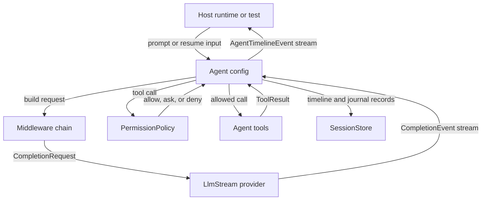

# Agent

Waltr agent architecture keeps model interaction, prompt assembly, tool execution, permissions, middleware, and durable session replay in `crates/waltr-agent/`. The crate is an isolated library: it can be used by hosts, tests, or future runtimes without depending on the server, shared client, TUI, or web layers.

## Responsibilities

| Area | Owns |
| --- | --- |
| Agent configuration | `AgentBuilder`, selected model, enabled tools, middleware chain, and permission policy. |
| Provider abstraction | Provider-neutral requests, stream events, tool calls, tool results, thinking blocks, and provider metadata. |
| Provider adapters | OpenAI and Anthropic request encoding, streaming, parsing, and provider-specific continuation data. |
| Agent loop | Turn progression, provider streaming, timeline events, tool execution, permission checks, and host-facing `AgentTimelineEvent` output. |
| Tools | Built-in filesystem, question, skills, task, MCP, and optional shell tool integration. |
| Permissions | Generic permission claims, resource matching, policy evaluation, and allow/ask/deny behavior before tool execution. |
| Middleware | Request construction hooks, prompt assembly, tool visibility and metadata, claims, skills, `AGENTS.md`, and suspension hooks. |
| Durable sessions | Event-sourced session records, snapshots, suspensions, resume inputs, and storage backends. |

## Boundaries

`crates/waltr-agent/` is a normal Rust library boundary. Code in this crate should not depend on `waltr-server`, `waltr-client`, `waltr-tui`, or `waltr-web`.

Adjacent layers should treat the agent as a hostable capability:

| Layer | Relationship To Agent |
| --- | --- |
| Server | Hosts and coordinates agent sessions through `SessionCoordinator`, while server state, authorization, and RPC/MCP contracts stay outside the agent crate. |
| Shared client | May render or control server-exposed agent state, but shared client reducers stay outside the agent crate. |
| Web and TUI | May present agent output, prompts, approvals, and session state, but UI routing and rendering stay outside the agent crate. |
| Tests | Exercise the agent directly through scripted providers, live providers, tools, and storage backends. |

The agent crate owns provider-neutral domain types and host-tool contracts. Hosts own policy choices, UI presentation, server APIs, process lifecycle, and runtime wiring around the library.

## Runtime Flow

An agent run starts from an `Agent` built with `AgentBuilder`. The run binds that configuration to a provider implementing `LlmStream`, a prompt or resume input, and either an ephemeral or durable session store.

The loop persists session progress before provider dispatch and while consuming provider events. Provider text and thinking deltas become durable timeline events. Tool-call previews are recorded and streamed before tool execution. A provider turn may include multiple tool calls; the loop records every preview before executing the collected calls. Generic tool progress can stream while each tool runs, and each final tool result is persisted as soon as that tool completes. The provider turn is marked finished only after all collected tool calls have resolved, so interruptions preserve completed results and cancel only unfinished work. Final tool results are returned to the provider as replayable tool results in later turns.

Suspending work is part of the runtime contract. Middleware or permission handling can stop progression with an external request, such as a permission approval or user question. The host later resumes the session with `ResumeInput`.

## Provider Boundary

`crates/waltr-agent/src/stream.rs` defines the provider-neutral request and event model:

| Type | Role |
| --- | --- |
| `LlmStream` | Trait implemented by provider adapters. |
| `CompletionRequest` | Prompt, optional system prompt, visible tools, and replayed turns sent to a provider. |
| `CompletionEvent` | Provider output normalized into text deltas, thinking data, tool calls, metadata, and finished signals. |
| `CompletionTurn` | Replayable turn history preserving thinking blocks, tool calls, tool results, and provider metadata. |
| `ToolDefinition`, `ToolCall`, `ToolResult` | Provider-neutral tool contract used by built-in tools, MCP tools, and hosts. |

Provider adapters under `crates/waltr-agent/src/provider/` encode this neutral model into provider-specific protocols and parse provider-specific streams back into neutral events. Provider-native metadata and thinking payloads may be stored for continuation, but replay correctness should not depend on metadata being present.

## Tools And Permissions

Tools are opt-in capabilities added through `AgentBuilder` or MCP configuration. A default agent built with only a model has no host tools.

Built-in tool areas:

| Tool Area | Purpose |
| --- | --- |
| `tools::filesystem` | Controlled file operations rooted in configured workspace paths. |
| `tools::question` | Structured external questions that suspend the run until a host answer is provided. |
| `tools::skills` | Agent skill discovery and loading. |
| `tools::task` | Task-oriented agent tool support. |
| `tools::shell` | Optional shell execution tool behind the `shell` feature. |
| `mcp` | Waltr-side Model Context Protocol integration exposed as agent tools and templates. |

Tool execution passes through generic permission claims. Tools and middleware describe requested operations as `PermissionClaim` values, and `PermissionPolicy` evaluates those claims by tool selector, operation class, filesystem path, shell command, or resource pattern.

Permission outcomes are runtime behavior, not UI behavior:

| Outcome | Meaning |
| --- | --- |
| `Allow` | Execute the tool and record the result. |
| `Ask` | Suspend with an external permission request for the host to answer. |
| `Deny` | Return a permission error instead of executing the tool. |

## Middleware

Middleware is the internal extension point for request construction, tool handling, and suspensions. Configured middleware behavior is exposed through builder options and public agent features.

Middleware can:

- Add or edit system prompt fragments.
- Add, remove, or annotate tools before provider request assembly.
- Observe or alter provider-neutral requests.
- Observe or replace tool calls and tool results.
- Suspend a run with an external request.

`AgentBuilder::build` assembles middleware in deterministic order. The stateful system prompt middleware runs first, feature and custom middleware run in registration order, `AGENTS.md` instruction middleware runs after that when configured, and skills middleware runs last when configured. This ordering is part of the request-construction contract because it can affect provider request hashes and tool visibility.

## Durable Sessions

Agent sessions are event-sourced. A session store persists cursor-assigned timeline events and internal `SessionJournalEvent` records identified by `SessionId` and guarded by revisions. Runtime snapshots are derived from the persisted journal and are used to resume with a new prompt, external response, tool results, or interruption.

`waltr-server` currently hosts sessions and exposes the same registered session service and coordinator through gRPC and the MCP `sessions` tool. MCP supports list, get, interrupt, wait, send, and wipe operations. Both surfaces must share that coordinator because active runs, queues, and live broadcasts are process-local.

The global session wipe directly removes every raw record from the configured session store, clears cached session MCP runtimes, and publishes one session-list cleared event. It does not inspect, reject, cancel, wait for, or gate running or queued work. Operators must stop session activity first; work that continues concurrently may recreate records after deletion. The gRPC and MCP surfaces invoke this same coordinator operation and require explicit confirmation.

Session storage implementations include memory, filesystem, OpenDAL-backed stores, S3, Scylla, and PostgreSQL through OpenDAL helpers. Storage details are below the `SessionStore` trait; the agent loop only depends on the trait contract.

Crash recovery is retry-the-turn. The request is journaled before provider dispatch, while parser progress inside an in-flight provider stream is not persisted as an authoritative checkpoint.

## Dependencies

The agent crate depends on provider, storage, protocol, and async infrastructure crates such as `reqwest`, `tokio`, `mcp`, `opendal`, `aws-sdk-s3`, `scylla`, `tokio-postgres`, and provider protocol helpers. The optional `shell` feature adds shell parsing dependencies through `tree-sitter` and `tree-sitter-bash`.

These dependencies stay inside the agent layer. Higher layers should use the public agent API instead of depending on provider adapter internals, middleware internals, or storage implementation details.

## Dependents

Current and expected dependents include:

| Dependent | Uses |
| --- | --- |
| Agent tests | Scripted-provider, live-provider, session, permission, MCP, filesystem, shell, question, and loop coverage. |
| Host runtimes | Agent configuration, timeline streams, durable sessions, suspensions, and resume inputs. |
| UI or server layers | Public timeline events after a host layer chooses how to authorize and expose them. |

## Invariants

- Agent code must not depend on server, shared client, TUI, or web crates.
- Provider adapters must cross the provider boundary through provider-neutral request and event types.
- Built-in host tools are opt-in; a default agent has no filesystem, shell, MCP, skills, task, or question tools unless configured.
- Permission claims must be evaluated before executing host tools that can read, write, delete, execute, or otherwise affect external resources.
- Middleware assembly order must remain deterministic.
- Durable session replay must be based on persisted timeline/journal records and derived projections, not provider-specific transient parser state.
- Provider-native metadata is an optimization for continuation and compatibility, not a requirement for replay correctness.

## Tests

Agent coverage is split between deterministic tests and ignored live-provider tests. See [../testing.md](../testing.md) for canonical commands.

Focused paths:

| Path | Covers |
| --- | --- |
| [../../crates/waltr-agent/tests/agent.rs](../../crates/waltr-agent/tests/agent.rs) | Deterministic agent integration test entry point. |
| [../../crates/waltr-agent/tests/agent/](../../crates/waltr-agent/tests/agent/) | Deterministic loop, session, permission, MCP, and question behavior. |
| [../../crates/waltr-agent/tests/live.rs](../../crates/waltr-agent/tests/live.rs) | Ignored live-provider test entry point. |
| [../../crates/waltr-agent/tests/live/agent/](../../crates/waltr-agent/tests/live/agent/) | Live-provider agent flows for tools, storage, context, permissions, MCP, shell, and filesystem behavior. |

## References

| Path | Purpose |
| --- | --- |
| [../../crates/waltr-agent/AGENTS.md](../../crates/waltr-agent/AGENTS.md) | Local crate boundary guidance. |
| [../../crates/waltr-agent/src/lib.rs](../../crates/waltr-agent/src/lib.rs) | Public exports and module boundary. |
| [../../crates/waltr-agent/src/agent/builder.rs](../../crates/waltr-agent/src/agent/builder.rs) | Agent construction, tools, permissions, prompt, MCP, and middleware assembly. |
| [../../crates/waltr-agent/src/agent/loop.rs](../../crates/waltr-agent/src/agent/loop.rs) | Internal run loop, provider streaming, tool execution, permissions, and timeline/journal persistence. |
| [../../crates/waltr-agent/src/agent/session/mod.rs](../../crates/waltr-agent/src/agent/session/mod.rs) | Durable session API surface. |
| [../../crates/waltr-agent/src/stream.rs](../../crates/waltr-agent/src/stream.rs) | Provider-neutral request, event, turn, tool, thinking, and metadata types. |
| [../../crates/waltr-agent/src/provider/mod.rs](../../crates/waltr-agent/src/provider/mod.rs) | Provider adapter exports. |
| [../../crates/waltr-agent/src/middleware/mod.rs](../../crates/waltr-agent/src/middleware/mod.rs) | Middleware hook contract. |
| [../../crates/waltr-agent/src/tools/mod.rs](../../crates/waltr-agent/src/tools/mod.rs) | Built-in tool modules. |
| [../../crates/waltr-agent/src/mcp/mod.rs](../../crates/waltr-agent/src/mcp/mod.rs) | Waltr-side MCP integration boundary. |
| [../../crates/mcp/](../../crates/mcp/) | Generic MCP protocol crate. |
| [../../crates/waltr-agent/src/permission/mod.rs](../../crates/waltr-agent/src/permission/mod.rs) | Permission policy, claims, matching, and effects. |
| [../agent/README.md](../agent/README.md) | Index of detailed agent feature docs. |
| [../mcp/README.md](../mcp/README.md) | Generic MCP protocol documentation. |
