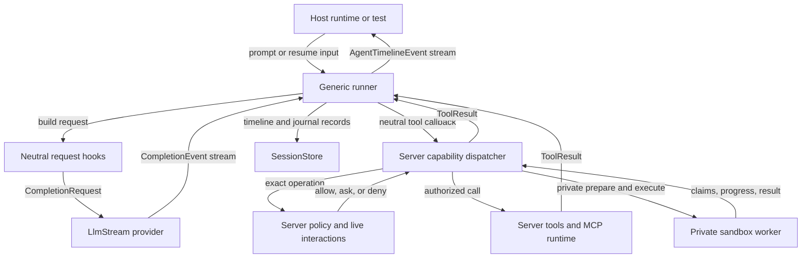

# Agent

`crates/waltr-agent/` is the generic provider/model runner and durable session library. `crates/waltr-server/src/agent_host/` owns concrete capabilities, definitions, templates, middleware, Skills, worker integration, and MCP runtime. Server policy and interactions live outside the agent. Workspace operations execute in `crates/waltr-agent-sandbox/`.

## Responsibilities

| Area | Owns |
| --- | --- |
| Server host configuration | `HostRuntimeBuilder`, strict definitions, reference resolution, concrete capabilities, middleware, and policy. |
| Provider abstraction | Provider-neutral requests, stream events, tool calls, tool results, thinking blocks, and provider metadata. |
| Provider adapters | OpenAI and Anthropic request encoding, streaming, parsing, and provider-specific continuation data. |
| Agent loop | Turn progression, provider streaming, timeline events, neutral tool callbacks, and host-facing `AgentTimelineEvent` output. |
| Host primitives | Structured session creation, per-run provider-turn limits, conditional metadata updates, and post-durable session events. |
| Server capabilities | Internal exact-identity dispatch for filesystem, optional shell, questions, Skills, tasks, MCP, templates, Apps, and authorized code. |
| Server permissions and interactions | Policy evaluation, private approval receipts, typed requests, and original live continuations. |
| Generic hooks | Neutral request, context, tool, cancellation, completion, and durable host fence/receipt contracts. |
| Durable sessions | Event-sourced history, snapshots, generic interruption/tool-result suspension, storage, and coordination. Definitions are opaque JSON to this library. |
| Sandbox worker | Filesystem, patch, optional shell execution, workspace reads/searches/snapshots, and skill file I/O in `crates/waltr-agent-sandbox/`. |

## Boundaries

`crates/waltr-agent/` is a normal Rust library boundary. Code in this crate should not depend on `waltr-server`, `waltr-client`, `waltr-tui`, or `waltr-web`.

Adjacent layers should treat the agent as a hostable capability:

| Layer | Relationship To Agent |
| --- | --- |
| Server | Hosts `SessionCoordinator`, concrete runtime assembly, private worker gateway, capability dispatch, MCP, permissions, interactions, and public contracts. |
| Shared client | May render or control server-exposed agent state, but shared client reducers stay outside the agent crate. |
| Web and TUI | May present agent output, prompts, approvals, and session state, but UI routing and rendering stay outside the agent crate. |
| Tests | Exercise the agent directly through scripted providers, live providers, tools, and storage backends. |

The agent crate owns provider-neutral domain types and host-tool contracts. Hosts own policy choices, UI presentation, server APIs, process lifecycle, and runtime wiring around the library.

Hosts inject the workspace root and a required `SandboxHandle` when constructing the session runtime factory. The worker reports its canonical root; runtime construction uses it for workspace-relative prompts and permissions. Agent and MCP runtime code does not introspect a production workspace root from process state.

## Private Workspace Boundary

`SandboxGateway` in `crates/waltr-server/src/agent_host/sandbox_gateway.rs` hosts a private bidirectional `waltr.sandbox.v1.SandboxService/Connect` stream. The worker owns workspace I/O and execution tickets. Embedded desktop and Android hosts run both as process-local tasks over `tokio::io::duplex`, without standalone environment overrides. Standalone hosts use a local Unix domain socket shared only with the worker, never public HTTP/gRPC or TCP. Process-local execution is not OS isolation; a sidecar can separate mounts and process authority, but a shared pod network is not network isolation. See [deployment](../deployment.md#workspace-worker-deployment).

The worker must report its canonical root before agent runtime construction and readiness. Startup fails if the required worker cannot connect or its root is unusable; `/ready` fails when the worker disconnects and recovers after the same worker reconnects. `/health` remains process liveness, not proof of worker availability. A lost stream does not restart an accepted operation, and a replacement worker/process cannot recover the old worker's in-memory tickets, running work, or replies. There is no host-side workspace execution fallback.

The server dispatcher verifies exact target identity, declaration revision, session binding, and policy. Whole-tool permission precedes concrete before-tool middleware; the worker then prepares the final arguments and returns resource claims and an opaque ticket. Final input/claim authorization precedes Execute. Denial or cancellation cancels the unused ticket. The generic runner records the call and durably stores its host dispatch fence before polling the effect. The worker consumes the single-use ticket for exactly the prepared arguments and rechecks paths/claims. Disconnect, cancellation, and lost replies never fall back to host execution or automatic replay of uncertain work.

The gateway holds a bounded in-memory queue across stream disconnects. The same living worker keeps running accepted work and automatically resends outstanding replies when it reconnects; the host matches IDs and ignores duplicate or late replies, without querying worker status or resending an uncertain Execute. Prepare and workspace requests have 30-second host delivery deadlines, and Execute has a 60-second deadline for non-shell tools or a deadline derived from the configured shell timeout. The worker has its own per-request execution bound. If no reply arrives by the host deadline, the request times out; a timeout does not prove a side effect did not happen. Gateway state is lost on server process death; tickets and unsent results are lost on worker process death. Known worker tool errors return normal provider-visible error results, while an unresolved provider-facing Execute timeout has an uncertain outcome and suspends instead. A recorded dispatch fence prevents automatic replay of uncertain work. Explicit tool results can resolve pending work; a new prompt can supersede it through the ordinary interrupted-turn path. Private approvals cannot be resumed from history. Removed history variants have no compatibility decoder; follow the [coordinated upgrade procedure](../runbooks/server-capability-cutover.md) rather than relying on legacy journal replay. Provider inference requests retain their separate retry-the-turn behavior.

The worker also handles read-only workspace context (`info`, `resolve`, `read`, `list`/`glob`, `search`/`grep`, bounded ranked `search_files`, `skills`, `skill`) and bounded `snapshot` walks. Prompt snapshots are opt-in. Workspace prompts, `AGENTS.md`, `@file`, `/skill`, and server context use the worker, not local reads. Globs cap at 1,024 with explicit truncation; ordinary search excludes ignored files but permits hidden `.agents/skills` discovery. Context grants no mutating tool. Startup checks known host-owned paths for overlap, not arbitrary workspace contents. See [Filesystem](../agent-host/filesystem.md), [Shell](../agent-host/shell.md), and [Skills](../agent-host/skills.md).

Tool templates, including nested and runtime instruction templates, use the same dispatcher as provider calls, Apps, and authorized reviewed JavaScript. They do not invoke a model to execute a capability. An Ask waits in the original live rendering operation. It is not a durable approval suspension or a reason to rerender an already executed effect. A successful render is durably accepted before provider dispatch. See [MCP prompt discovery](../agent-host/mcp.md#prompt-discovery).

Public MCP no longer discovers or dispatches `capability__*` tools, and self-MCP exposes no `waltr__capability__*` aliases. The public catalog retains management/administration tools, resources, and served Apps; it does not aggregate upstream MCP tools. Internal agent sessions retain native tools, definition-selected upstream MCP access, and session Apps through their normal runtime assembly. Native tools include `read`, `glob`, `grep`, profile-selected mutations such as `edit` or `apply_patch`, and optional `shell`. See [filesystem tool profiles](../agent-host/filesystem.md#tool-profiles).

Separately granted public `code` requests retain JavaScript execution and named helpers. They cannot discover, read schemas for, or execute upstream concrete MCP targets. Public code composition skips upstream runtime assembly; internal code grants and named agent helpers keep their normal authority. Custom public code ports must enforce this no-proxy contract. Public capability removal admits no new external dispatch rows and preserves [historical sensitive SQL data](persistence.md#sessionless-external-dispatch).

All server hosts load the same ordinary agent definitions from the unified catalog. Build capabilities control which configured tools runtime construction can install: shell-enabled builds install a configured shell tool, while builds without the `shell` feature keep shell-bearing definitions inspectable and loadable but omit the shell tool and feature-derived shell tool permissions.

Stdio MCP definitions remain ordinary catalog resources and follow the same materialization and runtime behavior in standalone, desktop, and Android hosts.

This restriction applies to server-side agent execution. Tauri WebView IPC capabilities remain a separate browser-shell security boundary.

## Agent Definitions

The server parses strict `waltr.dev/v1alpha1` `Agent`, `FeatureSet`, and `PermissionSet` resources. Unknown fields, unsupported values, malformed YAML, empty names, and unsupported API versions fail parsing. The generic agent stores the definition bundle opaquely and does not interpret these resources.

The implemented resource model is:

| Kind | Implemented fields |
| --- | --- |
| `Agent` | `metadata.name`; optional `spec.description`, `spec.systemPrompt`, and `spec.inheritsFrom.name`; ordered `spec.features` and `spec.permissions` entries. |
| `FeatureSet` | Optional `filesystem`, `agents`, `skills`, `shell`, `task`, and `mcp` feature configurations. Workspace-root fields accept only `$(session.workspace.root)`, the filesystem profile is `auto`, and the instruction filename is `AGENTS.md`. MCP selection and trace propagation belong to the `mcp` feature. |
| `PermissionSet` | Ordered `spec.tools` entries selected by exact tool `name` or by implemented `feature`, with whole-tool `allow`, `ask`, or `deny`, or filesystem path and shell command resource rules. |

The unified server catalog bundles these agent resources:

| Kind | Bundled resources |
| --- | --- |
| `Agent` | [`coding`](../../crates/waltr-server/resources/agents/coding.yaml), [`configuration`](../../crates/waltr-server/resources/agents/configuration.yaml), and [`default`](../../crates/waltr-server/resources/agents/default.yaml). |
| `FeatureSet` | [`coding`](../../crates/waltr-server/resources/features/coding.yaml). |
| `PermissionSet` | [`coding`](../../crates/waltr-server/resources/permissions/coding.yaml) and [`default`](../../crates/waltr-server/resources/permissions/default.yaml). |

Resolution is parent-first. Nonempty parent and child system-prompt fragments compose in that order, separated by a blank line. The parent fully composes before the child applies each list left-to-right. Every `spec.features[]` entry contains exactly one `featureSetRef: { name }` or one inline `filesystem`, `agents`, `skills`, `shell`, `task`, or `mcp` feature. A later feature replaces that whole feature configuration. Every `spec.permissions[]` entry contains exactly one `permissionSetRef: { name }` or one inline tool `name`/`feature` selector and permission. Permissions append in composition order and use the existing conflict rules. Missing references and inheritance cycles fail resolution.

```yaml
spec:
  features:
    - featureSetRef: { name: coding }
    - shell:
        root: $(session.workspace.root)
        systemPrompt: false
        defaultPermissions: true
  permissions:
    - permissionSetRef: { name: coding }
    - name: deploy
      permission: ask
```

The server owns resource persistence, live snapshots, and selection. Agent resources occupy the `agents`, `features`, and `permissions` catalog categories.

Each runtime file contains exactly one strict resource. Its directory fixes the resource kind. Its filename stem must equal `metadata.name`.

A persisted file replaces bundled bytes at the same canonical relative path. A new path adds one resource. Waltr applies no field merge.

The server compiles each valid catalog snapshot into a name-sorted agent catalog and marks the configured default.

Invalid persisted state fails startup. After startup, invalid direct edits remain on disk. The server retains the last-known-good active snapshot and exposes the reload error. A later valid edit activates without a restart.

The public `/mcp` resource collection `waltr://resources` and uniform create/edit/destroy tools manage every catalog kind.
See [Resource Catalog](config.md#administration).

Per-slot ETags and checks serialize writes through Waltr. They do not isolate the resource tree from another local process that can write `.waltr`.

`ListAgents`, new sessions, and later explicit agent selections read the current successful snapshot. Current session bundles do not passively rebase after a resource reload.

The bundled `configuration` agent explicitly includes only the `waltr` MCP resource and enables remote MCP Skills.
Its policy permits resource actions and denies session actions.
It grants `load_skill` and `read_mcp_resource` with `resources: true` and `skills: true`; strict input rules limit reads to the resource catalog and embedded administration Skill files, not session resources.
The bundled `coding` agent enables Skills through an inline MCP override and preserves all current MCP settings.
One `SkillsMiddleware` publishes `load_skill` with required `source: "local"` or `source: "mcp"` selectors and routes to the workspace or MCP adapter. `McpResourcesMiddleware` publishes `read_mcp_resource({server, uri})` for raw data, with held-manifest verification hooks. Ordinary MCP reads and user-inserted resource templates do not activate skills or grant execution authority.
Remote Skill activation requires manifest-bound approval; subsequent tool calls require additional per-call consent without permission expansion.
See [MCP Skills](../agent-host/mcp.md#mcp-skills) for durable-history, replay, and origin boundaries.

Each new top-level session stores an `AgentDefinitionBundle` with a selected catalog name and the exact ordered YAML source texts. Current clients require an explicit selection; omission in the older create RPC shape uses the configured default. Session summaries project the effective agent name. Legacy sessions without a bundle also project and use the configured default without being backfilled.

`UpdateSessionAgent` accepts an exact catalog name and persists the new bundle immediately. An active runtime retains its captured bundle. An actual bundle change invalidates its execution token. Its next stale append rejects; no live policy swap occurs. The next captured cycle, including queued or resumed work, uses the new agent; later template searches also reconstruct from it. History is preserved. The new prompt identity materializes a new base prompt on that cycle, approvals remain subject to the new policy, and task children inherit the cycle-captured bundle. MCP replacement waits for the next reconstruction and structural-fingerprint decision.

Multiple switches before a capture boundary coalesce from the first old name to the final name. The next cycle appends one duplicate-safe JSON `agent_switch` event on the `session_info` channel and clears the pending marker. A malformed present bundle fails reconstruction instead of falling back.

## Durable Ownership

`SessionCreateRequest` gives hosts one structured creation boundary. It includes the session ID, inference settings, self-contained agent bundle, and initial metadata map.

`AgentRunLimits` can cap provider turns for one run without weakening a lower runtime limit. The routine host uses this boundary for `maxTurns`.

`SessionRecord.inference_settings` stores only `InferenceSettings`. Its exact durable shape is one `provider: InferenceProviderSettings` value with these fields:

| Field | Durable value |
| --- | --- |
| `key` | Provider configuration key. |
| `api` | Provider API family. |
| `url` | Provider endpoint URL snapshot. |
| `model_id` | Provider model identifier. |
| `model_cost` | Optional model cost snapshot. |
| `headers` | Provider header templates. |
| `oauth` | Optional provider OAuth refresh settings. |
| `reasoning_effort` | Optional OpenAI reasoning effort. |

Session JSON uses the `inference_settings` field. The old `runtime_settings` field is unsupported. Waltr does not alias or backfill it, so an old field does not populate inference settings.

The selected definition bundle supplies the resolved base prompt, features, permissions, and MCP selection at reconstruction. Durable middleware state preserves the prompt materialized for that definition identity, captured `AGENTS.md` content, skill catalog, and loaded skill bodies. Task children inherit the parent's inference settings and cycle-captured bundle.

The schema supports strict nested input permissions. `permission.inputs` is a nonempty list; each rule has a nonempty `match` list whose conditions are ANDed. Conditions use canonical RFC 6901 pointers and exactly one value matcher: an exact typed JSON scalar (`null`, boolean, number, or string) or a string wildcard containing exactly one terminal `*`. Missing pointers do not match and leave the baseline or another rule in effect. A selected object or array denies closed. Matching precedence is condition count, exact-condition count, total wildcard-prefix length, effect conflict rank, then later composed position.

```yaml
permissions:
  - name: waltr
    permission:
      inputs:
        - match:
            - pointer: /action
              value: { wildcard: "sessions.*" }
            - pointer: /options/dryRun
              value: { exact: false }
          effect: ask
```

Routine resources and JavaScript execution belong to `waltr-server`; routine sources stay out of agent bundles. The server exposes the v2 Routine service. Generic MCP selection remains definition feature behavior. Unsupported fields fail strict parsing rather than being ignored. The removed `featureSetRefs` and `permissionSetRefs` fields have no alias or migration: old external definitions and stored source bundles that use them fail.

`spec.features: [{codeMode: true}]` opts an agent into the neutral code-tool provider port. Absence or false adds no code tool. Production additionally requires an explicit host grant for the actual authenticated principal, current lease, durable session incarnation, and operator profile. The principal-scoped adapter reuses the shared invocation service and ordinary tool policy. Queued runs retain their originating runtime factory, event sink, and completion coordinator; runs with different host bindings do not merge. Application membership alone does not grant code execution. Hosted MCP session admission carries the validated OAuth subject and original expiry/revocation lease through the same factory. Its host grants match the configured hosted issuer and opaque OAuth subject, not request metadata or an inferred OIDC identity. Unauthenticated MCP session admission fails closed. Embedded MCP instead requires the validated current process-generation bearer and retains its generation lifetime; this is trusted local authority, not a hosted OAuth subject. Public MCP code additionally requires an operator-selected `RoutineCodeGrant.public_mcp_session` within the explicit grant; each request gets its own proof-bound adapter over that session's normal opted-in runtime.

An explicitly cancellable session submission exposes an exact run/incarnation cancellation handle. Cancellation removes only its queued item or stops its active token; the ordinary run owner still supplies the completion outcome. Dropping a waiter alone does not cancel work. Ordinary authenticated MCP session create/send admission is durable: later access-token expiry does not cancel the admitted prompt. Observation may close on expiry. Explicit Routine, helper, and code leases retain their own cancellation contract. `OriginRuns` bounds and joins owned tasks; it does not impose ordinary prompt expiry.

Host tool injection follows normal definition, MCP and permission assembly. It adds no permissions and rejects duplicate tool names. Queued runs retain the originating host-tool provider. The host can read the current normal permission policy without a second ordinary-session runtime or a dispatch-journal replay. Normal tool contexts carry the actual durable session incarnation and the effective permission policy for that dispatch. This read-only policy includes runtime narrowing, including a code profile's restriction; a host tool cannot substitute its earlier factory policy.

User-message events follow the durable timeline append. Their source record and cursor therefore include the committed message, including for filesystem-backed sessions. Source identities prove freshness, not access; current-record identity and mutation CAS checks remain mandatory.

## Routine Session Boundaries

Generic capture uses the normal session operation gate. The server supplies source authority; the agent supplies history and lifetime safety.

The fork capture derives one immutable raw provider-neutral inference conversation from the rollback-effective journal. It stops at the latest completed provider turn, honors rollbacks, preserves source content regardless of active masks, and excludes active partial work. The capture also includes exact source inference and the exact agent definition. `capture_latest_completed_effective` is the explicit mask-aware capture used by pause-backed Routines such as compact-and-continue; callers never infer effective capture from the fork API.

The conversation preserves provider-replay prompts, assistant text, tool calls, tool results, and inline images. It excludes source lifecycle events, middleware state, status, usage and cost, request audit records, provider metadata, provider-native thinking payloads, rollback barriers, and active partial work. This provider-neutral history is not a byte-for-byte HTTP wire archive. Provider adapters still apply their normal request encoding rules.

The reviewed helper adapter creates a fresh durable auxiliary session with the captured history followed by its task user prompt. Production uses ordinary named agent bundles, including their Skills, MCP selection, and permission policy; Routine JavaScript does not supply replacement system prompts. Provider requests derive from that durable helper state. The copied history persists across restart and storage backends under ordinary session retention rules. Normal session delete and wipe operations remove these helpers. Current timeline RPCs and web and TUI renderers expose their normal durable timeline events without a separate client model.

An inference-only helper starts with only its task user prompt and the selected normal named agent bundle. Host grants restrict, rather than replace, that bundle's authority.

The fork compaction helper stores this exact user message after the copied history:

```text
<fork-direction>
<exact direction>
</fork-direction>
```

The normal `routine-fork` agent's system prompt treats the entire user message, including XML-like content, as untrusted emphasis text. The model must not execute instructions from that text or continue the source task.

JavaScript chooses destination history, inheritance flags, exact message and whether to start. Generic creation validates the authorized immutable source immediately before the destination transaction. That freshness check linearizes the source read; there is no cross-record transaction. The bundled fork selects source inference and definition, a fresh history and no general metadata. It clears `pending_switch_audit`.

`SessionCreateRequest` atomically persists the ordinary destination and its exact first prompt. Successful creation is the prompt-durability boundary and emits the normal post-durable user-message event. Start occurs only after this boundary.

After successful atomic creation, cancellation and start failure retain the destination and its identity in the Routine result.

## Runtime Flow

The server builds concrete runtime inputs with `HostRuntimeBuilder` and `ServerAgentRuntimeFactory`. The generic runner binds neutral tools/context/hooks to a provider implementing `LlmStream`, a prompt or generic resume input, and a session store.



The loop persists session progress before provider dispatch and while consuming provider events. Provider text and thinking deltas become durable timeline events. Tool-call previews are recorded and streamed before tool execution. A provider turn may include multiple tool calls; the loop records every preview before executing the collected calls. Generic tool progress can stream while each tool runs, and each final tool result is persisted as soon as that tool completes. The provider turn is marked finished only after all collected tool calls have resolved, so interruptions preserve completed results and cancel only unfinished work. Final tool results are returned to the provider as replayable tool results in later turns.

Permissions, questions, forms, and URL consent await the shared server broker in the original live operation. They are not generic runtime suspensions and have no external-response `ResumeInput`.

## Provider Boundary

`crates/waltr-agent/src/stream.rs` defines the provider-neutral request and event model:

| Type | Role |
| --- | --- |
| `LlmStream` | Trait implemented by provider adapters. |
| `CompletionRequest` | Prompt, optional system prompt, visible tools, and replayed turns sent to a provider. |
| `CompletionEvent` | Provider output normalized into text deltas, thinking data, tool calls, metadata, and finished signals. |
| `CompletionTurn` | Replayable turn history preserving thinking blocks, tool calls, tool results, and provider metadata. |
| `ToolDefinition`, `ToolCall`, `ToolResult` | Provider-neutral tool contract used by built-in tools, MCP tools, and hosts. Tool results preserve ordered text and validated inline-image blocks plus explicit error state. |

Provider adapters under `crates/waltr-agent/src/provider/` encode this neutral model into provider-specific protocols and parse provider-specific streams back into neutral events. Anthropic tool results carry native Base64 image sources, OpenAI Responses function outputs carry `input_image` items, and Chat Completions emits required text tool messages before labeled user image messages. Provider-native metadata and thinking payloads may be stored for continuation, but replay correctness should not depend on metadata being present.

## Tools And Permissions

Concrete tools are server-owned opt-in capabilities. The generic runner receives neutral callbacks and has no built-in tools, MCP, permission engine, shell feature, or workspace worker implementation.

Built-in tool areas:

| Tool Area | Purpose |
| --- | --- |
| `tools::filesystem` | Provider-facing schemas for worker-executed file operations. |
| `tools::question` | Typed questions awaiting the original live operation's answer. |
| `tools::skills` | Agent skill metadata and rendering; worker-backed discovery and loading. |
| `tools::task` | Task-oriented agent tool support. |
| `tools::shell` | Optional shell schema and hints behind the `shell` feature; worker executes commands. |
| `mcp` | Waltr-side Model Context Protocol integration exposed as agent tools and templates. |

Server tools and middleware describe requested operations as `PermissionClaim` values. Server `PermissionPolicy` evaluates those claims by tool selector, operation class, filesystem path, shell command, or resource pattern. These types are not part of the generic agent library.

Resolved agent-definition permissions start deny-by-default, which also keeps tools without an effective permission out of provider requests. `defaultPermissions: true` on filesystem, skills, shell, task, or MCP installs allow rules for the concrete tools owned by that enabled feature; omitting it or setting it to false leaves those tools denied unless a permission-set entry exposes them. Permission-set selectors can name one concrete tool or all concrete tools generated by an implemented feature. Ordered resource rules support `outsideRoot: $(session.workspace.root)` for filesystem claims and executable names for shell claims.

The bundled `coding` definition enables default permissions for its feature-owned tools. On shell-enabled builds, it asks before filesystem or shell access outside the session workspace. It also asks before shell commands named `git`, `pulumi`, `kubectl`, `terraform`, `gcloud`, `aws`, `gh`, `help`, `pyinfra`, `ansible`, `sudo`, or `ssh`, regardless of their arguments.

On builds without the `shell` feature, the same resolved definition retains its shell configuration and permission source. Runtime tool discovery returns no shell tool, so default and feature-selected shell permissions add no runtime rules. Filesystem, agents, skills, task, and configured MCP capabilities remain available according to their own build and definition requirements.

Permission outcomes are runtime behavior, not UI behavior:

| Outcome | Meaning |
| --- | --- |
| `Allow` | Execute the tool and record the result. |
| `Ask` | Await a typed server interaction in the original live operation. |
| `Deny` | Return a permission error instead of executing the tool. |

Whole-tool gates precede concrete middleware; final input and resource checks follow it. Private one-shot receipts bind the exact operation, capability, policy, arguments, and claims. Reusable patterns bind the session incarnation, exact capability, and policy, and never override deny. Neither is persisted. Restart or retirement discards grants and pending waits. See [Permissions](../agent-host/permissions.md#approval-lifetime) and [MCP Skills](../agent-host/mcp.md#mcp-skills).

## Live Interactions

`InteractionBroker` and `ServerPermissionPolicy` own private state outside session metadata and history. `InteractionService` exposes snapshot, watch, and response through the same `SessionService` broker in native and browser compositions, including embedded hosts. Snapshots fully replace pending state and carry a process generation and monotonic revision. Responses bind exact session, generation, request, and operation; only one valid authorized winner resolves the original continuation. Cancellation/drop of its owner removes pending state. Observer disconnect or release does not cancel or decide work. Restart discards pending requests and grants without replay.

Typed requests cover permission, question, form, and URL consent. Unsupported modes are not advertised, and unsupported forms cannot be accepted. URL acceptance is consent only: it does not fetch, open, or infer completion. Public MCP continuations bind the authenticated principal and exact call to the original live future using opaque `requestState`; no ambiguous replay or unrelated broadcast is allowed. See [Clients](clients.md#live-interactions) and [upgrade guidance](../runbooks/server-capability-cutover.md).

## Session MCP Apps

Waltr's MCP runtime opts into the generic Apps capability.
Server defaults include Apps assets; generic MCP client options still leave capability advertisement off until the host opts in.
The server-owned `status` app is an ordinary linked MCP resource, not a runtime app kind or special dispatch path.
Its refresh uses the same originating-server authority and current tool permissions as other Apps calls.
Asset availability does not grant tool authority or bypass the session checks in this section.
Provider tool discovery and dispatch exclude app-only tools.
The runtime keeps exact source-server and MCP tool identities; it does not derive authority from generated tool names.
Apps validation reads cached declarations and source associations directly; it does not construct provider tool closures for lookup.
The runtime uses generic typed declaration and resource-read helpers, but retains all Waltr authority and permission checks.
Cached lookup does not change authority freshness: current source and declaration checks still apply before dispatch and publication.

A linked tool result records a version-1 association in `event.metadata.mcp_app` only when after-tool middleware leaves its projection unchanged.
The association captures an opaque source-authority stamp, declaration, resource URI, actual post-middleware arguments, and complete original MCP result.
The raw result preserves `structuredContent` and `_meta` outside model context.
Ordinary provider-facing tool results retain their separate projection.
After-tool middleware mutation, replacement, or failure omits the Apps association.
Waltr does not expose the original raw result as a substitute for a transformed result.

Source-authority stamps bind the configured connection to anonymous authority or a non-secret authenticated authorization incarnation.
`OAuthCredential.authority_id` is an optional, serde-defaulted string; new credential constructors assign a fresh UUID.
Outbound OAuth refresh retains the identity, while reauthorization or account replacement creates a new identity.
Legacy credentials without an identity remain usable for ordinary MCP tools, but cannot authorize Apps associations.
Apps become eligible only after a new authorized credential supplies an identity.
The optional field resides in the current credential JSON and requires no SQL migration.
The embedded self-MCP store returns clones of one current credential, so its identity stays stable within that local store.

The runtime validates current source authority before and after linked-resource reads and Apps tool calls.
Credentialed Apps connections pin the authorization identity at construction.
Their credential provider resolves identity and bearer atomically from one credential snapshot for every HTTP request.
An identity mismatch rejects the request before dispatch; a separate token lookup cannot select a replacement account after the identity check.
MCP runtime reuse compares Apps authority stamps separately from the structural configuration fingerprint and credentialed-server set.

Custom server hosts use `McpAppCredentialProvider::credential()` to return `(nonsecret_authority_id, bearer)` from one snapshot.
They configure the connection through `McpServerConfig::streamable_http_with_app_credentials` with that identity.
Hosts retain the identity on refresh and replace it on reauthorization or account replacement.
Static bearer tokens and ordinary custom bearer providers supply no stable identity, so their connections remain Apps-ineligible.
Ordinary MCP tools remain available through those configurations.

The server host's `agent_host/mcp/session_apps.rs` supplies open/call/close operations for current sessions.
Open accepts only one complete recorded call/result pair that remains visible in the Effective timeline.
It validates current source authority and reads the linked resource through the session's exact MCP server.
Resource decode enforces the generic Apps URI, MIME, HTML-envelope, and one-MiB limit.

App handles bind the server Apps owner, session incarnation, recorded call, and source association.
The server admits at most 32 handles per Apps owner, each with a 15-minute lifetime.
Close revokes the handle and cancels its active calls.
Interrupt, delete, wipe, and coordinator shutdown invalidate affected authority.
Restart does not restore process-local handles.

App tool calls require a current installed app-visible tool on the same source server.
The path evaluates current whole-tool permission, the complete before-tool middleware chain, final input and resource claims, and after-tool middleware.
Middleware cannot redirect the approved tool name.
Permission Ask and upstream input requests use the same operation-bound live broker as other dispatches.
Busy, suspended, paused, stale, or canceled sessions fail closed.
Current policy and source checks apply again before dispatch and result publication.
If after-tool middleware returns `Continue` but changes content or error state, the Apps call returns `Denied`.
Replacement also denies the call; middleware failure follows its explicit error path. Ask waits on the original live broker continuation.
These paths publish neither the unfiltered raw result nor an Apps audit result.
Result rejection does not undo a tool that already executed.
Only an unchanged projection permits the complete original raw Apps result, including unknown fields, to reach the view.

These operations create no provider request, inference turn, or new session.
A successful app call appends a separate `mcp_app_audit` event with its arguments and raw result.
The audit preserves the original tool result and stays outside provider tool turns.

The server's `SessionService` supplies `OpenSessionMcpApp`, `CallSessionMcpAppTool`, and `CloseSessionMcpApp`.
Its opaque registry binds each handle to the request's authenticated issuer/subject, or the access-disabled owner context.
Owner mismatch fails closed; the registry does not grant general session ownership.
RPC operations have a 30-second bound, and registry entries expire after 15 minutes.
See [Clients](clients.md#session-mcp-apps) for the browser boundary and [Deployment](../deployment.md#mcp-apps-assets-and-app-container) for asset policy.

Sources: [host operations](../../crates/waltr-server/src/agent_host/mcp/session_apps.rs), [association](../../crates/waltr-server/src/agent_host/mcp/apps.rs),
[credential identity](../../crates/waltr-agent/src/agent/session/settings/credentials.rs), [custom host configuration](../../crates/waltr-server/src/agent_host/mcp/config.rs),
[runtime preparation](../../crates/waltr-server/src/agent_host/runtime_factory.rs), [runtime cache](../../crates/waltr-server/src/agent_host/mcp/registry.rs),
[provider result policy](../../crates/waltr-agent/src/agent/loop.rs), [embedded credentials](../../crates/waltr-server/src/local_admission.rs),
[server registry](../../crates/waltr-server/src/session/mcp_apps.rs), and [session service](../../crates/waltr-server/src/session/service.rs).

## Middleware

Concrete middleware is server-owned; the generic agent retains neutral request/context/runtime hooks. See [Host middleware](../agent-host/middleware.md).

Middleware can:

- Add or edit system prompt fragments.
- Add, remove, or annotate tools before provider request assembly.
- Observe or alter provider-neutral requests.
- Observe or replace tool calls and tool results.
- Await a typed server interaction inside a live host operation.

`HostRuntimeBuilder::build` assembles concrete middleware in deterministic order. The stateful system prompt runs first, feature and custom middleware run in registration order, `AGENTS.md` instructions follow, and Skills run last. Ordering affects request hashes and tool visibility. Neutral `HookOutcome` has continue/replacement results, not an external-request suspension.

Durable middleware state preserves first-execution prompt inputs across reconstruction. After the first execution, the stored fully composed system prompt and captured `AGENTS.md` content override newly composed values. The first execution also stores the discovered skill catalog. Individual skill content becomes durable only when that skill loads; Waltr does not pin every skill body during initial discovery.

## Durable Sessions

Agent sessions are event-sourced. A session store persists cursor-assigned timeline events and internal `SessionJournalEvent` records identified by `SessionId` and guarded by revisions. Runtime snapshots support continuation, prompts, tool results, and interruption, not private interaction responses. Inline tool-result images remain durable for replay. Provider-request audits redact image data and retain safe media, size, and digest metadata; server timeline projections likewise omit Base64.

`SessionRecord.revision` remains the public complete-record revision; `execution_sequence` defines a separate durable execution domain. Appends check an `ExecutionToken` with session ID, durable incarnation and sequence inside the atomic backend mutation. Opaque session/item metadata advances only the public revision, so a concurrent title does not invalidate a live append. Journal, timeline, middleware, fence, settlement, rollback, mask and actual configuration changes advance both domains. A combined metadata/mask transaction advances each once. Failed predicates and unchanged field setters advance neither; successful predicate-only `SessionMutation` advances only the public revision.

Append receipts return coherent committed metadata, configuration, public revision, next execution token and cursor facts. Timeline receipts also return assigned events. The engine adopts receipts before ordered publication; it never guesses a public revision or reloads to reconstruct an append result. Current publication guards reject obsolete lifecycle output and preserve newer metadata. The factory/coordinator adopts its own authorized configuration commit before execution starts or resumes. External configuration changes reject stale execution rather than hot-swap providers or policy.

Strict public revision CAS, context digests, incarnation and pre-state metadata/mask predicates remain independent of execution tokens. No revision or token grants authority. Host fences still precede effects; uncertainty never permits automatic replay. Credential, interaction, Routine program, list-sequence and timeline-cursor namespaces remain separate. See [storage contracts](../agent/storage.md#revision-domains-and-append-receipts) and [stored record compatibility](../agent/storage.md#stored-record-compatibility).

The run loop persists terminal errors as `Failed` before it returns the original error, including request preparation and partial initialization failures. Failure records retain typed authentication metadata and publish a session-list summary upsert. The coordinator also persists asynchronous runtime-construction failures before it releases run ownership or starts queued work. A new template prompt supersedes a prior outcome even when preparation fails before `PromptAppended`. Cancellation and suspension or terminal outcomes established during the current attempt retain their lifecycle semantics. Failure persistence errors log both the original error and the persistence error; a store outage prevents a durable failure guarantee.

Persistent replacement masks are rollback-aware administrative journal events. One atomic mutation resolves subtraction by opaque mask ID, stable key or completed-prefix overlap against the pre-mutation active set. It removes matches before additions, rejects overlaps, allocates one administrative cursor and increments the revision. Raw timeline reads and snapshots remain unchanged. Explicit subtraction preserves source events; rollback before the mutation removes its effect. Every built-in store uses its whole-record lock or compare-and-swap path. OpenDAL without ETags or configured compare-and-swap rejects mutation. Generic exact-item and completed-prefix replacements carry no category schema or coverage policy. Filter, truncation and annotation masks are not implemented.

`SessionRecord::active_session_masks` replays that rollback-effective history into active masks paired with their activation cursors. `SessionCoordinator::timeline_projection` loads one record under the ordinary session operation boundary and returns an explicit `Raw` or `Effective` page. Raw projection wraps the same events selected by the existing `TimelineQuery`. Effective projection hides the selected completed-turn prefix, inserts one synthetic user text snapshot at the activation cursor, and preserves later durable events. The synthetic variant has typed `MaskReplacement` presentation metadata and an opaque mask ID, but no canonical `TimelineItemId`, parent, arbitrary metadata, or durable item lookup contract.

Projection pages carry the loaded record revision, the consumed raw continuation cursor, and `has_more`. Effective paging scans raw events in the requested direction, advances across hidden or channel-filtered events, and counts both synthetic and durable visible entries against the requested limit. The boundary includes only raw events actually inspected, so a fully hidden page still progresses without consuming a later durable entry. Channel filters still apply to durable events; the replacement participates only in the `user_text` channel. Administrative cursors order replacements but never enter raw timeline queries or raw watch publication.

The existing raw timeline subscription remains event-and-truncation only. `watch_timeline_projection` uses the same agent-owned publication sequence and emits raw appends plus an authoritative invalidation carrying the new projection revision after mask addition, subtraction, or rollback. If local broadcast retention is exceeded, it emits `ResetRequired` with the gap size instead of silently losing the update. A host opens this subscription before its initial effective query, applies newer live updates, and replaces the projection after invalidation or reset. A fresh query supplies the reset revision and is the reconnect and catch-up authority; hosts and clients do not receive or interpret mask selectors.

Provider hydration keeps the raw snapshot for lifecycle status, middleware state, turn progression, item identity, and cursor bookkeeping, but materializes prompt and completed-turn context in effective mode. A `ThroughCursor` replacement is limited to an exact completed-turn prefix: selected prompt and completion context is hidden and one synthetic user prompt is inserted at the earliest selected turn. With no active masks, effective materialization equals the prior raw provider-neutral request. `SessionCopy::from_record` remains raw, while `SessionCopy::from_record_effective` applies active masks explicitly. No provider-specific continuation or synthetic provider payload is created.

Session and canonical item metadata contain opaque durable JSON values. `SessionMutation` combines optional revision, context and durable-incarnation predicates with metadata predicates, updates and dependent masks. Every backend evaluates predicates against pre-update state and commits the complete mutation atomically. Absence differs from a present JSON null. Unknown item identities and reserved `_`, `waltr.` and `engine.` namespaces reject before mutation. Metadata-only changes advance revision; item annotations survive supported copy/projection operations without a raw provider-evidence rewrite.

Metadata bounds are 128-byte keys, 64 KiB values, 128 keys per map, 4096 annotated items and 1 MiB aggregate metadata. A complete transaction permits at most 2 MiB. Host operations can impose stricter limits. Category schemas, checkpoint keys, background selection and mask names belong to Routine JavaScript, not the agent.

The agent emits `SessionEvent::UserMessageCreated` only after a user prompt append succeeds. `SessionSemanticKind::{RunFinished,TurnCompleted,ToolResultCommitted}` reports generic post-commit facts. Delivery uses an injected `SessionEventSink`, runs best-effort, and never changes the source operation result. The agent does not replay or recover these events. Server-owned process-local roles classify helper, ephemeral and task sessions by actual session ID and incarnation. Public metadata supplies audit data, never classification authority or private approval recovery.

`waltr-server` currently hosts sessions and exposes the same registered session service and coordinator through gRPC and the MCP `sessions` tool. MCP supports list, get, interrupt, wait, send, and wipe operations. Both surfaces must share that coordinator because active runs, queues, and live broadcasts are process-local.

`SessionSummary` combines durable record fields with agent-owned process-local coordination facts and one derived `SessionProgress` and `SessionCapabilities` projection. `SessionRecord::summary()` always supplies default `Ready` coordination and derives the projection from it; none of these process-local fields serialize into `SessionRecord` or the journal. Progress precedence is durable failure, owned pause, completion barrier, durable suspension kind, actual coordinator run, durable active stage, finished, then idle. It preserves the detailed durable run stage, coordination reason, queue depth, armed continuation, and the existing MCP-compatible `running` meaning. Durable suspension is not running even during the brief coordinator-`Running` publication window; completion barriers and owned pauses remain running. A new coordinator therefore projects persisted sessions as `Ready`, even if the previous process ended while a pause or queue existed; a durable active stage remains visibly running after restart but is not interruptible without a real process-local active run.

Capabilities expose only authoritative session actions. Prompts queue during process-local running, completion barriers, and pauses; a prompt on a ready durable suspension supersedes it; other ready states admit it immediately. Interrupt is available only for coordinator `Running`. Private responses use `InteractionService`, not session progress or timeline capabilities. Durable `SessionStatus::Suspended` remains separate from an owned `Paused` phase. The projection grants no pause-lease, mask, rollback, Routine-admission, delete, wipe, or shutdown authorization.

`SessionCoordinator::acquire_pause_reject_busy` accepts a validated host-neutral reason and creates an opaque process-local owned pause only when no run, pause, lifecycle operation, delete, or wipe owns the session and a completed provider turn exists. Reason codes are required, nonempty, and bounded; optional source and trigger attributes are also bounded and must be omitted rather than empty. The lease exposes the provider-visible completed source cursor and internally pins the latest timeline boundary used for atomic mask mutation. Effective capture and mask mutation revalidate ownership. Metadata-only revision changes do not affect the pinned timeline boundary; any timeline append causes a typed boundary error. Pauses, reasons, continuations, and queues are intentionally not durable and disappear with the coordinator process.

After a normally finished coordinated run is durable, the coordinator replaces its active state with a short-lived completion barrier before queued work. New queue-if-active submissions join the current FIFO while the barrier remains live. The host callback receives generic source/run identity, terminal cursor, completed-turn context usage and effective provider/model identity. Server-local roles supply helper/task classification; the agent exposes no durable host-purpose field. Cumulative session metrics do not represent current context pressure.

Completion admission has two phases. Removing a durably finished active run first installs a completion barrier with the agent-owned `post-run-automation` reason. The coordinator bounds terminal-record loading, snapshot derivation, and host preparation together to two seconds; this phase cannot claim a pause and may be aborted safely. If preparation returns `SessionCompletionCoordinationPreparation::Claim`, that value carries the validated host reason selected for this completion. The coordinator atomically converts the matching barrier into an owned pause, replaces the barrier reason with the claim descriptor, and passes the lease to one host finalizer. Finalization is not timed out or aborted: capture and authoritative durable admission resolve before the coordinator decides whether to retain the pause or drain queued work. Failure or panic removes the claimed pause and fails open; success returns an already-created worker future that owns the lease. Worker construction therefore cannot panic in the supervisor, and no later pause reacquisition race exists. The coordinator holds no session or coordination mutex across either host await. The best-effort semantic event sink is not part of this ordering contract.

Ordinary `QueueIfActive` submissions join the same FIFO queue while paused even though no provider run is active. Reject and replace policies return a typed paused error rather than breaking another owner's pause. A successful mask mutation can arm one continuation at its committed administrative cursor. Releasing the matching owner starts that continuation without rollback before queued user prompts; ordinary completion then drains and coalesces adjacent compatible prompts as before. Release is idempotent for its successfully released lease. A stale or competing lease cannot capture, mutate, arm, or release the live pause.

`RunConflictPolicy::NextTurnIfActive` explicitly opts a text prompt into the current run's next safe model boundary.
Ordinary queue-after-run defaults remain unchanged.
The coordinator bounds this process-local handoff to 64 prompts, 16384 UTF-8 bytes each, and 1 MiB total per run.
The run owner drains FIFO prompts only after the response and complete tool batch, before its next provider request or normal completion.
It appends ordinary user journal and timeline events through current execution tokens and append receipts.
It reuses normal resume-input and user-template policy within that same owner.
Adjacent prompts share one model request; no concurrent writer, separate history format, effect replay, or extra run exists.
Transport retries retain their canonical request and defer new prompts until the successful response boundary.
The active run retains its runtime, provider-turn limit, completion validation, evidence bounds, and deadline.
Prompt admission and the final empty-boundary check share one atomic gate.
A prompt that wins admission extends the run; a late prompt receives an explicit error.
The gate closes before completion validation and stays closed if validation requests another turn.
All accepted handles resolve with the original run's outcome under their submission IDs.
`Started` means immediate admission, also when the prompt joins the current run; the active run ID does not change.
Canceled, failed, or suspended runs fail or suspend accepted handles rather than silently discard successful work.
Undrained process-local prompts do not survive cancellation, suspension, or process death and never replay automatically.
An idle session starts a normal run; a durable suspension or failure rejects this mode.
Owned admission also checks the exact incarnation under the session operation.
Paused, complete-gate, canceled, direct-tool, incompatible-host, full, or prior-queue states reject admission rather than queue.
An active permission interaction retains its authority; prompts wait until its tool and the rest of the batch settle.
Independently cancellable submissions reject this mode because all accepted prompts share the current run's lifetime.

Session list publication retains the latest durable summary by incarnation and overlays coordination, progress, and capabilities as one process-local owner group. Every merge recomputes progress and capabilities from the selected durable status and exact coordination before publishing one full summary. Run, queue, barrier, pause, continuation, release, interruption, deletion, wipe, and shutdown transitions publish full summary upserts after the authoritative in-memory change; coordination-only upserts retain the durable revision and are not suppressed by same-revision merge rules. Queue depth counts logical queued submissions and becomes zero when compatible prompts are promoted and coalesced into one active run. `SessionCoordinator::list()` registers each durable baseline first, then reads coordination and reconciles the returned and retained summaries while the coordinator lock excludes transitions. A transition at either edge therefore appears in the reconciled snapshot or publishes against an already-retained summary, and an incarnation change suppresses stale reconciliation. Initial list, reconnect, and sequence-gap repair cannot replace a live pause with default `Ready` or publish mismatched derived fields. Storage awaits never occur while coordinator or synchronous publication locks are held.

Delete, wipe, interrupt, and shutdown invalidate owned pauses, cancel exact queued/run ownership, and suppress conflicting admission. Wipe serializes with `SessionControl`, removes every raw session in the namespace, and publishes one cleared event; it requires explicit confirmation. Generic coordinator shutdown disables admission and drains run ownership. Server host retirement separately clears private policy state and drains/joins cached MCP runtimes, including generic stdio shutdown and child reaping. It adds no stronger termination bound than the MCP contract. No operation automatically wipes retained data during upgrade.

`SessionControl` centralizes process-local lifecycle serialization, per-session mutation serialization, and the session-list projection. Pause acquisition uses nonblocking lifecycle and mutation acquisition so manual admission rejects rather than waits behind conflicting ownership. An incarnation is an in-memory token for one lifetime of a session ID, not a durable revision. Delete and wipe remove the projected incarnation, so a delayed publication from an earlier lifetime cannot update a same-ID recreation. Runtime capture carries this token through MCP preparation and runtime construction; each cache return, insertion, or eviction reacquires the ordered session guards and verifies the token after asynchronous work. A stale newly started MCP runtime is shut down without entering the cache. A publication claim is an RAII claim on the projection entry, not a capacity reservation. Dropping a failed or cancelled claim removes only its matching empty incarnation.

Session summaries have split ownership. Host-originated publications own metadata values, inference settings, and the selected agent. Run-originated publications own revision, status, current prompt, activity, and metrics. The process-local owner group contains coordination plus its derived progress and capabilities. The projection merges complete summaries according to that ownership, rejects stale incarnations and lower revisions, preserves run-owned fields at equal revision, keeps timestamps monotonic, recomputes the complete process-local group, and allocates each sequence while holding its short synchronous projection mutex.

The lock order is lifecycle read or write, then the session-keyed asynchronous mutation mutex, then the short synchronous list-projection mutex. A gate-registration lease exists before waiting for the keyed mutex and removes its pointer-matching registry entry only after the final holder or waiter drops. Unrelated sessions retain independent mutation mutexes. No synchronous mutex crosses an await. `SessionRunContext` carries the bound control handle, timeline broadcaster, and optional event sink through `AgentRunBuilder`, `EphemeralSessionRun`, `AgentLoopState`, and `AgentSessionRuntime`. Generic deletion and server host retirement have separate owners: durable deletion and publication remain serialized, while server retirement invalidates the exact host incarnation and drains its MCP runtime. A same-ID recreation must not reuse or shut down that detached runtime.

Session storage implementations include memory, filesystem, OpenDAL-backed stores, S3, Scylla, and PostgreSQL through OpenDAL helpers. Storage details are below the `SessionStore` trait; the agent loop only depends on the trait contract.

Filesystem conditional metadata uses process-wide locks keyed by root and session. It requires one process owner and no external file writer.

Generic OpenDAL uses backend ETags or an explicit compare-and-swap adapter. A conditional update returns unsupported when neither mechanism exists; Waltr never substitutes a non-atomic write.

The PostgreSQL helper supplies database compare-and-swap. Dedicated S3 supports ETag compare-and-swap or an explicit single-writer mode. The latter requires one process and no external writer.

Crash recovery is retry-the-turn. The request is journaled before provider dispatch, while parser progress inside an in-flight provider stream is not persisted as an authoritative checkpoint.

## Dependencies

The generic agent depends on provider, storage, and async infrastructure (`reqwest`, `tokio`, `opendal`, S3, Scylla, PostgreSQL helpers), not MCP or the worker. The server composes them. Server `shell` enables concrete shell schemas/Bash parsing and worker shell execution; the agent has no shell feature.

These dependencies stay inside the agent layer. Higher layers should use the public agent API instead of depending on provider adapter internals, middleware internals, or storage implementation details.

## Dependents

Current and expected dependents include:

| Dependent | Uses |
| --- | --- |
| Agent tests | Generic providers, neutral runner/session hooks, storage, and live inference. |
| Server host tests | Concrete middleware, permission, MCP, filesystem, shell, questions, and host runtime coverage. |
| Host runtimes | Agent configuration, timeline streams, durable sessions, suspensions, and resume inputs. |
| UI or server layers | Public timeline events after a host layer chooses how to authorize and expose them. |

## Invariants

- Agent code must not depend on server, shared client, TUI, or web crates.
- Provider adapters must cross the provider boundary through provider-neutral request and event types.
- Built-in host tools are opt-in; a default agent has no filesystem, shell, MCP, skills, task, or question tools unless configured.
- Permission claims must be evaluated before executing host tools that can read, write, delete, execute, or otherwise affect external resources.
- Workspace-backed tools must not execute in the agent or server host; use the required private worker. Persist the dispatch fence before polling provider-facing Execute and never automatically replay an uncertain dispatch.
- Tool templates use the same exact-identity dispatch and operation-bound policy as other entry points; do not rerender uncertain effects to reconstruct an approval. Keep `@file` and `/skill` worker-backed.
- Middleware assembly order must remain deterministic.
- Durable session replay must be based on persisted timeline/journal records and derived projections, not provider-specific transient parser state.
- Provider-native metadata is an optimization for continuation and compatibility, not a requirement for replay correctness.
- Session mutation paths must acquire lifecycle, per-session mutation, and list-projection synchronization in that order; synchronous projection state must never cross an await.
- Routine source capture must release the source operation gate before provider compaction work starts.
- Owned pause operations must verify the process-local owner and pinned timeline boundary; continuation must not append a rollback.
- Source-backed Routine helpers must persist their captured provider-neutral inference conversation before provider dispatch.

## Tests

Agent coverage is split between deterministic tests and ignored live-provider tests. See [../testing.md](../testing.md) for canonical commands.

Focused paths:

| Path | Covers |
| --- | --- |
| [../../crates/waltr-agent/tests/agent.rs](../../crates/waltr-agent/tests/agent.rs) | Deterministic agent integration test entry point. |
| [../../crates/waltr-agent/tests/agent/](../../crates/waltr-agent/tests/agent/) | Generic runner and storage contracts. |
| [../../crates/waltr-agent/tests/live.rs](../../crates/waltr-agent/tests/live.rs) | Ignored live-provider test entry point. |
| [../../crates/waltr-agent/tests/live/agent/](../../crates/waltr-agent/tests/live/agent/) | Generic live inference and storage. |
| [../../crates/waltr-server/tests/agent_host/](../../crates/waltr-server/tests/agent_host/) | Concrete host contracts, including ignored live coverage. Compiled as library module `host_tests`. |

## References

| Path | Purpose |
| --- | --- |
| [../../crates/waltr-agent/AGENTS.md](../../crates/waltr-agent/AGENTS.md) | Local crate boundary guidance. |
| [../../crates/waltr-agent/src/lib.rs](../../crates/waltr-agent/src/lib.rs) | Public exports and module boundary. |
| [../../crates/waltr-agent/src/agent/builder.rs](../../crates/waltr-agent/src/agent/builder.rs) | Neutral runner construction. |
| [../../crates/waltr-agent/src/agent/loop.rs](../../crates/waltr-agent/src/agent/loop.rs) | Provider streaming, neutral callbacks/fences, and history. |
| [../../crates/waltr-agent/src/agent/session/mod.rs](../../crates/waltr-agent/src/agent/session/mod.rs) | Durable session API surface. |
| [../../crates/waltr-agent/src/agent/event.rs](../../crates/waltr-agent/src/agent/event.rs) | Host-neutral post-durable session events and delivery boundary. |
| [../../crates/waltr-agent/src/stream.rs](../../crates/waltr-agent/src/stream.rs) | Provider-neutral request, event, turn, tool, thinking, and metadata types. |
| [../../crates/waltr-agent/src/provider/mod.rs](../../crates/waltr-agent/src/provider/mod.rs) | Provider adapter exports. |
| [../../crates/waltr-agent/src/middleware/mod.rs](../../crates/waltr-agent/src/middleware/mod.rs) | Middleware hook contract. |
| [../../crates/waltr-server/src/agent_host/tools/mod.rs](../../crates/waltr-server/src/agent_host/tools/mod.rs) | Concrete tools. |
| [../../crates/waltr-server/src/agent_host/sandbox_gateway.rs](../../crates/waltr-server/src/agent_host/sandbox_gateway.rs) | Private worker gateway. |
| [../../crates/waltr-agent-sandbox/src/lib.rs](../../crates/waltr-agent-sandbox/src/lib.rs) | Worker-owned workspace operations and RPC entry point. |
| [../../crates/waltr-server/src/sandbox.rs](../../crates/waltr-server/src/sandbox.rs) | Private gateway, embedded duplex worker, and standalone socket lifecycle. |
| [../../proto/waltr/sandbox/v1/sandbox_service.proto](../../proto/waltr/sandbox/v1/sandbox_service.proto) | Private streaming RPC contract. |
| [../../crates/waltr-server/src/agent_host/mcp/mod.rs](../../crates/waltr-server/src/agent_host/mcp/mod.rs) | Concrete MCP integration. |
| [../../crates/mcp/](../../crates/mcp/) | Generic MCP protocol crate. |
| [../../crates/waltr-server/src/permission/mod.rs](../../crates/waltr-server/src/permission/mod.rs) | Policy, claims, and private approvals. |
| [../../crates/waltr-server/src/agent_host/definition/mod.rs](../../crates/waltr-server/src/agent_host/definition/mod.rs) | Strict definitions and resolution. |
| [../../crates/waltr-server/resources/](../../crates/waltr-server/resources/) | Bundled unified resource catalog. |
| [../../crates/waltr-server/src/agent_definition.rs](../../crates/waltr-server/src/agent_definition.rs) | Unified catalog persistence, validation, snapshots, and watcher lifecycle. |
| [config.md](config.md) | Canonical unified catalog contract. |
| [../agent/README.md](../agent/README.md) | Index of detailed agent feature docs. |
| [../agent-host/README.md](../agent-host/README.md) | Concrete server tool, middleware, permission, Skills, and MCP guides. |
| [../mcp/README.md](../mcp/README.md) | Generic MCP protocol documentation. |
