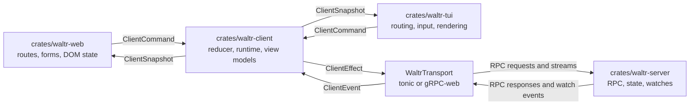
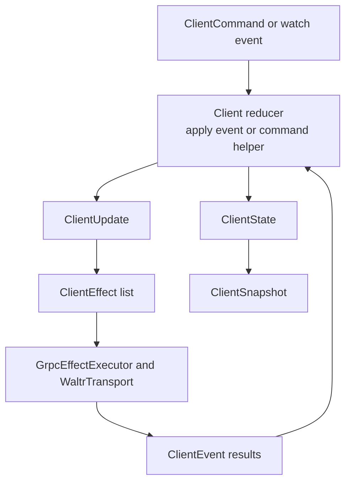
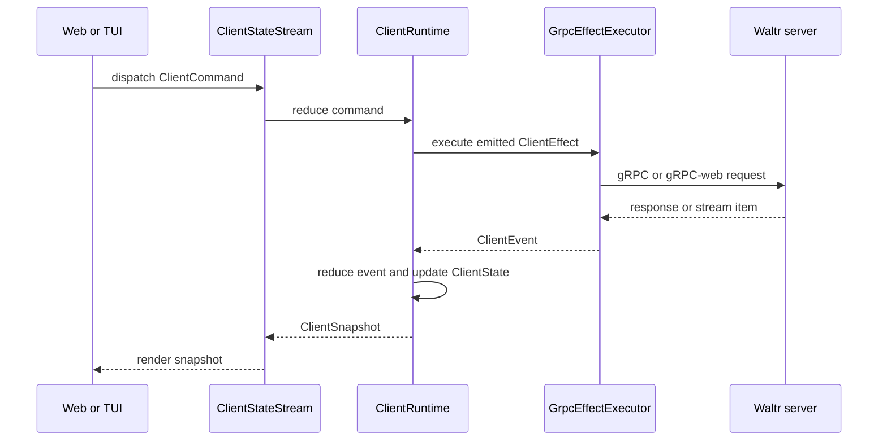

# Clients

Waltr client architecture keeps server data coordination in `crates/waltr-client/` so web and TUI clients can share behavior while keeping platform-specific routing, forms, rendering, and transient UI state local.

## Responsibilities

| Layer | Owns |
| --- | --- |
| `crates/waltr-server/` | Shared server state, RPC services, persistence, watches, validation, and concurrency checks. |
| `crates/waltr-client/` | Shell-neutral reducer state, server-facing commands, effect intents, transport adapters, stable view models, and runtime orchestration. |
| `crates/waltr-web/` | Browser routes, forms, transitions, DOM state, and browser-specific command dispatch. |
| `crates/waltr-tui/` | Terminal routes, input handling, rendering, snapshots, and terminal-specific command dispatch. |

Web and TUI should not duplicate server data state machines. They should consume `waltr-client` snapshots and dispatch `waltr-client` commands, then adapt the resulting state to their UI surfaces.

## Server RPC Boundary

The client talks to the server through generated gRPC contracts under `proto/waltr/`.

Config traffic uses `waltr.config.v1.ConfigService`:

| RPC | Client Use |
| --- | --- |
| `GetConfig` | Load the current config snapshot. |
| `PatchConfig` | Submit sparse top-level config patches with an expected ETag. |
| `WatchConfig` | Receive an initial config snapshot and subsequent config change events. |

Status traffic uses the status service to watch system readiness. Config watch maintenance depends on the status watch because the reducer only opens or reopens config watches after the server reports ready.

`crates/waltr-client/src/transport.rs` defines the runtime-neutral `WaltrTransport` trait and the default transports:

| Runtime | Transport |
| --- | --- |
| Native | `NativeGrpcTransport`, backed by tonic channels. |
| Browser/WASM | `WasmGrpcTransport`, backed by gRPC-web over `fetch`. |

Transport code converts server RPC messages into client domain types such as `Configuration`, `ConfigWatchUpdate`, and `SystemStatus`. UI implementations should not call generated service clients directly when a shared client command or runtime path exists.

## Reducer State Machine

`crates/waltr-client/src/client.rs` exposes the shell-neutral `Client` reducer. It owns a `ClientState` and accepts `ClientEvent` values. Applying an event mutates state and returns a `ClientUpdate` containing zero or more `ClientEffect` intents.

The reducer is intentionally split from side effects:

| Concept | Role |
| --- | --- |
| `ClientState` | Current config, status, stream state, operation status, watch status, errors, watch interest counts, and retry attempts. |
| `ClientEvent` | Facts that already happened, such as config loaded, patch failed, watch changed, or reconnect delay elapsed. |
| `ClientEffect` | Work that must happen outside the reducer, such as load config, patch config, open a watch, or sleep before reconnecting. |
| `ClientUpdate` | Reducer output containing side-effect intents for the runtime to execute. |

Operation state uses shared statuses: `Idle`, `Loading`, `Ready`, `Opened`, `Received`, `Waiting`, and `Failed`. UI clients should render from these statuses instead of deriving separate server-data state.

## Runtime Orchestration

`ClientRuntime` and `ClientStateStream` connect the reducer to `GrpcEffectExecutor`.

The runtime loop:

1. Receives a shell command or watch event.
2. Applies the corresponding reducer event or command helper.
3. Executes emitted effects through the transport executor.
4. Applies returned events back into the reducer.
5. Publishes a stable `ClientSnapshot` for shells.

The stream form coordinates startup and long-lived watches. It waits for status readiness, maintains watch streams, applies watch events as they arrive, and dispatches shell commands into the same reducer-owned state.

## Client Implementation Contract

Web and TUI implementations should follow these rules:

- Use `ClientRuntime`, `ClientStateStream`, `ClientCommand`, `ClientSnapshot`, and stable view models from `waltr-client` for server-backed state.
- Keep form drafts, focus, route params, modal state, animation state, and terminal/browser rendering concerns local to the implementation.
- Dispatch shared commands for server data mutations instead of constructing RPC requests in UI code.
- Treat snapshots as the source of truth for loaded config, patch/load/watch status, status readiness, and operation errors.
- Register config watch interest while a UI surface needs live config updates, and release interest when that surface no longer needs them.
- Preserve feature parity between web and TUI by changing shared reducer behavior in `waltr-client` when behavior is not platform-specific.

## References

| Path | Purpose |
| --- | --- |
| [../../crates/waltr-client/src/client.rs](../../crates/waltr-client/src/client.rs) | Reducer entry point and command helpers. |
| [../../crates/waltr-client/src/coordination/state.rs](../../crates/waltr-client/src/coordination/state.rs) | Shared client state and operation statuses. |
| [../../crates/waltr-client/src/coordination/event.rs](../../crates/waltr-client/src/coordination/event.rs) | Client events, effects, and config patch shape. |
| [../../crates/waltr-client/src/coordination/runtime.rs](../../crates/waltr-client/src/coordination/runtime.rs) | Runtime and state-stream orchestration. |
| [../../crates/waltr-client/src/transport.rs](../../crates/waltr-client/src/transport.rs) | RPC transport boundary. |
| [../../crates/waltr-client/src/view.rs](../../crates/waltr-client/src/view.rs) | Stable shell-facing view models. |
| [../../proto/waltr/config/v1/config_service.proto](../../proto/waltr/config/v1/config_service.proto) | Config RPC contract. |
| [config.md](config.md) | Config patch, ETag, and watch behavior. |
