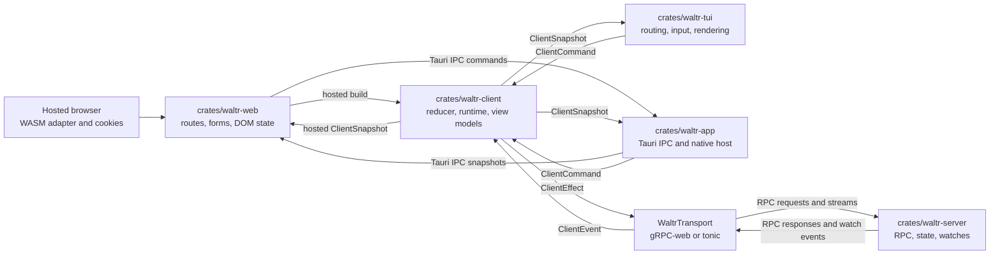
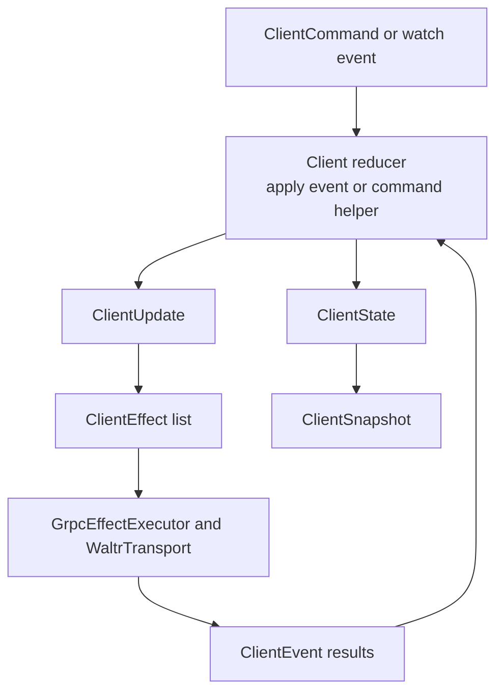
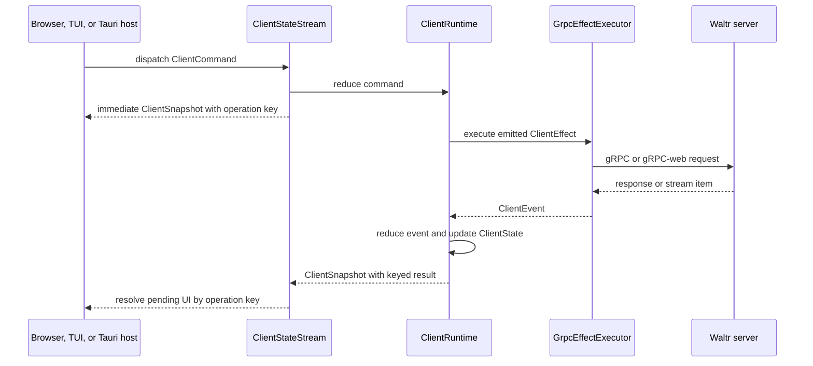

# Clients

Waltr client architecture keeps server data coordination in `crates/waltr-client/` so hosted browser, TUI, and Tauri clients can share behavior while keeping platform-specific routing, rendering, effects, and transient UI state local.

## Responsibilities

| Layer | Owns |
| --- | --- |
| `crates/waltr-server/` | Shared server state, RPC services, persistence, watches, validation, and concurrency checks. |
| `crates/waltr-client/` | Shell-neutral reducer state, server-facing commands, effect intents, transport adapters, stable view models, runtime orchestration, and the feature-gated shared native access protocol. |
| `crates/waltr-web/` | Shared Solid routes, forms, transitions, and DOM state; build-time platform selection between hosted browser WASM and Tauri IPC adapters. |
| `crates/waltr-tui/` | Terminal routes, input handling, rendering, snapshots, environment configuration, and terminal effects around shared native access. |
| `crates/waltr-app/` | Tauri lifecycle, fixed native configuration, Rust client and credential runtime, ordered IPC bridge, local navigation policy, external URL opening, and desktop/Android packaging. |

Client shells should not duplicate server data state machines. They consume `waltr-client` snapshots and dispatch `waltr-client` commands, then adapt the resulting state to their UI surfaces.

## Server RPC Boundary

The client talks to the server through generated gRPC contracts under `proto/waltr/`.

Resource traffic uses `waltr.resource.v1.ResourceService`:

| RPC | Client Use |
| --- | --- |
| `GetResourceCatalog` | Load the complete current catalog snapshot. |
| `WatchResourceCatalog` | Receive complete initial and later catalog snapshots. |
| `InspectResource` | Read one persisted slot and its ETag. |
| `ReplaceResource` | Replace one complete YAML resource. |
| `ResetResource` | Remove one persisted override. |

Manual Routine traffic uses `waltr.routine.v1.RoutineService`:

| RPC | Client Use |
| --- | --- |
| `WatchManualRoutines` | Watch complete global typed definition snapshots and their stable digest. |
| `StartManualRoutine` | Validate and durably admit one detached manual invocation. |
| `ListRoutineInvocations` | Page durable invocation aggregates by admission sequence, optionally filtered by exact-AND metadata equality. |
| `GetRoutineInvocation` | Load one durable invocation, its tasks, results, and event history. |
| `WatchRoutineInvocations` | Load a bounded server-filtered snapshot or replay matching SQL events after a durable global cursor. |

Status traffic uses the status service to watch system readiness. Catalog watch maintenance waits until the server reports ready.

`crates/waltr-client/src/transport/mod.rs` defines the runtime-neutral `WaltrTransport` trait and the default transports:

| Runtime | Transport |
| --- | --- |
| TUI and Tauri native hosts | `NativeGrpcTransport`, backed by rustls-verified tonic channels and an in-memory credential provider. |
| Hosted browser/WASM | `WasmGrpcTransport`, backed by same-origin gRPC-web over `fetch`. |

Transport code converts RPC messages into `ResourceCatalog`, effective `Configuration`, and `SystemStatus` values. UI code uses shared client commands instead of generated clients.

Session RPCs and shared views use `InferenceSettings`, `InferenceSettingsRequest`, and `UpdateSessionInferenceSettings` for provider, model, reasoning effort, and provider match status. `ListAgents` independently returns the name-sorted startup catalog with descriptions and the configured default. Create commands select a catalog name, while the older RPC omission uses the default. `UpdateSessionAgent` switches an existing session by exact name. Session summaries expose the effective agent name. MCP selection, endpoint snapshots, drift status, and trace propagation are not separate session controls; they belong to the selected agent definition.

`SessionView` preserves the complete durable metadata map from each `SessionSummary`. Metadata is public session state and must contain no credentials or secrets. Numbers must convert exactly to protobuf `double`; the server rejects a lossy projection.

`SessionAssociationsView` also projects string values for `waltr.task.parent_session_id`, `waltr.task.description`, and `waltr.routine.invocation_id`. `SessionStatusView` projects an optional typed suspension kind. Shells use these typed fields for shared behavior and retain complete metadata for other consumers.

`SessionView.coordination` retains the server-projected, process-local coordination state for diagnostics and compatibility. `SessionView.progress` is the agent-owned unified lifecycle projection, including phase, optional run stage, reason, queue count, armed continuation, and activity. `SessionView.capabilities` carries prompt disposition plus external-response and interrupt availability. Missing or unspecified progress and prompt disposition map to `Unknown`, with absent booleans false. List snapshots and full-summary upserts replace all three structures directly. The client does not infer progress or capabilities from durable status, coordination, pending commands, or timeline activity. Shells own final labels and presentation.

Session detail timeline commands explicitly request the Effective projection. The transport retains an explicit projection mode so direct Rust callers can continue to request Raw for administration and debugging. Effective responses are already projected by the server: the client stores their entries, projection revision, raw page boundary, and `has_more` without receiving or applying mask selectors. Backward detail requests use the stored raw page boundary rather than a visible or synthetic entry cursor.

`SessionTimelineView.events` contains `ProjectedTimelineEntryView` values. Durable entries wrap the existing action-capable `TimelineEventView`. Synthetic entries expose a distinct opaque identity, presentation enum, ordering position, content, and status but no durable item ID, parent ID, metadata, or action cursor. `MaskReplacement` is explicit and unknown presentation values remain `Unknown`; shells must not parse IDs or metadata to recover presentation.

Hosted MCP `sessions.list`, `sessions.get`, and `sessions.wait` expose the same complete metadata map. This feature requires no generic MCP behavior; `crates/mcp` remains unchanged.

## Reducer State Machine

`crates/waltr-client/src/client.rs` exposes the shell-neutral `Client` reducer. It owns a `ClientState` and accepts `ClientEvent` values. Applying an event mutates state and returns a `ClientUpdate` containing zero or more `ClientEffect` intents.

The reducer is intentionally split from side effects:

| Concept | Role |
| --- | --- |
| `ClientState` | Current access, catalog, effective configuration, status, streams, operations, watches, errors, interests, and retry attempts. |
| `ClientEvent` | Facts such as access changes, catalog loads, resource-write failures, watch changes, or reconnect delays. |
| `ClientEffect` | Work outside the reducer, such as catalog loads, resource writes, watches, or reconnect sleeps. |
| `ClientUpdate` | Reducer output containing side-effect intents for the runtime to execute. |

Operation state uses shared statuses: `Idle`, `Loading`, `Ready`, `Opened`, `Received`, `Waiting`, and `Failed`. UI clients should render from these statuses instead of deriving separate server-data state.

Asynchronous commands receive a runtime-local operation key. `snapshot.operations.current[key]` carries the keyed result. Shells wait for `ready` or `failed`.

## Runtime Orchestration

`ClientRuntime` and `ClientStateStream` connect the reducer to `GrpcEffectExecutor`.

The runtime loop:

1. Receives a shell command or watch event.
2. Applies the corresponding reducer event or command helper.
3. Executes emitted effects through the transport executor.
4. Applies returned events back into the reducer.
5. Publishes a stable `ClientSnapshot` for shells.

The stream form coordinates startup and long-lived watches. It waits for status readiness, maintains watch streams, applies watch events as they arrive, and dispatches shell commands into the same reducer-owned state.

The hosted browser build compiles `waltr-client` to WASM and owns a deterministic adapter disposal path. Vite `tauri` mode instead selects `crates/waltr-web/src/platform/tauri.ts`, emits relative local assets, and does not build or import WASM. `crates/waltr-app` hosts one Rust `ClientStateStream` and native access coordinator for that UI.

The Tauri bridge preserves these lifecycle invariants:

- Exactly one active generation-stamped runtime exists. Starting another runtime synchronously disposes the prior generation.
- The uncoalesced initial snapshot is delivered before later updates. Eligible later snapshots use bounded latest-value coalescing; logout barriers and their resulting cleared snapshots use a bounded uncoalesced control lane.
- Commands enter one bounded FIFO and are dispatched in order. Events have monotonic sequences, gaps recover through current state, and stale-generation output is rejected in Rust and TypeScript.
- Disposal invalidates publication, stops and joins the runtime, clears credentials, removes listeners, and rejects later native output. Rust performs this teardown on document reload, main-window destruction, process exit, and ordinary or authenticated Android suspension; Android resume starts a fresh generation.
- Android retains the current generation only across the first browser-away pause for a pending unauthenticated login. Rust marks the handoff before it opens the browser. The first resume consumes the exception and releases any held callback. A later pause, authenticated pause, or suspended terminal result invalidates the generation and clears credentials.
- The hosted WASM adapter also stops polling, frees its Rust client, clears listeners, and rejects work after disposal.

## Client Observability Boundary

Client observability has separate WebView and native Rust paths:

| Runtime | Export path | Stable identity | Enablement |
| --- | --- | --- | --- |
| Hosted browser production bundle | Grafana Faro to `https://faro.holdenitdown.net/collect` | `waltr-spa` | Vite production builds only. |
| Tauri WebView release bundle | Grafana Faro to `https://faro.holdenitdown.net/collect` | `waltr-tauri` | Vite `tauri` release builds only. |
| Tauri native Rust release app | OTLP/HTTP protobuf to `https://telemetry.holdenitdown.net:4318` | `waltr-app-native` | Rust release builds only. |

Faro does not initialize in Vite development, Tauri `tauri-dev`, or test builds. Tauri development still uses the Tauri adapter and packaged relative assets; its explicit build-time telemetry gate remains disabled even though Vite emits a production-form asset bundle. Initialization and reporting failures never affect routing, rendering, or client commands. Hosted Faro injects W3C trace context only into requests to the page's own origin. Tauri Faro injects no request trace context because native Rust owns Tauri gRPC traffic.

`waltr-app` enables the `waltr-client/native-tracing` feature. Under that feature, `NativeGrpcTransport` creates bounded connection and gRPC client spans, records allowlisted service and method names, records status and duration classes, and injects `traceparent` plus valid `tracestate` headers. Without that feature, `waltr-client` adds no native spans or W3C headers. This keeps propagation ownership with the native transport rather than the WebView or shared reducer.

Native exporter initialization is fail-open. Release startup continues when subscriber, TLS client, or exporter setup fails. The exporter uses a 256-span queue, batches at most 64 spans, applies two-second request and shutdown timeouts, and follows no redirects. The process-lifetime guard requests bounded shutdown when the Tauri event loop returns. Android suspend and resume paths do not synchronously flush or recreate the exporter, so abrupt mobile process termination can lose queued spans.

Both paths enforce a strict privacy boundary. Telemetry excludes credentials, authorization and callback values, query strings, commands, snapshots, user content, arbitrary error or panic text, request and response bodies, and stable user or device identifiers. Faro replaces route identifiers with fixed templates, removes user and session metadata, drops logs, reduces exceptions to a fixed message, allowlists trace attributes, and reduces Web Vitals measurements to recognized metric names, bounded numeric values, and documented enum context. It drops DOM attribution, generated identifiers, URLs, actions, and unknown measurements. Native spans use fixed operation classes and outcomes; panic telemetry contains only a fixed class, source location, thread name, build version, revision, and target. The native exporter strips all request headers except the OTLP protobuf content type.

Effective timeline watches append and identity-dedupe projected events. A projection reset is authoritative and replaces stale projected entries plus projection metadata. Raw descriptors continue to process legacy durable event and truncation updates. Projection mode is part of the watch identity, so reconnect/open-generation guards cannot attach a stale raw stream to an effective detail watch.

Agent discovery follows session watch interest and status readiness. The reducer tracks a request generation, ignores stale completions, sorts returned entries, and keeps failed discovery explicit rather than substituting the current or default agent. Create waits for a ready catalog and selected name. Agent switching is an independent keyed operation, so its success or failure does not reuse create state.

Routine definition and invocation watches, replay cursors, history reduction, detail loads, pagination, request identity, and stale guards belong to `waltr-client`. Routine invocation metadata is immutable normalized string admission context. The canonical source-session key is `waltr.routine.source_session_id`.

The shared client interest-counts the definition watch, singleton global invocation history, and each keyed source-session history independently. Every history has its own watch lifecycle, cursor, and health; it requests a fresh snapshot after invalid replay without replacing another history's state. Global Routine list and detail flows use the empty-filter global history.

Routine list and watch requests accept generic metadata maps. Every entry uses exact string equality, entries compose with AND, and an empty map selects global history. The server filters before pagination, snapshot, and replay limits. Sequence values remain positions in the global durable journal, so gaps are valid in filtered histories.

Manual start acceptance associates a keyed operation with a durable invocation ID. Structured validation failures preserve submitted inputs for correction.

Request IDs provide transport correlation only. A deliberate retry uses a fresh request ID and operation key. The shared client emits no automatic start retry.

The runtime keeps one cancellation-safe in-flight effect slot. Command preemption does not drop or restart that future; it resumes and completes exactly once. When access is denied and queued/in-flight work is drained, the stream parks until a command or credential generation change instead of publishing an unchanged busy loop.

## Session Context

Each open session detail owns a read-only Context panel. Hosted browser, Tauri web, and TUI surfaces derive the same content from shared session and timeline snapshots and the selected entry in `session_histories`.

Usage metrics have two scopes. Context tokens come from the latest turn's timeline metrics. Cache read and write rates use aggregate session cache tokens over aggregate total input tokens. Cost uses the aggregate session total and currency.

The subtask list includes direct children only. A child qualifies when its typed task parent session ID equals the selected session ID. The panel does not infer descendants.

Routine associations come directly from `session_histories[session_id]`. This shared-client convenience projection uses a server watch filtered by `waltr.routine.source_session_id`, while the server RPC remains generic for arbitrary exact-AND metadata filters. Shells perform no additional filtering or deduplication. There is no helper-owner fallback, so a helper session sees only Routines directly sourced by that helper.

Context statuses use three semantic tones with exact status text beside every dot or color:

| Tone | Statuses |
| --- | --- |
| Green or ready | Active session phases, waiting suspension kinds, and admitted or running Routine invocations. |
| Red or error | Failed or interrupted sessions and Routine invocations. |
| Grey or muted | Idle, finished, succeeded, unspecified, unknown, and other inactive states. |

Responsive layouts preserve this content, its links, and its metric semantics. Web places a right sidebar above 900 pixels and a bounded scrollable stacked panel at smaller widths. TUI uses a right 72/28 split at widths of at least 110 columns and a capped six-row summary below that width.

The session detail registers its source-session Routine watch only while open and releases it when closed. Its timeline watch independently owns the latest-turn context source. Other session-scoped watches and the singleton global Routine history have independent interests and remain active when their consumers still need them.

Session Context remains a presentation projection over shared-client state. Routine association filtering is server-owned rather than a shell-side projection.

## Access Lifecycle

Waltr access authentication is separate from provider and upstream-MCP credential management. `AccessStatus` is `UnknownChecking`, `LoginRequired`, `LoginInProgress`, `Authenticated`, or `LoginFailed`. Outbound authentication failures remain ordinary operation or failed-session results with structured `AuthenticationFailure` data; they do not change access state or create pending authorization state.

Shared access commands are `StartWaltrLogin`, `CompleteWaltrLogin`, `FailWaltrLogin`, `CancelWaltrLogin`, `LogoutWaltr`, and `WaltrAccessExpired`. `AccessEvent` applies the corresponding facts to deterministic reducer state. Browser navigation and cookie logout stay in the hosted browser runtime. Native discovery, PKCE, callback-policy selection and validation, token exchange, refresh, expiry, and generation-safe credential replacement live in `waltr-client` behind `native-access`; native hosts provide configuration, bounded callback delivery, and presentation effects.

The transport decodes version-1 `AuthenticationFailure` protobuf status details. A valid outbound-provider or outbound-MCP failure preserves its domain, reason, nonempty `AuthTarget`, safe message, and sanitized MCP context on the ordinary operation error. Failed session status carries the same optional structure for asynchronous and queued failures. Only an `Unauthenticated` response explicitly classified as the `WALTR_ACCESS` domain becomes Waltr login required and clears the current native bearer lease. Missing, malformed, unknown-version, or otherwise unmatched details remain ordinary errors rather than guessing an authentication domain.

Expiry or failed native refresh clears protected config, status, sessions, timelines, streams, and in-flight protected operation state. It preserves watch interests and reload intent, but invalidates the status watch epoch so late events from an old credential cannot reauthenticate the client. Login completion starts a new status epoch. A current-epoch protected status event establishes authentication, then child watches reopen according to interest and config/session collections reload. Explicit logout also clears watch interests.

Native transports attach the current in-memory bearer credential to each unary request and newly opened stream. Credential leases are monotonic generations: stale login and refresh tasks cannot overwrite or clear credentials owned by a newer flow. Browser gRPC-web relies on same-origin cookie behavior and does not inject bearer tokens.

Native HTTPS uses rustls-backed tonic channels with normal certificate and hostname verification. Explicit logout clears the credential and performs an anonymous status reprobe so access-disabled servers can return to `Authenticated`; credential generations prevent results from the prior lease from mutating the new state.

The hosted browser route sends the browser to `/oidc/login` with a validated local return path and calls `/oidc/logout` with same-origin credentials. The TUI supplies environment-derived native configuration, browser launching, copyable URL behavior, and terminal events. The Tauri host supplies fixed preview configuration, system HTTPS opening, secret-free IPC progress, desktop/Android runtime ownership, and Android callback delivery. See [Access Authentication](access-authentication.md).

The Tauri app uses identifier `dev.waltr.app`, endpoint `https://preview-waltr.holdenitdown.net`, public client ID `waltr-preview-native`, and audience `waltr-preview-api`. Desktop selects an ephemeral `http://127.0.0.1:<port>/callback` policy; Android selects the external policy with exact callback `dev.waltr.app:/oauth2redirect`. Both are public Authorization Code with PKCE flows and send no app secret.

On Android, `MainActivity` passes cold and warm `Intent` objects opaquely to JNI after the superclass callback. Kotlin does not read, retain, parse, or log callback content. Rust calls `Intent.getDataString()`, immediately wraps the value as a redacted callback, and routes no callback through Tauri events or IPC. The host keeps one latest callback for the active generation; a newer input replaces an unprocessed value. A callback received during preserved suspension remains held until resume. The coordinator validates each forwarded callback in order and accepts a valid callback after invalid input. Process death clears attempt state, so a cold callback fails closed.

Outbound provider/MCP authorization remains separate from Waltr access and begins only through an explicit Config action. One generic target-scoped command family lists and reads sanitized status, begins and completes authorization, inspects or cancels attempts, forces refresh, and resets credentials for either target kind. The shared reducer exports statuses and keyed operation results alongside only an opaque attempt ID, authorization URL, expiry, completion mode, registration method, lifecycle, and sanitized failure reason. For server-callback attempts the shared runtime polls `PollAuthAttempt`; shells render snapshots and may cancel the explicit attempt. Manual attempts submit the final redirect URL or code. Browser, Tauri, and TUI surfaces never receive provider or MCP access tokens, refresh tokens, PKCE verifiers, registration responses, or callback state. Session surfaces render outbound failures with Config navigation and require an explicit resend or rerun after authentication; they never begin OAuth or replay work automatically.

## Client Implementation Contract

Browser, TUI, and Tauri implementations should follow these rules:

- Use `ClientRuntime`, `ClientStateStream`, `ClientCommand`, `ClientSnapshot`, and stable view models from `waltr-client` for server-backed state.
- Keep form drafts, focus, route params, modal state, animation state, and terminal/browser rendering concerns local to the implementation.
- Dispatch shared commands for server data mutations instead of constructing RPC requests in UI code.
- Treat snapshots as the source of truth for the catalog, effective configuration, watches, readiness, and operation errors.
- For async command completion, capture the operation key from the immediate command snapshot and observe `snapshot.operations.current[key]` until it reaches `ready` or `failed`.
- Register catalog watch interest while a UI surface needs live resource updates. Release interest when that surface no longer needs them.
- Preserve feature parity across browser, TUI, and Tauri paths by changing shared reducer behavior in `waltr-client` when behavior is not platform-specific.
- Keep Waltr access state distinct from provider/upstream-MCP `AuthTarget` state, and ignore stale login attempts, credential leases, and watch epochs.
- Keep WebView telemetry and native Rust telemetry separate. The hosted WebView owns same-origin propagation; the native transport owns Tauri gRPC propagation.
- Preserve the telemetry privacy boundary. Add only fixed operation classes, controlled outcomes, normalized routes, and allowlisted protocol attributes.
- Keep native OAuth and bearer/refresh credentials in Rust. IPC may expose only shared snapshots, commands, opaque lifecycle data, safe errors, and secret-free access progress.
- Keep remote content out of privileged WebViews. Tauri main-WebView navigation is restricted to packaged local content, new windows are denied, and Rust opens only credential-free HTTPS URLs that pass its external URL policy.
- Keep provider and MCP catalog loading, mutation commands, operation keys, and snapshots in the shared reducer; browser bindings must not construct direct catalog transports.
- Keep outbound OAuth attempt state in shared commands/snapshots while credentials, refresh claims, callback validation, discovery, and registration remain server/agent concerns.
- Render provider and MCP credential status from the shared auth snapshot and reconcile authorize, refresh, and reset through their keyed operation results.
- Start outbound OAuth only from explicit Config actions. Session operation and status failures may link to the target's Config editor but must not create attempt state or replay work.
- Dispatch the keyed shared session-wipe command only after local destructive confirmation. Direct success and remote session-list cleared events atomically remove session summaries, timelines, template searches, and session-scoped watch state; shells own only confirmation and presentation.
- Load and render the shared agent catalog for session creation and switching. Do not synthesize a selection while discovery is loading or failed.
- Treat an agent switch as applying to the next captured cycle. Active work continues with its current agent, session history remains, and the switch operation completes independently of create.
- Replace complete metadata maps from each `SessionSummary`; do not merge client-side keys from an older summary.
- Replace progress, capabilities, and legacy coordination from each complete `SessionSummary`; do not derive lifecycle or action availability from durable phase, pending operations, or timeline state.
- Use Effective timeline commands for session detail, page from `rawPageBoundary` while `hasMore` is true, and treat projection resets as authoritative.
- Render projected timeline presentation directly. Only `ProjectedTimelineEntryView::Durable` carries a `TimelineEventView` suitable for edit, rollback, rerun, continue, or other durable-item actions.
- Use a nonempty string `metadata.title` as the display label. Use the stable session ID for every other value.
- Keep auxiliary routine sessions in normal session lists. Their `waltr.session.ephemeral` metadata does not hide them.
- Render manual Routine forms from shared ordered definitions. Support the closed string and boolean field types.
- Preserve exact string drafts, field errors, and server errors after a rejected start.
- Use fresh request and operation identities for each deliberate Routine retry.
- Treat start acceptance as durable admission, not execution completion.
- Report pre-admission failure or durable admission success inside the session palette.
- Offer close and direct global-detail navigation after admission.
- Render durable task progress only on the associated global invocation detail.
- Keep global Routine list and invocation-detail surfaces separate and read-only in both shells.
- Register and release the selected session's scoped Routine watch with Session Context, and render `session_histories[session_id]` without client filtering, deduplication, or helper-owner fallback.
- Launch manual Routines only from the existing session palettes.
- Treat helper sessions as links and ordinary sessions, not Routine lifecycle authority.

The TUI opens create selection with `C-x s` and switches the open session with `C-x a`. The web uses separate Create session and Switch agent dialogs. Both surfaces identify the selected agent and tell users that active work finishes with the current agent and the new choice applies on the next cycle.

## References

| Path | Purpose |
| --- | --- |
| [../../crates/waltr-client/src/client.rs](../../crates/waltr-client/src/client.rs) | Reducer entry point and command helpers. |
| [../../crates/waltr-client/src/coordination/state.rs](../../crates/waltr-client/src/coordination/state.rs) | Shared client state and operation statuses. |
| [../../crates/waltr-client/src/coordination/event.rs](../../crates/waltr-client/src/coordination/event.rs) | Client events, effects, and resource-write intents. |
| [../../crates/waltr-client/src/coordination/runtime.rs](../../crates/waltr-client/src/coordination/runtime.rs) | Runtime and state-stream orchestration. |
| [../../crates/waltr-client/src/native_access.rs](../../crates/waltr-client/src/native_access.rs) | Shared native OIDC protocol and in-memory credential lifecycle. |
| [../../crates/waltr-client/src/transport/mod.rs](../../crates/waltr-client/src/transport/mod.rs) | RPC transport boundary. |
| [../../crates/waltr-client/src/transport/native_trace.rs](../../crates/waltr-client/src/transport/native_trace.rs) | Feature-gated native gRPC spans and W3C context injection. |
| [../../crates/waltr-app/src/bridge.rs](../../crates/waltr-app/src/bridge.rs) | Tauri runtime generation, ordered IPC, and bounded publication. |
| [../../crates/waltr-app/src/observability.rs](../../crates/waltr-app/src/observability.rs) | Native release OTLP exporter, bounded lifecycle, and privacy controls. |
| [../../crates/waltr-app/src/policy.rs](../../crates/waltr-app/src/policy.rs) | Packaged navigation and external HTTPS URL policies. |
| [../../crates/waltr-web/src/telemetry.ts](../../crates/waltr-web/src/telemetry.ts) | Hosted and Tauri WebView Faro setup, normalization, and privacy controls. |
| [../../crates/waltr-web/src/platform/tauri.ts](../../crates/waltr-web/src/platform/tauri.ts) | Tauri frontend adapter and stale-output recovery. |
| [../../crates/waltr-client/src/view/mod.rs](../../crates/waltr-client/src/view/mod.rs) | Stable shell-facing view models. |
| [../../proto/waltr/resource/v1/resource_service.proto](../../proto/waltr/resource/v1/resource_service.proto) | Resource RPC contract. |
| [../../proto/waltr/routine/v1/routine_service.proto](../../proto/waltr/routine/v1/routine_service.proto) | Manual Routine RPC contract. |
| [config.md](config.md) | Unified catalog, per-slot ETag, and watch behavior. |
| [routines.md](routines.md) | Canonical Routine lifecycle, replay, restart, and UI contract. |
| [access-authentication.md](access-authentication.md) | Access boundaries and browser, native, and MCP authentication flows. |
