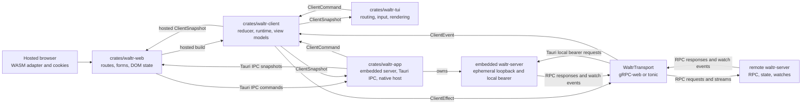
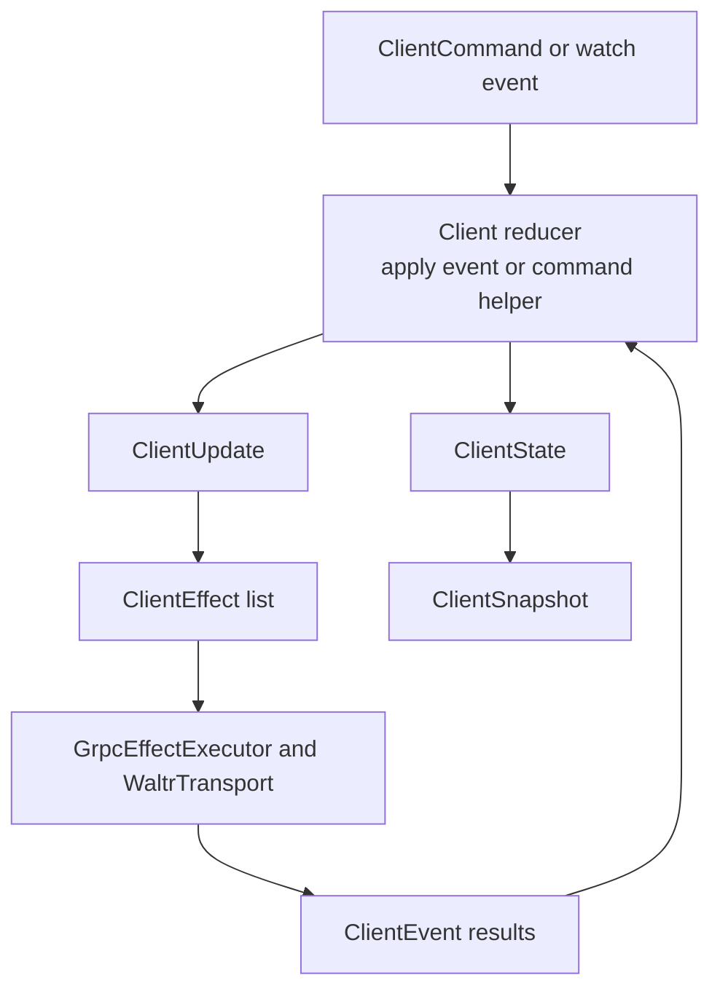
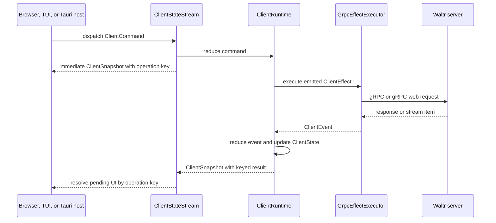

# Clients

Waltr client architecture keeps server data coordination in `crates/waltr-client/` so hosted browser, TUI, and Tauri clients can share behavior while keeping platform-specific routing, rendering, effects, and transient UI state local.

## Responsibilities

| Layer | Owns |
| --- | --- |
| `crates/waltr-server/` | Shared server state, RPC services, persistence, watches, validation, and concurrency checks. |
| `crates/waltr-client/` | Shell-neutral reducer state, server-facing commands, effect intents, transport adapters, stable view models, runtime orchestration, and optional native access for remote hosts. |
| `crates/waltr-audio-io/` | Native device capture and PCM conversion, independent of UI and network transports. |
| `crates/waltr-desktop/` | Desktop startup configuration, hold lifecycle, global shortcuts, and trusted local commands. |
| `crates/waltr-web/` | Shared Solid routes, forms, transitions, and DOM state; build-time platform selection between hosted browser WASM and Tauri IPC adapters. |
| `crates/waltr-tui/` | Terminal routes, input handling, rendering, snapshots, environment configuration, and terminal effects around shared native access. |
| `crates/waltr-app/` | Server profiles, lazy embedded server, native access and secure credentials, Rust client runtime, ordered IPC, navigation policy, and platform packaging. |

Client shells should not duplicate server data state machines. They consume `waltr-client` snapshots and dispatch `waltr-client` commands, then adapt the resulting state to their UI surfaces.

## Server RPC Boundary

The client talks to the server through generated gRPC contracts under `proto/waltr/`.

Resource traffic uses `waltr.resource.v1.ResourceService`:

| RPC | Client Use |
| --- | --- |
| `GetResourceCatalog` | Load the complete current catalog snapshot. |
| `WatchResourceCatalog` | Receive complete initial and later catalog snapshots. |
| `InspectResource` | Read one effective resource plus persisted-slot source and ETag details. |
| `ReplaceResource` | Replace one complete YAML resource. |
| `ResetResource` | Remove one persisted override. |

Embedded startup provisions its generation URL into the ordinary persisted `mcp-servers/waltr.yaml` slot before the client loads the catalog. Clients inspect, replace, watch, and reset it through the same ETag contract as any other persisted resource. A reset can fail ordinary candidate validation when the bundled fallback requires an unavailable `WALTR_PUBLIC_URL`.

Manual Routine traffic uses `waltr.routine.v1.RoutineService`:

| RPC | Client Use |
| --- | --- |
| `WatchManualRoutines` | Watch complete global typed definition snapshots and their stable digest. |
| `StartManualRoutine` | Validate and durably admit one detached manual invocation. |
| `ListRoutineInvocations` | Page durable invocation aggregates by admission sequence, optionally filtered by exact-AND metadata equality. |
| `GetRoutineInvocation` | Load one durable invocation, its tasks, results, and event history. |
| `WatchRoutineInvocations` | Load a bounded server-filtered snapshot or replay matching SQL events after a durable global cursor. |

Status traffic uses the status service to watch system readiness. Catalog watch maintenance waits until the server reports ready.

`crates/waltr-client/src/transport/mod.rs` defines the runtime-neutral `WaltrTransport` trait and the default transports:

| Runtime | Transport |
| --- | --- |
| TUI or Tauri remote host | `NativeGrpcTransport`, backed by rustls-verified tonic channels, bundled Mozilla WebPKI roots, and native access credentials. |
| Tauri local host | `NativeGrpcTransport` to an ephemeral HTTP loopback endpoint, with a random process-generation bearer held only in Rust. |
| Hosted browser/WASM | `WasmGrpcTransport`, backed by same-origin gRPC-web over `fetch`. |

Transport code converts RPC messages into `ResourceCatalog`, effective `Configuration`, and `SystemStatus` values. UI code uses shared client commands instead of generated clients.

Session RPCs and shared views use `InferenceSettings`, `InferenceSettingsRequest`, and `UpdateSessionInferenceSettings` for provider, model, reasoning effort, and provider match status. `ListAgents` independently returns the name-sorted startup catalog with descriptions and the configured default. Create commands select a catalog name, while the older RPC omission uses the default. `UpdateSessionAgent` switches an existing session by exact name. Session summaries expose the effective agent name. MCP selection, endpoint snapshots, drift status, and trace propagation are not separate session controls; they belong to the selected agent definition.

`SessionView` preserves the complete durable metadata map from each `SessionSummary`. Metadata is public session state and must contain no credentials or secrets. Numbers must convert exactly to protobuf `double`; the server rejects a lossy projection.

`SessionAssociationsView` also projects string values for `waltr.task.parent_session_id`, `waltr.task.description`, and `waltr.routine.invocation_id`. `SessionStatusView` projects an optional typed suspension kind. Shells use these typed fields for shared behavior and retain complete metadata for other consumers.

`SessionView.coordination` retains the server-projected, process-local coordination state for diagnostics and compatibility. `SessionView.progress` is the agent-owned unified lifecycle projection, including phase, optional run stage, reason, queue count, armed continuation, and activity. `SessionView.capabilities` carries prompt disposition plus external-response and interrupt availability. Missing or unspecified progress and prompt disposition map to `Unknown`, with absent booleans false. List snapshots and full-summary upserts replace all three structures directly. The client does not infer progress or capabilities from durable status, coordination, pending commands, or timeline activity. Shells own final labels and presentation.

Session detail timeline commands explicitly request the Effective projection. The transport retains an explicit projection mode so direct Rust callers can continue to request Raw for administration and debugging. Effective responses are already projected by the server: the client stores their entries, projection revision, raw page boundary, and `has_more` without receiving or applying mask selectors. Backward detail requests use the stored raw page boundary rather than a visible or synthetic entry cursor.

`SessionTimelineView.events` contains `ProjectedTimelineEntryView` values. Durable entries wrap the existing action-capable `TimelineEventView`. Synthetic entries expose a distinct opaque identity, presentation enum, ordering position, content, and status but no durable item ID, parent ID, metadata, or action cursor. `MaskReplacement` is explicit and unknown presentation values remain `Unknown`; shells must not parse IDs or metadata to recover presentation.

Hosted MCP resources `waltr://sessions` and `waltr://sessions/{id}`, plus tool `query` action `session.wait`, expose the same complete metadata map.
This feature requires no generic MCP behavior; `crates/mcp` remains unchanged.

## Routine Interaction Clients

[`RoutineInteractionTransport`](../../crates/waltr-client/src/transport/interaction.rs) reuses the current native credential or browser cookie policy.
`interact` exposes native duplex input and output; `run_interaction` accepts a complete upload on native and WASM transports.
These caller-owned operations bypass the reducer command lane; media never enters snapshots.
The shared core requires no Tauri, web UI, or capture implementation.

Hosts must preserve these lifecycle rules:

- Poll duplex output concurrently with input production.
- Observe `Accepted` before any input event.
- Close every input stream before `finish_input`.
- Retain the input handle after `finish_input` until output completes.
- Retain `InteractionControl` for cancellation on access loss, logout, or host disposal.
- After Run cancellation, poll or drop output to disconnect the response RPC.
- Never automatically retry or replay an interaction.

Drop of either duplex half cancels the operation, even after input completion.
`final_text(port)` requires `SUCCEEDED`, clean response EOF, and exactly one successfully closed text stream on that port.
Every segment must carry a commitment before successful stream close. Preview text supplies no completion guarantee.
`source_session_id` must remain `None`: the server rejects every `Some` value, even an empty string.
Chat session identity serves only as a local draft fence, not interaction source context.

Default core limits cover eight queued messages, one MiB of encoded queue data, and 256 KiB per chunk.
Complete Run requests have a 32 MiB encoded-body limit.
Text state permits one MiB, 4,096 segments, and 64 lifetime stream IDs per direction.
Hosts can select tighter limits; desktop text state uses 256 KiB and each output action accepts at most 128 KiB.
`committed_prefix(port)` exposes only contiguous frozen segments in first-appearance order, up to the first draft segment.
The accessor rejects ambiguous selected-port streams; it supplies no terminal-success guarantee.
`live_text(port)` applies the same selected-stream validation and exposes the current hypothesis, including drafts.
Native chat preview remains separate and can contain revisable hypotheses.

### Native Audio Library

[`waltr-audio-io`](../../crates/waltr-audio-io/src/lib.rs) owns native CPAL capture and PCM conversion, independent of UI, Tauri, and network transports.
The separate `waltr-audio` crate owns upstream Google speech adapters, not devices or conversion.
The native default output uses headerless 24 kHz mono S16LE PCM.
The rubato converter uses stateful sinc resampling, an anti-alias filter, delay removal, and an exact final flush.
The conversion-only build requires no CPAL dependency.

Desktop device selection accepts the default device or one exact, unique display name; duplicate names fail.
The library exposes no stable device-ID selector.
Android permits only the default device and explicit 48 kHz mono I16 source capture, then converts to the target rate.
Android uses no device discovery, default-configuration query, name lookup, JNI context, or Activity reference.
Unsupported hardware returns an ordinary backend error; the application adds no rate or device fallback.
Android `input_devices` returns `UnsupportedDeviceSelection`.

Hosts own microphone permission and foreground policy. The library adds no automatic device recovery.
Run capture start, shutdown, and owner Drop on a host worker, never the UI or audio callback thread.
Shutdown joins native work; OS driver calls have no portable hard deadline.
Default native bounds permit five minutes, one MiB of queued output, 64 output items, and eight raw queue items.
The capture owner parks when idle instead of an idle polling interval.
Callbacks, output consumption, stop, cancellation, and backend errors wake the owner through retained notifications.
Native capture initializes conversion before stream construction, because some CPAL backends can invoke callbacks during construction.
Callbacks copy into preallocated blocks without a wait for the owner; accepted blocks remain drainable after callback quiescence.

### Desktop Host And Shortcuts

[`waltr-desktop`](../../crates/waltr-desktop/src/lib.rs) supplies startup configuration, hold lifecycle, native shortcut backends, and local output actions.
The native app composes these libraries through its Rust runtime bridge.
The libraries remain Tauri-independent; no standalone headless executable, button host, or wake-word host exists.
See [desktop configuration](config.md#desktop-client-configuration) for the schema and command trust boundary.

A press reserves the single audio gate without a queue, then starts capture.
The first nonempty audio frame admits `Interact`; release without input starts no RPC.
Repeated presses for the current hold do nothing; other presses return busy.
Release requests a normal capture flush and input completion, not cancellation.
Command mode waits for clean EOF, successful final-text validation, capture cleanup, and current guards before one command execution.
Typing mode delivers each current hypothesis while duplex input continues, even before provider commitment.
Repeated hypotheses and identical final text add no duplicate output.
Revisions replace only the changed suffix of this hold's sanitized output through Backspace events.
Both modes require clean EOF, `SUCCEEDED`, and exact selected-stream validation for terminal success.
The desktop pre-admission contract limits conservative aggregate library/host retained-audio capacity to one target-rate second.
Actual-format preflight selects the largest reserve of one through eight queued raw blocks that fits that capacity, plus one callback/converter owner block.
This selection precedes callback pool allocation and stream construction.
The budget includes all pool capacities, converter history and transient output, native output slots and pending send, and ten host chunk credits.
Eight host credits form a byte-bounded PCM queue; the worker and consumer each retain at most one additional chunk.
Small frames consume their actual byte length, not a whole chunk credit.
At 24 kHz, each chunk holds at most 1,500 bytes, and the host queue holds 12,000 bytes: 250 ms of PCM16 mono.
The bridge continues to drain native capture while RPC open or Accepted waits, without a second admission buffer.
RPC input remains empty until Accepted; normal release preserves queued PCM and drains it after acceptance.
Cancellation discards queued PCM and joins capture; byte-credit exhaustion fails explicitly and also joins capture.
For 24 kHz output and 48 kHz mono input, preflight selects three queued 4096-sample blocks plus the owner block.
Smaller native callback slices still consume a whole raw pool lease.
Preflight rejects an otherwise supported format with `PreacceptBudgetExceeded` if even the minimum reserve exceeds the limit.
This reserve tolerates only a finite callback burst or owner delay, not arbitrary scheduler stalls or sustained downstream backpressure.
The bound excludes the borrowed OS callback slice and opaque driver/device buffers that CPAL cannot expose or constrain.
Overflow fails the operation rather than silently discarding audio.
Profile, access, generation, and credential revision changes cancel the operation and suppress stale effects.
The host closes the RPC and awaits capture joins plus output-action cleanup before reservation release.
Normal release preserves the final audio flush and continued live output.
Cancellation never rolls back text that already reached another application.

#### Live External Text

[`typing`](../../crates/waltr-desktop/src/typing.rs) defines a local-capable asynchronous factory/session boundary, independent of any OS backend.
The host awaits bounded writes directly, with no unbounded delivery queue.
Each write contains at most 1 KiB of UTF-8.
One hold permits 128 KiB of cumulative work: inserted UTF-8 bytes plus deleted graphemes.
Each actual backend batch rechecks cancellation, generation, access, and credential revision immediately before its effect.
The backend owns startup and cleanup; the host awaits cleanup even after a blocked write or failed startup.
No backend means `Unsupported`, never a command fallback.
Errors use fixed categories; diagnostics expose no output text or raw backend messages.

Text targets the current keyboard focus for each batch, not the application that had focus at key press.
Focus changes can redirect later batches into another application.
No target lock or application-level insertion acknowledgement exists.
The action adds no Enter, Tab, shortcut, paste, clipboard, or automatic message submission.
The action offers no draft controls, retry, replay, or final-text duplication.
Revisions use the longest common prefix at an extended grapheme boundary and count deleted graphemes.
Every replacement passes complete sanitization, capability checks, and cumulative work bounds before any deletion.
A partial deletion or write failure stops the hold; the host never retries unknown target state.

The sanitizer maps CR, LF, tab, U+2028, and U+2029 to spaces.
CRLF produces one space, even across hypothesis updates.
All other control characters, including DEL and C0/C1 controls, reject the entire hypothesis before any replacement effect.
A later provider, stream, or backend failure leaves prior effects in place, including any partial revision deletion.
macOS sends unmodified physical Backspace pairs for revisions; target applications need not match Unicode grapheme deletion behavior.
Wayland supports append-only UTF-8 output and rejects revisions with `Unsupported` before any deletion or replacement.
The EI text interface exposes keysyms but no backward-text deletion API; this backend deliberately adds no keysym fallback.
Native chat preview and its draft-edit fences do not change.

macOS uses `global-hotkey` with main-thread construction and destruction, one process-wide dispatcher, and a bounded event queue.
The host must supply a macOS run loop. No media-key or interception fallback exists.
Wayland uses the GlobalShortcuts portal through `ashpd`.
The backend retains the accepted subset and actual effective triggers; `preferred_trigger` remains a hint.
Activated, Deactivated, Changed, session loss, and backend errors affect the current shortcut generation.
No X11 fallback exists. Backend capability errors remain runtime results, not compile-time support guarantees.

### Native App Audio Composition

The bridge composes native client hooks: shortcut signals, text-free activity, runtime fences, and owned cleanup.
These boundaries do not define a device-context API or support arbitrary native input.
The current shortcut adapter implements audio holds; chat dictation remains a separate audio consumer.

[`native_audio::Host`](../../crates/waltr-app/src/native_audio/mod.rs) owns microphone admission and audio runtime fences.
Its `Held` adapter composes desktop audio holds, permission, and output actions.
[`dictation::Host`](../../crates/waltr-app/src/dictation.rs) owns chat operation identities, status, preview, jobs, and IPC.
Both consumers share one nonqueued `AudioAdmission` gate; this gate excludes only concurrent microphone operations.
The desktop `interaction` driver below `Hold` owns capture startup, first-nonempty-frame admission, Accepted-gated audio input, concurrent output through EOF, cancellation, and capture joins for both consumers.
Its typed output consumer seam separates chat preview/status from live external typing; chat does not construct a shortcut binding or command.
Successful remote EOF before input completion fails the operation and joins cancelled capture without waiting for key-up; it cannot authorize a terminal command or chat final text.
`Actor::new` accepts command-only configurations. `Actor::with_effects` also installs an explicit typing factory and synchronous effect fence, rejecting typing configurations without that capability before device access.
The app retains its process-owned shortcut registrar and ingress/permission adapter across runtime generations rather than replacing it with the caller-driven actor.
The reservation covers permission, capture startup, RPC work, and cleanup.
The bridge clones the same credential-aware `NativeGrpcTransport` before it moves the transport into `ClientRuntime`.
Native audio uses full-duplex `Interact`, not a second endpoint, credential source, or WebView media channel.
`source_session_id` remains `None`; the frontend session ID serves only as a local draft fence.

`start_runtime` advertises `dictation: true` on Apple Silicon macOS, Linux, and Android.
This flag describes the implemented consumer, not live platform acceptance.
Intel macOS advertises no dictation capability; its permission adapter returns `Unavailable`.
No Intel or universal-package support promise follows from shared library support.

The IPC accepts positive JavaScript-safe generation and operation IDs.
A bounded monotonic high-water mark rejects stale starts; cancel-before-start creates a tombstone.
Late identities cannot affect a replacement operation or generation.
Status replies contain only identity, phase, `preview`, and optional `finalText`.
They contain no PCM, endpoint, bearer, or backend error detail; command rejection uses fixed messages.
Native `preview` contains the latest bounded selected-port text hypothesis from the validated duplex output state.
Ambiguous selected-port streams clear the preview; cancellation, failure, and terminal success also clear it.
Preview publication rechecks generation, operation, access, cancellation, and credential revision.
Final text requires successful committed selected-port output, clean EOF, capture cleanup, and current identity/access guards.
The shared frontend preserves the [draft fences](#browser-chat-dictation) and never submits a chat message automatically.

[`AudioPermissions`](../../crates/waltr-app/src/audio_permissions.rs) owns audio-only authorization with generation, foreground epoch, and exact request tickets.
Cancellation resolves the waiter but cannot dismiss OS permission UI.
The dialog slot stays busy until its callback; a stale grant never starts capture.
Resume restores eligibility only; it never restarts an old operation.
Apple Silicon macOS uses a dedicated AVFoundation audio-only adapter.
Android uses a dedicated `RECORD_AUDIO` launcher with exact-ticket failure cleanup, not a microphone foreground service.
Linux reports permission granted without an application-level OS prompt; device and portal failures remain ordinary failures.

[`shortcuts::Owner`](../../crates/waltr-app/src/shortcuts.rs) owns desktop registration for the process, independent of runtime credential leases.
macOS creates and drops its registrar on the main run loop.
Wayland owns its portal session on a worker and closes that session on shutdown.
The shortcut router stamps physical edges with an `IngressEpoch` before queue admission.
Replacement, access loss, and renewed access establish ordered epoch barriers; old presses cannot target a new runtime.
A key-up retains its original press epoch and cannot finish a newer operation.
Release during permission or startup requests normal completion, not cancellation.
Native chat dictation and holds defer interaction admission until the first nonempty PCM frame.
Normal stop drains accepted audio and converter tail before input completion, even after release during permission or startup.
Clean capture with no nonempty frames produces the local `no_input` diagnostic outcome after worker cleanup.
It opens no interaction or upstream speech request and performs no external text or command action.
Chat preserves its terminal `succeeded` phase with no `finalText`; holds return success without an action.
Capture failure remains a failure, even with zero frames. Cancellation and identity guards still apply.
Both consumers share the pre-admission byte queue and aggregate one-second retained-audio bound described above.

Holds recheck generation, access, cancellation, and credential revision at capture, RPC, and output-action boundaries.
The credential monitor provides cleanup, not effect authority.
Final-text validation precedes the single configured command; live external text can precede terminal completion.
The host adds no replay or rollback of irreversible effects.
The runtime owns audio jobs in a local `JoinSet` and drains them before exit or explicit logout credential deletion and reply.
Desktop exit, WebView destruction, and reload callbacks request nonblocking retirement; they never join capture workers on the UI thread.
Async disposal and replacement await retirement barriers.
Android pause cancels active audio before the remote-runtime preservation branch; a remote auth runtime can survive, but audio never resumes automatically.

### Client Routine Activity Tray

[`RuntimeBridge`](../../crates/waltr-app/src/bridge.rs) owns the generic activity tracker independently of its audio host.
It injects a clone into the audio composition; other client hooks need no audio host to access activity.
[`ActivityTracker`](../../crates/waltr-app/src/activity.rs) accounts for process-local client operations through owned, text-free leases.
Native chat dictation and desktop holds retain a lease across permission, RPC, output actions, and cleanup.
Future client hooks must use the same lease API across their complete lifecycle.
The tracker does not represent all server Routines or global server activity.
Busy or duplicate requests create no activity lease.
Overlapping leases retain active status until the last operation completes; stale completion cannot clear another operation.
Failures wait for all active cleanup, then produce a two-second error state.
Ordinary cancellation produces no error state.

The optional desktop [tray owner](../../crates/waltr-app/src/tray.rs) renders a quiet idle icon, a four-frame active animation, and a distinct error icon.
The active animation requests four updates per second; a static active frame remains distinct if the panel throttles updates.
The menu contains only status, **Open Waltr**, and **Quit**.
Open Waltr shows, restores, and focuses the current window; Quit uses normal app exit.
The tray adds no history, settings, transcript, close-to-hide behavior, or residency guarantee.
It requires no WebView state, and tray failure does not prevent app startup.
Android has no tray.
Platform panel requirements belong in [Deployment](../deployment.md#desktop-tray-and-external-text).

### Browser Chat Dictation

The hosted browser uses [`audio/`](../../crates/waltr-web/src/audio/) with a static AudioWorklet, not MediaRecorder.
Capture requires a secure context, a user gesture, and browser microphone permission.
The browser converts the actual AudioContext rate to 24 kHz mono PCM through linear interpolation, without an anti-alias filter.
Default bounds permit five minutes and 16 MiB of PCM.
The hard PCM ceiling reserves 64 KiB below 32 MiB; shared-client validation separately checks the actual encoded Run body.
Eight worklet credits bound 128 KiB of sample messages, plus 16 KiB of local staging.

The browser sends PCM as a `Uint8Array` directly into the current WASM client, not JSON or the snapshot command lane.
Stop completes capture before the bounded Run upload. This path provides no live microphone upload.
Cancellation aborts pending admission, response output, and capture on access loss, logout, or disposal.

[`DictationControl`](../../crates/waltr-web/src/components/DictationControl.tsx) exposes one hold-to-talk microphone button without inline Routine fields.
Pointer press or Space/Enter press starts capture within the user gesture; release finishes capture, even during startup.
Pointer cancellation, lost capture, blur, access loss, navigation, and server switch cancel the operation.
The component rejects repeated keys and synthetic clicks; transcript processing prevents another start.
The composer blocks Send until dictation reaches a terminal state.
Native hypotheses replace the captured draft selection directly, including revisions to empty text; updates continue after release until final completion.
The hosted browser retains its final-only Run path.
Only hosts with `DictationHost.livePreview === true` apply hypotheses to the composer; native hosts opt in, and absent capability defaults off.
A local draft transaction distinguishes its own text and caret updates from user edits without microphone focus changes.
Each new dictation advances the draft revision once before transaction capture, so older submit or edit-message completions cannot overwrite it.
Typing, IME composition, caret movement, and other draft edits permanently detach automatic updates for that operation.
After detachment, successful text remains available through explicit **Insert dictation** at the current selection or **Discard dictation**.
Detached draft text stays intact; explicit Insert replaces only the current selection, so users can select provisional text before insertion.
Cancellation or failure restores the original draft and captured selection only while exact text, caret, and user-revision ownership remain valid.
Session and scope changes retire owned provisional text before draft invalidation; late output never writes into a new context.
Final text replaces owned provisional text without duplication and never submits a chat message automatically.
Configuration changes cancel the operation and discard retained text.

The shared frontend consumes `ConfigView.sessionDictation` through the shared client snapshot in browsers, desktop, and Android.
Absent configuration disables the microphone button. Configuration load never requests microphone access.
The composer ignores browser-local Routine preferences and supplies no hardcoded Routine fallback.
The explicit `DictationHost.start` selection API and desktop keybind configuration remain independent.
The native app uses the same frontend draft rules through its separate [Rust audio consumer](#native-app-audio-composition).

See [client audio tests](../testing.md#client-audio-and-dictation) for deterministic contracts and separate platform acceptance gates.

## Reducer State Machine

`crates/waltr-client/src/client.rs` exposes the shell-neutral `Client` reducer. It owns a `ClientState` and accepts `ClientEvent` values. Applying an event mutates state and returns a `ClientUpdate` containing zero or more `ClientEffect` intents.

The reducer is intentionally split from side effects:

| Concept | Role |
| --- | --- |
| `ClientState` | Current access, catalog, effective configuration, status, streams, operations, watches, errors, interests, and retry attempts. |
| `ClientEvent` | Facts such as access changes, catalog loads, resource-write failures, watch changes, or reconnect delays. |
| `ClientEffect` | Work outside the reducer, such as catalog loads, resource writes, watches, or reconnect sleeps. |
| `ClientUpdate` | Reducer output containing side-effect intents for the runtime to execute. |

Operation state uses shared statuses: `Idle`, `Loading`, `Ready`, `Opened`, `Received`, `Waiting`, and `Failed`. UI clients should render from these statuses instead of deriving separate server-data state.

Asynchronous commands receive a runtime-local operation key. `snapshot.operations.current[key]` carries the keyed result. Shells wait for `ready` or `failed`.

## Runtime Orchestration

`ClientRuntime` and `ClientStateStream` connect the reducer to `GrpcEffectExecutor`.

The runtime loop:

1. Receives a shell command or watch event.
2. Applies the corresponding reducer event or command helper.
3. Executes emitted effects through the transport executor.
4. Applies returned events back into the reducer.
5. Publishes a stable `ClientSnapshot` for shells.

The stream form coordinates startup and long-lived watches. It waits for status readiness, maintains watch streams, applies watch events as they arrive, and dispatches shell commands into the same reducer-owned state.

The hosted browser build compiles `waltr-client` to WASM and owns a deterministic adapter disposal path.
Vite `tauri` mode selects `crates/waltr-web/src/platform/tauri.ts` and emits relative local assets with no WASM import.
Both browser and Tauri build scripts generate shared WASM artifacts as a prerequisite; Tauri bundles contain no WASM output.
`crates/waltr-app` hosts one Rust `ClientStateStream` for the selected Local or remote server.

Local selection starts `waltr-server` on demand on an ephemeral IPv4 loopback port. Rust keeps its endpoint and random 256-bit bearer outside IPC and WebView state. Remote selection starts no embedded server and uses native gRPC with optional discovered access configuration.

Before publication, Rust removes the exact endpoint and bearer from every serialized client snapshot. This projection does not mutate shared client state.

Web routes use the authoritative shared access and readiness snapshots without a topology override. `ClientAdapter.access` is an optional generic capability. The hosted browser supplies server login and same-origin logout; Tauri supplies native access operations only for an explicit non-`local` server ID. Local admission supplies neither operation. Without access operations, login-required snapshots show no sign-in action and authenticated shells show no sign-out action. Provider and upstream-MCP authorization remains independent.

The Tauri bridge preserves these lifecycle invariants:

- Exactly one active generation-stamped runtime exists. Each bridge owns one managed `RetirementQueue` background reaper for retired client threads.
- The reaper joins queued threads and automatically removes completed records. IPC disposal awaits tracked completion barriers off-callback under `selection.operation`.
- IPC replacement waits for those completion barriers before the new runtime starts.
- The uncoalesced initial event arrives before later updates. Eligible snapshots use bounded latest-value coalescing; native `platform` startup controls use a bounded ordered lane and remain adapter-private sequencing inputs rather than app context or route presentation.
- Commands enter one bounded FIFO and are dispatched in order. Events have monotonic sequences, gaps recover through current state, and stale-generation output is rejected in Rust and TypeScript.
- Disposal invalidates publication, stops the client runtime, clears its local bearer provider, removes listeners, and rejects later native output.
- In Local mode, Android activity pause stops only the client runtime. The foreground service keeps the embedded server alive best effort.
- Local activity resume creates a fresh client generation against the current embedded server generation.
- In remote mode, activity pause preserves the client generation and its native OAuth attempt. Remote resume requests no local server or notification.
- The Android foreground notification exposes a Stop server action. The action requests the current nonblocking native server stop, removes the notification, and stops the service.
- The Stop command uses `START_NOT_STICKY`. Ordinary service startup remains `START_STICKY`; task-removal continuity remains best effort.
- Stop persists no disabled setting. A later Local selection or Local activity resume can start a fresh embedded server generation.
- A suspend may hand one unexpired pending outbound authorization attempt to only the immediately following client generation against that same server generation. The handoff is process-local and single-use; terminal, expired, stale, skipped-generation, disposal, and server-replacement paths clear it.
- Android Local lifecycle callbacks signal client stop and enqueue retirement without a join. The managed reaper completes teardown off-callback.
- Server-controller reaper threads separately join exact embedded server generations; client teardown does not change that server contract.
- A fresh Android Local generation applies current notification permission before it considers a current server connection.
- A permission-required Local generation remains disconnected until a permission transition permits connection. Remote generations bypass this gate.
- Notification permission changes publish an adapter-private startup control event to active generations.
- Each Android lifecycle ticket owns one exact bridge generation after successful start.
- Suspend invalidates the active start ticket and exact active generation. Resume creates a replacement ticket.
- A stale or suspended completion stops only its own generation. It cannot stop or claim a replacement generation.
- The hosted WASM adapter also stops polling, frees its Rust client, clears listeners, and rejects work after disposal.

The embedded server has an independent process-owned lifecycle. Setup creates only its controller; Local selection starts the server. Switching to remote retains an active local server and its durable state. Desktop app exit stops it. Android local service startup alone requires notification permission; remote selection neither starts that service nor requests permission.

A nonblocking server stop moves the exact current generation to `Stopping` and detaches its thread while holding the controller lock. Its reaper joins only that detached generation and publishes `Stopped` or `Failed` only after the join completes.

Start reservation waits while the controller is `Stopping`; a replacement cannot start until the detached generation exits. Old and new embedded servers therefore never overlap their shared app-private roots. Android lifecycle callbacks remain nonblocking because the reaper, not the callback, owns the join.

Android starts the server through a non-exported, same-process `specialUse` foreground service. Notification permission gates service startup on Android 13 and later.

`android:stopWithTask="false"` and ordinary `START_STICKY` startup provide best-effort continuity after task removal. They do not guarantee survival after force-stop, process kill, reboot, or user termination. The notification Stop command instead returns `START_NOT_STICKY` and prevents an automatic sticky restart for that command.

Every server restart creates a new endpoint, bearer, and outbound callback marker. Startup atomically refreshes the durable self-MCP resource file with the new endpoint before catalog load. Durable databases and sessions reopen, and normal Routine restart reconciliation handles unfinished work.

The app host explicitly enables the curated models.dev seed. Embedded startup remains network-first, then uses a valid app-private disk cache, and uses the stale built-in seed only when that cache is absent. Malformed or unreadable cache state remains a categorized startup failure.

Generation-bound outbound MCP attempts and credentials do not reopen. Same-generation reauthorization can reuse its valid DCR registration; a replacement generation requires reauthorization and fresh DCR when applicable. Status and cancel report not found for an attempt from an older generation.

## Native Server Selection Frontend

[`App.tsx`](../../crates/waltr-web/src/app/App.tsx) lazy-loads [`NativeApp`](../../crates/waltr-web/src/app/NativeApp.tsx) only in Tauri builds. Injected adapter loaders and fixture routes retain the direct provider/router path. Hosted browser builds do not load the native picker boundary.

[`ServerPicker`](../../crates/waltr-web/src/app/ServerPicker.tsx) reads the Rust registry through [`platform/tauri.ts`](../../crates/waltr-web/src/platform/tauri.ts). First launch requires an explicit choice. On initial registry load, a valid `lastConnectedId` reconnects the last successful server without a registry write from the frontend.

The picker lists the built-in Local profile and saved remote profiles. Add server accepts an HTTP(S) URL without credentials, query, or fragment, plus an optional name of at most 100 characters. Rust further requires HTTPS except for exact loopback hosts: `localhost`, `127.0.0.1`, or `[::1]`. Rust normalizes URLs and deduplicates profiles by endpoint. The frontend passes only public profile data; it accepts no client secret or token. Registry failures use fixed messages and a list retry action. The picker offers removal only for remote profiles.

[`ServerProfiles`](../../crates/waltr-app/src/server_profiles.rs) atomically persists app-data `servers.json`. Only an authenticated shared snapshot records `lastConnectedId`; a save or failed connection does not. Remote profiles have opaque stable IDs. Local has the fixed nonremovable ID `local` and no public endpoint.

Selection creates a fresh adapter loader and resets the route, query, and fragment to `/`. Switch server clears selection and reloads the registry. Retry connection remounts the same selection. The keyed provider/router boundary disposes the old adapter and clears drafts and server-specific UI state. Neither action invokes profile removal or logout.

[`ServerControls`](../../crates/waltr-web/src/app/ServerControls.tsx) and [`serverSelection`](../../crates/waltr-web/src/app/serverSelection.tsx) keep selection operations outside shared server state. Switch server remains available during startup, access checks/login, and the authenticated shell. Startup load or connection failures also expose Retry connection. Access routes still derive login progress and failure from shared snapshots.

### Frontend IPC Contract

The adapter listens before runtime start and preserves generation/sequence checks across events, recovery, and command responses. Rust also checks the current generation before dispatch, access actions, browser launch, and exact-generation disposal. Selection tickets cancel stale starts. Native platform and access-progress events remain private sequence inputs; the web adapter ignores their presentation. Shared snapshots remain authoritative.

| IPC command | Arguments |
| --- | --- |
| `list_servers` | None. |
| `save_server` | `{ url, name }`. |
| `remove_server` | `{ serverId }`. |
| `start_runtime` | `{ serverId }`; returns the generation and platform-gated `dictation` capability. |
| `dictation_start` | `{ generation, operationId, selection: { routine, trigger, input, output }, sessionId }`; session identity stays local. |
| `dictation_finish`, `dictation_status`, `dictation_cancel` | `{ generation, operationId }`; no media crosses IPC. |
| `client_state` | `{ afterSequence }`; the adapter validates the returned generation. |
| `client_dispatch` | `{ command, generation }`. |
| `start_access_login`, `logout_access` | `{ generation }`; only explicit remote selections expose these access operations. |
| `open_authorization_attempt` | `{ attemptId, generation }`. |
| `open_external_url` | `{ url, generation }`. |
| `dispose_runtime` | `{ generation }`. |

Native login ignores the browser login URL argument and invokes Rust with only the current generation. Dispatch, access operations, and openers reject unstarted or disposed adapters before IPC. Disposal removes listeners before native disposal. If runtime start completes after disposal, the adapter disposes only that returned generation, never an unqualified replacement.

Frontend contract tests cover [picker/remount behavior](../../crates/waltr-web/tests/platform/server-picker.test.tsx) and [adapter IPC/generation checks](../../crates/waltr-web/tests/platform/tauri.test.ts). These tests do not establish native Rust or Android lifecycle behavior.

## Client Observability Boundary

Native shortcut holds and chat microphones share content-free app diagnostics through [`native_audio_telemetry`](../../crates/waltr-app/src/native_audio_telemetry.rs).
The literal target remains `waltr_app_lib::dictation_telemetry` for telemetry continuity; native audio span and event schemas remain unchanged.
Each admitted operation owns a `native.audio.operation` async span through permission, RPC, external actions, and complete cleanup.
The span parents the native transport spans; app events record bounded admission outcomes, permission results, milestones, and one terminal summary.
Synchronous event scopes restore the saved dispatcher and operation context, so worker milestones and post-await terminal logs export the operation's exact trace and span IDs.
The literal interaction RPC catalog names `routine_interaction.Interact` and `routine_interaction.Run`; unknown paths remain private.
Validated remote failure, interruption, and rejection remain distinct from invalid selected output; opaque stream errors retain their observed RPC boundary without parsing messages.
Primary and cleanup categories remain separate, including when the same capture worker error supplies both. Cleanup-only failures do not become primary failures.
Process-local numeric diagnostic identifiers never copy IPC or configuration identifiers.
The desktop observer defaults to no-op and does not expand either exporter target allowlist.
See [native audio diagnostics](../runbooks/telemetry-smoke.md#native-audio-diagnostics) for exact fields, milestone semantics, privacy limits, and artifact requirements.

Client observability has separate WebView and native Rust paths:

| Runtime | Export path | Stable identity | Enablement |
| --- | --- | --- | --- |
| Hosted browser production bundle | Grafana Faro to `https://faro.holdenitdown.net/collect` | `waltr-spa` | Vite production builds only. |
| Tauri WebView release bundle | Grafana Faro to `https://faro.holdenitdown.net/collect` | `waltr-tauri` | Vite `tauri` release builds only. |
| Tauri native Rust app | OTLP/HTTP protobuf traces, logs, and metrics | `waltr-app-native` | Every non-test native build, including local and debug builds. |

Faro does not initialize in Vite development, Tauri `tauri-dev`, or test builds. Tauri development still uses the Tauri adapter and packaged relative assets; its explicit Faro gate remains disabled even though Vite emits a production-form asset bundle. This WebView gate does not disable native Rust telemetry in a non-test app build. Initialization and reporting failures never affect routing, rendering, or client commands. Faro uses `getWebInstrumentations()` and the default `TracingInstrumentation`. It exports its standard logs, exceptions, session, user-action, navigation, performance, resource, and trace data. Repeated application errors remain separate events. Explicit app view reports still replace known route identifiers with route templates.

Hosted Faro injects W3C trace context only into requests to the page's own origin. Tauri sets `ignoreUrls: [/.*/]`, so Faro observes no adapter-private loopback requests and injects no request trace context. Rust owns Tauri gRPC traffic and keeps the private endpoint and bearer outside WebView state and telemetry.

`waltr-app` enables the `waltr-client/native-tracing` feature. Under that feature, `NativeGrpcTransport` creates bounded connection and gRPC client spans, records allowlisted service and method names, records status and duration classes, and injects `traceparent` plus valid `tracestate` headers. Without that feature, `waltr-client` adds no native spans or W3C headers. This keeps propagation ownership with the native transport rather than the WebView or shared reducer.

Native telemetry uses the standard OpenTelemetry SDK provider pattern used by services: batched span and log exporters plus a periodic metric exporter. Trace export accepts INFO+ spans and events from the complete `waltr_app_lib` module tree and `waltr_client::transport::native_trace`. Log export accepts INFO+ events from the complete `waltr_app_lib` module tree. Both filters also accept INFO/WARN events from the exact target `waltr_client::native_access::telemetry`. These `native.auth` events carry only bounded `stage` and `category` values plus a process-local numeric `generation`. This target exception excludes spans, ERROR/DEBUG events, nested targets, lookalike targets, arbitrary client events, and secrets. The tracing subscriber bridges the accepted events into the log provider. OpenTelemetry 0.32 requires programmatic OTLP/HTTP endpoints per signal, so Waltr configures these fixed URLs:

- `https://telemetry.holdenitdown.net:4318/v1/traces`
- `https://telemetry.holdenitdown.net:4318/v1/logs`
- `https://telemetry.holdenitdown.net:4318/v1/metrics`

All three providers share service name `waltr-app-native` and resource attributes for Cargo version, sanitized app revision, and Rust target. Startup emits the `app.startup` log and increments `waltr.app.startups` with fixed lifecycle context. A nonpanic Android embedded-server startup failure additionally emits one `android.server.start_failed` event with only `error` outcome and a closed categorical failure value. A caught JNI panic marks the startup operation span as failed but emits no duplicate startup-failure event. The global panic hook emits the sole panic event and excludes the panic payload. Initialization and export remain fail-open. Initialization failure writes one fixed stderr line and includes no error details. The process-lifetime guard gives trace and log shutdown two seconds; OpenTelemetry SDK 0.32 gives metric shutdown its fixed five-second bound. Android suspend and resume paths do not synchronously flush or recreate providers, so abrupt mobile process termination can lose queued telemetry. Automated Rust tests disable native initialization and use deterministic in-memory exporters instead of a collector.

This personal-use telemetry favors operational detail over global field sanitization. Faro data can include URLs, identifiers, exception text, stacks, console output, and browser or session metadata. Standard resource, performance, navigation, action, and trace fields also remain available. Explicit app view reports normalize known routes, but this normalization does not sanitize every standard Faro payload.

The mandatory app boundary remains narrower and strict. The private Tauri loopback endpoint and bearer never enter WebView telemetry. Native export follows the target and level allowlists above. Panic telemetry excludes panic payload text and retains only its fixed metadata fields. Native exporters use a shared blocking Rustls client with bundled roots, TLS 1.2 or 1.3, hostname and chain verification, no redirects, no inherited or environment-derived headers, and only the canonical OTLP protobuf content type.

Effective timeline watches append and identity-dedupe projected events. A projection reset is authoritative and replaces stale projected entries plus projection metadata. Raw descriptors continue to process legacy durable event and truncation updates. Projection mode is part of the watch identity, so reconnect/open-generation guards cannot attach a stale raw stream to an effective detail watch.

Agent discovery follows session watch interest and status readiness. The reducer tracks a request generation, ignores stale completions, sorts returned entries, and keeps failed discovery explicit rather than substituting the current or default agent. Create waits for a ready catalog and selected name. Agent switching is an independent keyed operation, so its success or failure does not reuse create state.

Routine definition and invocation watches, replay cursors, history reduction, detail loads, pagination, request identity, and stale guards belong to `waltr-client`. Routine invocation metadata is immutable normalized string admission context. The canonical source-session key is `waltr.routine.source_session_id`.

The shared client interest-counts the definition watch, singleton global invocation history, and each keyed source-session history independently. Every history has its own watch lifecycle, cursor, and health; it requests a fresh snapshot after invalid replay without replacing another history's state. Global Routine list and detail flows use the empty-filter global history.

Routine list and watch requests accept generic metadata maps. Every entry uses exact string equality, entries compose with AND, and an empty map selects global history. The server filters before pagination, snapshot, and replay limits. Sequence values remain positions in the global durable journal, so gaps are valid in filtered histories.

Manual start acceptance associates a keyed operation with a durable invocation ID. Structured validation failures preserve submitted inputs for correction.

Request IDs provide transport correlation only. A deliberate retry uses a fresh request ID and operation key. The shared client emits no automatic start retry.

The runtime keeps one cancellation-safe in-flight effect slot. Ordinary command preemption retains that future until completion.
Apps Close deliberately drops only a matching Apps Call; see [Session MCP Apps](#session-mcp-apps).
When access is denied and queued/in-flight work is drained, the stream parks until a command or credential generation change instead of publishing an unchanged busy loop.

## Session MCP Apps

The hosted browser exposes an explicit Open app action on a tool call with linked Apps metadata.
The action opens a modal inside the current session detail.
It creates no app catalog, task graph, or separate session.
Open, tool call, close, and cancellation use shared `waltr-client` commands and keyed Apps state.
The web layer owns the modal, `AppHost` lifecycle, promise correlation, and trusted container implementation.
Web `src/mcp-apps/container/` owns the container source; `src/mcp-apps/bridge-contract.ts` owns the shared bridge contract.
Web `policy.ts` reexports the bridge constants and validator; it adds URL policy, not another container implementation.
The web `app-container/container.html` entry joins the normal browser Vite build, which emits a self-contained `dist/app-container/` pair.
Vite assertions forbid shared container chunks and external asset references.
The container-only `app-container` mode requires no WASM; Tauri modes omit the container.

`ClientStateStream` processes Apps Close through the same shared effect lane as other commands.
Close drops an in-flight Apps Call only when its app ID matches, and removes queued calls for that app.
The stream retains unrelated in-flight effects, including non-Apps work; server Close can wait behind those effects.
It creates no parallel close lane or JavaScript RPC path.
Direct `ClientRuntime` dispatch remains serialized and does not provide stream command preemption.
Canceled Opens retain their pending effect so a late handle response can trigger cleanup through the same shared lane.
Local payload removal and iframe disposal do not prove instantaneous server revocation.

One generic app host renders any linked source-server HTML resource, regardless of tool name.
App tool calls use the owner-bound session handle; responses update the view without overwriting the original snapshot or triggering inference.
The public MCP `status` tool returns text plus `structuredContent.ready` and `structuredContent.observedAtUnixMs`.
It uses the same dependency-readiness reader as `/ready`, not `/health` process liveness.
With `apps-served-assets` enabled and an HTML Apps capability on the current request, its tool declaration links `ui://waltr/status`.
The server owns this self-contained SDK app and serves it through ordinary MCP resources; Refresh calls the originating server's `status` tool without inference.
Waltr renders it through the same generic AppHost and app container as any linked MCP app, with no status-specific host behavior.
Without assets or the matching capability, the tool stays text-only and the UI resource is unavailable.
Server defaults include the app container and server-owned status app assets; the generic MCP client's Apps capability remains default-off.
`apps-host-assets` selects container assets; `apps-served-assets` selects MCP-served app assets; `apps-assets` selects both.
The `web` feature selects that umbrella, and default features retain it.
Neither asset feature gates the session Apps RPCs.

Server `mcp_apps_host/` owns consumer isolation, asset routes, view storage, origin checks, and HTTP policy.
The server consumes web-built container assets; the separate `@rfhold/waltr-server` workspace package builds explicit server-owned apps.
Its `scripts/apps.entries` list selects independent single-file Vite builds, not a runtime catalog.
The API web asset collection excludes `/app-container/` and legacy `/apps/` files.
The public `app_container` module reexports its API for compatibility.
Neutral `http_lifecycle` code owns HTTP connection tasks and bounded shutdown, independent of app content.
`session/mcp_apps.rs` owns session RPC handle authority; `mcp_service/apps/mod.rs` owns static resource publication and common CSP.
`mcp_service/apps/status.rs` owns ordinary status tool linkage.
Neither module defines a special status renderer.
See [Waltr-served Apps authoring](../mcp/apps-authoring.md) for source entries, resource declarations, and ordinary tool registration.

The bundled web-enabled TUI owns a separate Apps listener through `ServerApplication::bind_with_apps`.
Loopback startup derives exact API parent origins and starts an ephemeral asset listener in the same process.
It supplies the public app container URL through HTML-head `waltr-mcp-apps-container-url` metadata.
Root and deep-link shell responses use `no-store`.
The browser treats runtime metadata as authoritative, ahead of the compiled Vite fallback.
Invalid or duplicate metadata fails closed; absent metadata permits external hosts to use the compiled URL.
The bundled host cancels and joins both HTTP lifecycles and the Apps expiry task on shutdown or startup rollback.
An unexpected Apps listener exit fails the server and prevents a detached asset service.
The standalone API entry point leaves Apps disabled unless all three runtime Apps environment variables explicitly opt in.
That opt-in requires `web` and uses `bind_with_apps_config` for the same bootstrap, rollback, and shutdown ownership.
The preview and production Pulumi sources configure separate HTTPS Apps origins; source configuration does not establish live DNS, TLS, or deployment.
Plain TUI mode has no Apps renderer or non-web Apps listener.

The SDK-backed `AppHost` loads an app container iframe from a separate trusted asset origin.
The app container needs `allow-scripts allow-same-origin` only on that separate origin.
It publishes bounded HTML to the asset service and loads an inner iframe with `allow-scripts` only.
The inner view has an opaque origin and no parent DOM access.
HTTP CSP policy applies before script execution; JavaScript or HTML meta policy does not replace that boundary.
Both frames deny browser permissions and receive no Waltr credentials.

Host/app-container messages validate source window, exact origin, generation, and size.
The app container excludes reserved sandbox-control messages from the view channel.
The host negotiates `ui/initialize`, accepts `ui/notifications/initialized`, then sends the original complete input and result exactly once.
Refresh uses only the `tools/call` response, not a second original-result notification.
The host reports protocol display mode `inline` despite the in-site modal presentation.
Close bounds teardown, cancels calls, removes listeners and frames, and requests view deletion.
Server Close checks the registry owner and revokes the handle without a session load.
Session deletion or wipe therefore does not block handle cleanup.
The modal and container ignore `pagehide` with `persisted: true`; final unload performs cleanup.
Asset expiry also covers lost unload cleanup.

The initial host supports same-server tool calls and bounded display/lifecycle messages.
It rejects unsupported resource reads, model-context updates, messages to the model, sampling, and external links with method-not-supported errors.
It grants no requested external CSP origins or browser permissions, and ignores resource domain hints.

Normal Apple Silicon macOS builds enable Apps without a diagnostic feature, separate profile, or prior isolation report.
Target-specific Cargo dependencies select container assets, served app assets, and the WKWebView adapter.
Rust starts a separate trusted loopback asset listener for each selected client runtime, for Local and remote profiles alike.
The listener serves no API and receives no API bearer.
Runtime switch or disposal detaches the exact WK navigation policy and shuts down its asset listener.
Apps assets do not require the embedded server.
The `start_runtime` response supplies `nativeApps.containerUrl` only after the WKNavigationDelegate installation acknowledges success.
The frontend uses that Rust capability for Open app; it does not require diagnostic evidence.
The acknowledgement enforces runtime security rather than release validation.
Bootstrap exposes only nonsecret asset URLs; the private API endpoint and bearer stay outside WebView state.
The base `tauri.conf.json` retains `frame-src 'none'`; no automatic macOS configuration relaxes that policy.
At startup, `app_container.rs` applies compile-target-aware CSP through `context.config_mut()` before the Tauri builder consumes the context.
Only macOS/aarch64 permits `http://127.0.0.1:*/container.html`; other targets, including Intel macOS, retain `frame-src 'none'`.
The function changes only `frame-src` in configured normal and development CSP; optional diagnostics also permit the probe frame URL.
Rust restricts subframes further to exact current-generation ports and asset paths.
It also permits empty `about:blank` and `about:srcdoc` frames only from the packaged page or trusted current-generation asset frames.
The WKNavigationDelegate distinguishes main frames, subframes, responses, and popups before the original Wry delegate handles packaged navigation.
Remote main navigation and new windows remain denied.
The confined stock Tauri IPC transport restricts its lexical invoke key to the packaged top frame.
All application IPC commands retain the packaged-top-frame boundary. API credentials remain Rust-only.
Other native platforms remain unsupported; this target makes no Intel or universal-package promise.
MockRuntime, Node transport tests, and browser contracts do not prove native runtime isolation.
Their proof limits do not impose a prerequisite for normal Apple Silicon macOS Apps enablement.
Fresh recorded `status` calls can carry linked Apps metadata; older text-only calls do not acquire Open app retroactively.

The optional `native-apps-test` diagnostic harness uses a separate identifier, configuration, and app-private profile.
It adds the attack-fixture listener, probe markers, and the `nativeAppsTest` helper.
Neither that helper nor its evidence pipeline is necessary for normal Apps.
See [macOS Apps verification](../testing.md#macos-native-apps-verification) for normal-app live acceptance and optional diagnostic checks.

Sources: [shared Apps state](../../crates/waltr-client/src/apps.rs), [dialog](../../crates/waltr-web/src/mcp-apps/AppDialog.tsx),
[shared effect lane](../../crates/waltr-client/src/coordination/runtime.rs),
[host](../../crates/waltr-web/src/mcp-apps/AppHost.ts), [app container](../../crates/waltr-web/src/mcp-apps/container/container.ts),
[bridge contract](../../crates/waltr-web/src/mcp-apps/bridge-contract.ts), [Vite build](../../crates/waltr-web/vite.config.ts),
[consumer isolation](../../crates/waltr-server/src/mcp_apps_host/mod.rs), [HTTP lifecycle](../../crates/waltr-server/src/http_lifecycle.rs),
[session handle registry](../../crates/waltr-server/src/session/mcp_apps.rs), [status resource](../../crates/waltr-server/src/mcp_service/apps/status.rs),
[URL policy](../../crates/waltr-web/src/mcp-apps/policy.ts), [bundled lifecycle](../../crates/waltr-server/src/app.rs),
[HTML bootstrap](../../crates/waltr-server/src/web_assets.rs), [TUI startup](../../crates/waltr-tui/src/main.rs),
[native IPC boundary](../../crates/waltr-app/src/app_container.rs), [native container lifecycle](../../crates/waltr-app/src/native_apps.rs),
[WK navigation adapter](../../crates/waltr-app/src/native_apps_navigation.rs), and [readiness](../../crates/waltr-server/src/readiness.rs).
See [Agent](agent.md#session-mcp-apps) for authority and audit behavior, [Deployment](../deployment.md#mcp-apps-assets-and-app-container) for configuration,
and [Testing](../testing.md#mcp-apps) for proof limits.

## Session Context

Each open session detail owns a read-only Context panel. Hosted browser, Tauri web, and TUI surfaces derive the same content from shared session and timeline snapshots and the selected entry in `session_histories`.

Usage metrics have two scopes. Context tokens come from the latest turn's timeline metrics. Cache read and write rates use aggregate session cache tokens over aggregate total input tokens. Cost uses the aggregate session total and currency.

The subtask list includes direct children only. A child qualifies when its typed task parent session ID equals the selected session ID. The panel does not infer descendants.

Routine associations come directly from `session_histories[session_id]`. This shared-client convenience projection uses a server watch filtered by `waltr.routine.source_session_id`, while the server RPC remains generic for arbitrary exact-AND metadata filters. Shells perform no additional filtering or deduplication. There is no helper-owner fallback, so a helper session sees only Routines directly sourced by that helper.

Context statuses use three semantic tones with exact status text beside every dot or color:

| Tone | Statuses |
| --- | --- |
| Green or ready | Active session phases, waiting suspension kinds, and admitted or running Routine invocations. |
| Red or error | Failed or interrupted sessions and Routine invocations. |
| Grey or muted | Idle, finished, succeeded, unspecified, unknown, and other inactive states. |

Responsive layouts preserve this content, its links, and its metric semantics. Web places a right sidebar above 900 pixels, a bounded scrollable stacked panel through tablet widths, and an accessible Context disclosure collapsed by default at phone widths. TUI uses a right 72/28 split at widths of at least 110 columns and a capped six-row summary below that width.

The session detail registers its source-session Routine watch only while open and releases it when closed. Its timeline watch independently owns the latest-turn context source. Other session-scoped watches and the singleton global Routine history have independent interests and remain active when their consumers still need them.

Session Context remains a presentation projection over shared-client state. Routine association filtering is server-owned rather than a shell-side projection.

## Access Lifecycle

Waltr access authentication is separate from provider and upstream-MCP credential management. `AccessStatus` is `UnknownChecking`, `LoginRequired`, `LoginInProgress`, `Authenticated`, or `LoginFailed`. Outbound authentication failures remain ordinary operation or failed-session results with structured `AuthenticationFailure` data; they do not change access state or create pending authorization state.

Shared access commands are `StartWaltrLogin`, `CompleteWaltrLogin`, `FailWaltrLogin`, `CancelWaltrLogin`, `LogoutWaltr`, and `WaltrAccessExpired`. `AccessEvent` applies the corresponding facts to deterministic reducer state. Browser navigation and cookie logout stay in the hosted browser runtime. Remote native hosts can use `waltr-client` native access.

The transport decodes version-1 `AuthenticationFailure` protobuf status details. A valid outbound-provider or outbound-MCP failure preserves its domain, reason, nonempty `AuthTarget`, safe message, and sanitized MCP context on the ordinary operation error. Failed session status carries the same optional structure for asynchronous and queued failures. Only an `Unauthenticated` response explicitly classified as the `WALTR_ACCESS` domain becomes Waltr login required and clears the current native bearer lease. Missing, malformed, unknown-version, or otherwise unmatched details remain ordinary errors rather than guessing an authentication domain.

Expiry or failed native refresh clears protected config, status, sessions, timelines, streams, and in-flight protected operation state. It preserves watch interests and reload intent, but invalidates the status watch epoch so late events from an old credential cannot reauthenticate the client. Login completion starts a new status epoch. A current-epoch protected status event establishes authentication, then child watches reopen according to interest and config/session collections reload. Explicit logout also clears watch interests.

Native transports attach the current in-memory bearer credential to each unary request and newly opened stream. Remote native credential leases use monotonic generations. Tauri Local installs its process-generation bearer before the client stream starts. Remote Tauri uses the shared access coordinator. Browser gRPC-web relies on same-origin cookies.

Remote native HTTPS uses rustls with the ring provider, TLS 1.2 or 1.3, and bundled Mozilla roots. Only Tauri Local uses host-created HTTP loopback instead. Native OTLP export keeps the bundled-root policy. Hosted browser and WebView Faro retain platform trust.

Remote native logout clears its in-memory credential and follows the native access store contract. The Tauri frontend exposes logout for remote selections only; local admission supplies no user access operations.

The hosted browser adapter sends the browser to `/oidc/login` with a validated local return path and calls `/oidc/logout` with same-origin credentials. The TUI supplies environment-derived native configuration, browser launch, copyable URL behavior, and terminal events. The Tauri host supplies lazy Local ownership, remote native login, secure refresh-token persistence, and OS browser launch. Native control events remain adapter-private sequence inputs. See [Access Authentication](access-authentication.md#tauri-native-host-adapter) for callback, storage, refresh, sign-out, and removal contracts.

Outbound provider/MCP authorization remains separate from Waltr access and begins only through an explicit Config action. One generic target-scoped command family lists and reads sanitized status, begins and completes authorization, inspects or cancels attempts, forces refresh, and resets credentials for either target kind. The shared reducer exports statuses and keyed operation results alongside an opaque attempt ID, authorization URL, expiry, completion mode, registration method, lifecycle, and sanitized failure reason. For server-callback attempts the shared runtime polls `PollAuthAttempt`; shells render snapshots and can cancel the explicit attempt. Manual attempts submit the final redirect URL or code. Session surfaces require an explicit retry after authentication.

Hosted browser and TUI surfaces retain the generic authorization URL behavior. The web adapter contract also offers optional `openAuthorizationAttempt(attemptId)` for hosts that must open a redacted URL by opaque attempt identity. Tauri uses this operation when the URL contains its private loopback endpoint.

For that case, the bridge blanks the snapshot URL and retains the full URL only in Rust. WebView sends the current opaque attempt ID to `open_authorization_attempt`.

Rust accepts only the active generation's current pending attempt. On Android suspend, it may rebind that pending attempt and its Rust-only URL to the exact immediate replacement client generation when the embedded server generation is unchanged. The fresh shared-client reducer restores the attempt without replaying `BeginAuth`; callback attempts resume polling and manual attempts remain idle. Web presentation reopens the restored pending attempt and retains its keyed manual-input draft across the temporary route remount.

Rust validates the retained URL with the external HTTPS policy before launch. The handoff does not survive process death and never exposes the private URL, endpoint, or bearer to the WebView.

Browser, Tauri, and TUI surfaces never receive provider or MCP tokens, PKCE verifiers, registration responses, or callback state.

## Client Implementation Contract

Browser, TUI, and Tauri implementations should follow these rules:

- Use `ClientRuntime`, `ClientStateStream`, `ClientCommand`, `ClientSnapshot`, and stable view models from `waltr-client` for server-backed state.
- Keep form drafts, focus, route params, modal state, animation state, and terminal/browser rendering concerns local to the implementation.
- Dispatch shared commands for server data mutations instead of constructing RPC requests in UI code.
- Treat snapshots as the source of truth for the catalog, effective configuration, watches, readiness, and operation errors.
- For async command completion, capture the operation key from the immediate command snapshot and observe `snapshot.operations.current[key]` until it reaches `ready` or `failed`.
- Register catalog watch interest while a UI surface needs live resource updates. Release interest when that surface no longer needs them.
- Preserve feature parity across browser, TUI, and Tauri paths by changing shared reducer behavior in `waltr-client` when behavior is not platform-specific.
- Keep Waltr access state distinct from provider/upstream-MCP `AuthTarget` state, and ignore stale login attempts, credential leases, and watch epochs.
- Keep WebView telemetry and native Rust telemetry separate. The hosted WebView owns same-origin propagation; the native transport owns Tauri gRPC propagation.
- Preserve the Tauri secret boundary, native target limits, fixed panic payload exclusions, and hardened exporter transport. Treat standard Faro data as high-detail personal-use telemetry.
- Keep Tauri's private Local endpoint and all access credentials in Rust. IPC exposes public profiles, snapshots, commands, asset bootstrap, and bounded controls. Native controls stay outside route presentation.
- Redact the endpoint and bearer from every Tauri snapshot. Redact any authorization URL that contains the endpoint.
- Open a redacted authorization URL only through the opaque current attempt-ID command. Keep the full URL in Rust.
- Keep remote content out of privileged WebViews. Tauri main-WebView navigation is restricted to packaged local content, new windows are denied, and Rust opens only credential-free HTTPS URLs that pass its external URL policy.
- Mark the shared document with the build-time browser or Tauri platform. Hosted browser CSS consumes `env(safe-area-inset-*)`; Tauri CSS keeps those values at zero because the Android native host insets the whole WebView.
- Use dynamic viewport units with legacy viewport fallbacks, keep short-height access and dialog surfaces scrollable, and preserve keyboard access and complete content in compact navigation and Context disclosures.
- Keep provider and MCP catalog loading, mutation commands, operation keys, and snapshots in the shared reducer; browser bindings must not construct direct catalog transports.
- Keep outbound OAuth attempt state in shared commands/snapshots while credentials, refresh claims, callback validation, discovery, and registration remain server/agent concerns.
- Render provider and MCP credential status from the shared auth snapshot and reconcile authorize, refresh, and reset through their keyed operation results.
- Start outbound OAuth only from explicit Config actions. Session operation and status failures may link to the target's Config editor but must not create attempt state or replay work.
- Dispatch the keyed shared session-wipe command only after local destructive confirmation. Direct success and remote session-list cleared events atomically remove session summaries, timelines, template searches, and session-scoped watch state; shells own only confirmation and presentation.
- Load and render the shared agent catalog for session creation and switching. Do not synthesize a selection while discovery is loading or failed.
- Treat an agent switch as applying to the next captured cycle. Active work continues with its current agent, session history remains, and the switch operation completes independently of create.
- Replace complete metadata maps from each `SessionSummary`; do not merge client-side keys from an older summary.
- Replace progress, capabilities, and legacy coordination from each complete `SessionSummary`; do not derive lifecycle or action availability from durable phase, pending operations, or timeline state.
- Use Effective timeline commands for session detail, page from `rawPageBoundary` while `hasMore` is true, and treat projection resets as authoritative.
- Render projected timeline presentation directly. Only `ProjectedTimelineEntryView::Durable` carries a `TimelineEventView` suitable for edit, rollback, rerun, continue, or other durable-item actions.
- Use a nonempty string `metadata.title` as the display label. Use the stable session ID for every other value.
- Keep auxiliary routine sessions in normal session lists. Their `waltr.session.ephemeral` metadata does not hide them.
- Render manual Routine forms from shared ordered definitions. Support the closed string and boolean field types.
- Preserve exact string drafts, field errors, and server errors after a rejected start.
- Use fresh request and operation identities for each deliberate Routine retry.
- Treat start acceptance as durable admission, not execution completion.
- Report pre-admission failure or durable admission success inside the session palette.
- Offer close and direct global-detail navigation after admission.
- Render durable task progress only on the associated global invocation detail.
- Keep global Routine list and invocation-detail surfaces separate and read-only in both shells.
- Register and release the selected session's scoped Routine watch with Session Context, and render `session_histories[session_id]` without client filtering, deduplication, or helper-owner fallback.
- Launch manual Routines only from the existing session palettes.
- Treat helper sessions as links and ordinary sessions, not Routine lifecycle authority.

The TUI opens create selection with `C-x s` and switches the open session with `C-x a`. The web uses separate Create session and Switch agent dialogs. Both surfaces identify the selected agent and tell users that active work finishes with the current agent and the new choice applies on the next cycle.

## References

| Path | Purpose |
| --- | --- |
| [../../crates/waltr-client/src/client.rs](../../crates/waltr-client/src/client.rs) | Reducer entry point and command helpers. |
| [../../crates/waltr-client/src/coordination/state.rs](../../crates/waltr-client/src/coordination/state.rs) | Shared client state and operation statuses. |
| [../../crates/waltr-client/src/coordination/event.rs](../../crates/waltr-client/src/coordination/event.rs) | Client events, effects, and resource-write intents. |
| [../../crates/waltr-client/src/coordination/runtime.rs](../../crates/waltr-client/src/coordination/runtime.rs) | Runtime and state-stream orchestration. |
| [../../crates/waltr-client/src/native_access.rs](../../crates/waltr-client/src/native_access.rs) | Shared native OIDC protocol and in-memory credential lifecycle. |
| [../../crates/waltr-client/src/transport/mod.rs](../../crates/waltr-client/src/transport/mod.rs) | RPC transport boundary. |
| [../../crates/waltr-client/src/transport/native_trace.rs](../../crates/waltr-client/src/transport/native_trace.rs) | Feature-gated native gRPC spans and W3C context injection. |
| [../../crates/waltr-app/src/bridge.rs](../../crates/waltr-app/src/bridge.rs) | Tauri runtime generation, ordered IPC, and bounded publication. |
| [../../crates/waltr-app/src/server_controller.rs](../../crates/waltr-app/src/server_controller.rs) | Process-owned embedded server, app-private roots, endpoint, bearer, and build capabilities. |
| [../../crates/waltr-app/src/observability.rs](../../crates/waltr-app/src/observability.rs) | Native OTLP providers, module target limits, bounded lifecycle, and hardened export transport. |
| [../../crates/waltr-app/src/policy.rs](../../crates/waltr-app/src/policy.rs) | Packaged navigation and external HTTPS URL policies. |
| [../../crates/waltr-server/src/embedded.rs](../../crates/waltr-server/src/embedded.rs) | Explicit embedded server composition and lifecycle. |
| [../../crates/waltr-server/src/local_admission.rs](../../crates/waltr-server/src/local_admission.rs) | Local bearer middleware and self-MCP credential adapter. |
| [../../crates/waltr-web/src/telemetry.ts](../../crates/waltr-web/src/telemetry.ts) | Standard hosted and Tauri WebView Faro setup, route normalization, and Tauri request exclusion. |
| [../../crates/waltr-web/src/platform/tauri.ts](../../crates/waltr-web/src/platform/tauri.ts) | Tauri frontend adapter and stale-output recovery. |
| [../../crates/waltr-client/src/view/mod.rs](../../crates/waltr-client/src/view/mod.rs) | Stable shell-facing view models. |
| [../../proto/waltr/resource/v1/resource_service.proto](../../proto/waltr/resource/v1/resource_service.proto) | Resource RPC contract. |
| [../../proto/waltr/routine/v1/routine_service.proto](../../proto/waltr/routine/v1/routine_service.proto) | Manual Routine RPC contract. |
| [config.md](config.md) | Unified catalog, per-slot ETag, and watch behavior. |
| [routines.md](routines.md) | Canonical Routine lifecycle, replay, restart, and UI contract. |
| [access-authentication.md](access-authentication.md) | Access boundaries and browser, native, and MCP authentication flows. |
