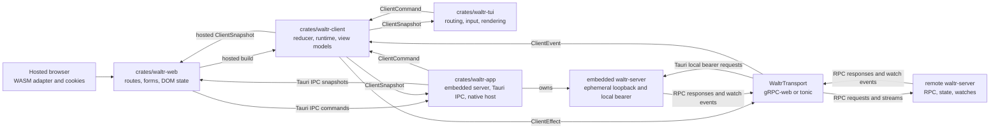
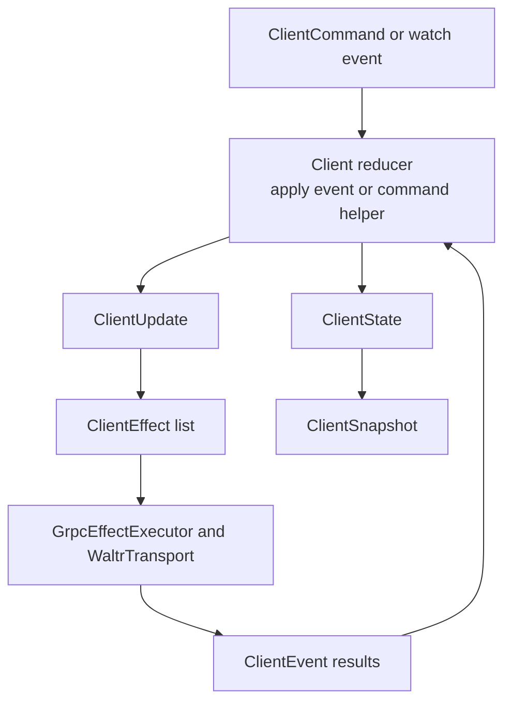
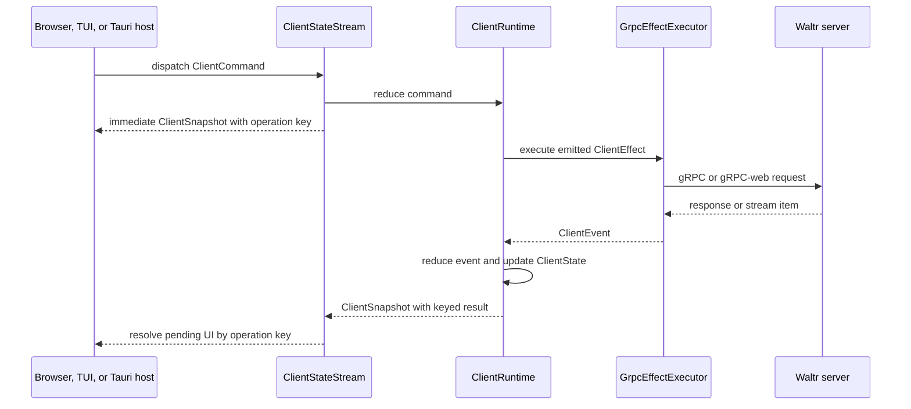

# Clients

Waltr client architecture keeps server data coordination in `crates/waltr-client/` so hosted browser, TUI, and Tauri clients can share behavior while keeping platform-specific routing, rendering, effects, and transient UI state local.

## Responsibilities

| Layer | Owns |
| --- | --- |
| `crates/waltr-server/` | Shared server state, RPC services, persistence, watches, validation, and concurrency checks. |
| `crates/waltr-client/` | Shell-neutral reducer state, server-facing commands, effect intents, transport adapters, stable view models, runtime orchestration, and optional native access for remote hosts. |
| `crates/waltr-web/` | Shared Solid routes, forms, transitions, and DOM state; build-time platform selection between hosted browser WASM and Tauri IPC adapters. |
| `crates/waltr-tui/` | Terminal routes, input handling, rendering, snapshots, environment configuration, and terminal effects around shared native access. |
| `crates/waltr-app/` | Embedded server lifecycle, local credentials, Rust client runtime, ordered IPC bridge, navigation policy, external URL opening, and platform packaging. |

Client shells should not duplicate server data state machines. They consume `waltr-client` snapshots and dispatch `waltr-client` commands, then adapt the resulting state to their UI surfaces.

## Server RPC Boundary

The client talks to the server through generated gRPC contracts under `proto/waltr/`.

Resource traffic uses `waltr.resource.v1.ResourceService`:

| RPC | Client Use |
| --- | --- |
| `GetResourceCatalog` | Load the complete current catalog snapshot. |
| `WatchResourceCatalog` | Receive complete initial and later catalog snapshots. |
| `InspectResource` | Read one effective resource plus persisted-slot source and ETag details. |
| `ReplaceResource` | Replace one complete YAML resource. |
| `ResetResource` | Remove one persisted override. |

Embedded startup provisions its generation URL into the ordinary persisted `mcp-servers/waltr.yaml` slot before the client loads the catalog. Clients inspect, replace, watch, and reset it through the same ETag contract as any other persisted resource. A reset can fail ordinary candidate validation when the bundled fallback requires an unavailable `WALTR_PUBLIC_URL`.

Manual Routine traffic uses `waltr.routine.v1.RoutineService`:

| RPC | Client Use |
| --- | --- |
| `WatchManualRoutines` | Watch complete global typed definition snapshots and their stable digest. |
| `StartManualRoutine` | Validate and durably admit one detached manual invocation. |
| `ListRoutineInvocations` | Page durable invocation aggregates by admission sequence, optionally filtered by exact-AND metadata equality. |
| `GetRoutineInvocation` | Load one durable invocation, its tasks, results, and event history. |
| `WatchRoutineInvocations` | Load a bounded server-filtered snapshot or replay matching SQL events after a durable global cursor. |

Status traffic uses the status service to watch system readiness. Catalog watch maintenance waits until the server reports ready.

`crates/waltr-client/src/transport/mod.rs` defines the runtime-neutral `WaltrTransport` trait and the default transports:

| Runtime | Transport |
| --- | --- |
| TUI remote host | `NativeGrpcTransport`, backed by rustls-verified tonic channels, bundled Mozilla WebPKI roots, and native access credentials. |
| Tauri local host | `NativeGrpcTransport` to an ephemeral HTTP loopback endpoint, with a random process-generation bearer held only in Rust. |
| Hosted browser/WASM | `WasmGrpcTransport`, backed by same-origin gRPC-web over `fetch`. |

Transport code converts RPC messages into `ResourceCatalog`, effective `Configuration`, and `SystemStatus` values. UI code uses shared client commands instead of generated clients.

Session RPCs and shared views use `InferenceSettings`, `InferenceSettingsRequest`, and `UpdateSessionInferenceSettings` for provider, model, reasoning effort, and provider match status. `ListAgents` independently returns the name-sorted startup catalog with descriptions and the configured default. Create commands select a catalog name, while the older RPC omission uses the default. `UpdateSessionAgent` switches an existing session by exact name. Session summaries expose the effective agent name. MCP selection, endpoint snapshots, drift status, and trace propagation are not separate session controls; they belong to the selected agent definition.

`SessionView` preserves the complete durable metadata map from each `SessionSummary`. Metadata is public session state and must contain no credentials or secrets. Numbers must convert exactly to protobuf `double`; the server rejects a lossy projection.

`SessionAssociationsView` also projects string values for `waltr.task.parent_session_id`, `waltr.task.description`, and `waltr.routine.invocation_id`. `SessionStatusView` projects an optional typed suspension kind. Shells use these typed fields for shared behavior and retain complete metadata for other consumers.

`SessionView.coordination` retains the server-projected, process-local coordination state for diagnostics and compatibility. `SessionView.progress` is the agent-owned unified lifecycle projection, including phase, optional run stage, reason, queue count, armed continuation, and activity. `SessionView.capabilities` carries prompt disposition plus external-response and interrupt availability. Missing or unspecified progress and prompt disposition map to `Unknown`, with absent booleans false. List snapshots and full-summary upserts replace all three structures directly. The client does not infer progress or capabilities from durable status, coordination, pending commands, or timeline activity. Shells own final labels and presentation.

Session detail timeline commands explicitly request the Effective projection. The transport retains an explicit projection mode so direct Rust callers can continue to request Raw for administration and debugging. Effective responses are already projected by the server: the client stores their entries, projection revision, raw page boundary, and `has_more` without receiving or applying mask selectors. Backward detail requests use the stored raw page boundary rather than a visible or synthetic entry cursor.

`SessionTimelineView.events` contains `ProjectedTimelineEntryView` values. Durable entries wrap the existing action-capable `TimelineEventView`. Synthetic entries expose a distinct opaque identity, presentation enum, ordering position, content, and status but no durable item ID, parent ID, metadata, or action cursor. `MaskReplacement` is explicit and unknown presentation values remain `Unknown`; shells must not parse IDs or metadata to recover presentation.

Hosted MCP `sessions.list`, `sessions.get`, and `sessions.wait` expose the same complete metadata map. This feature requires no generic MCP behavior; `crates/mcp` remains unchanged.

## Reducer State Machine

`crates/waltr-client/src/client.rs` exposes the shell-neutral `Client` reducer. It owns a `ClientState` and accepts `ClientEvent` values. Applying an event mutates state and returns a `ClientUpdate` containing zero or more `ClientEffect` intents.

The reducer is intentionally split from side effects:

| Concept | Role |
| --- | --- |
| `ClientState` | Current access, catalog, effective configuration, status, streams, operations, watches, errors, interests, and retry attempts. |
| `ClientEvent` | Facts such as access changes, catalog loads, resource-write failures, watch changes, or reconnect delays. |
| `ClientEffect` | Work outside the reducer, such as catalog loads, resource writes, watches, or reconnect sleeps. |
| `ClientUpdate` | Reducer output containing side-effect intents for the runtime to execute. |

Operation state uses shared statuses: `Idle`, `Loading`, `Ready`, `Opened`, `Received`, `Waiting`, and `Failed`. UI clients should render from these statuses instead of deriving separate server-data state.

Asynchronous commands receive a runtime-local operation key. `snapshot.operations.current[key]` carries the keyed result. Shells wait for `ready` or `failed`.

## Runtime Orchestration

`ClientRuntime` and `ClientStateStream` connect the reducer to `GrpcEffectExecutor`.

The runtime loop:

1. Receives a shell command or watch event.
2. Applies the corresponding reducer event or command helper.
3. Executes emitted effects through the transport executor.
4. Applies returned events back into the reducer.
5. Publishes a stable `ClientSnapshot` for shells.

The stream form coordinates startup and long-lived watches. It waits for status readiness, maintains watch streams, applies watch events as they arrive, and dispatches shell commands into the same reducer-owned state.

The hosted browser build compiles `waltr-client` to WASM and owns a deterministic adapter disposal path. Vite `tauri` mode selects `crates/waltr-web/src/platform/tauri.ts`, emits relative local assets, and does not build or import WASM. `crates/waltr-app` hosts one Rust `ClientStateStream` for its embedded server.

Tauri starts `waltr-server` on an ephemeral IPv4 loopback port. Rust keeps the endpoint and random 256-bit bearer outside IPC and WebView state.

Before publication, Rust removes the exact endpoint and bearer from every serialized client snapshot. This projection does not mutate shared client state.

Web routes use the authoritative shared access and readiness snapshots without a topology override. `ClientAdapter.access` is an optional generic capability: the hosted browser adapter supplies `openLogin` and same-origin `logout`, while the Tauri adapter supplies no access operations. A login-required Tauri snapshot therefore renders the unavailable-access notice without a sign-in action, and an authenticated Tauri shell renders no sign-out action. Provider and upstream-MCP authorization remains available independently.

The Tauri bridge preserves these lifecycle invariants:

- Exactly one active generation-stamped runtime exists. Desktop replacement joins the prior generation; Android replacement signals stop and reaps it asynchronously.
- The uncoalesced initial event arrives before later updates. Eligible snapshots use bounded latest-value coalescing; native `platform` startup controls use a bounded ordered lane and remain adapter-private sequencing inputs rather than app context or route presentation.
- Commands enter one bounded FIFO and are dispatched in order. Events have monotonic sequences, gaps recover through current state, and stale-generation output is rejected in Rust and TypeScript.
- Disposal invalidates publication, stops the client runtime, clears its local bearer provider, removes listeners, and rejects later native output.
- Android activity pause stops only the client runtime. The same-process foreground service keeps the embedded server alive best effort.
- Android activity resume creates a fresh client generation against the current embedded server generation.
- The Android foreground notification exposes a Stop server action. The action requests the current nonblocking native server stop, removes the notification, and stops the service.
- The Stop command uses `START_NOT_STICKY`. Ordinary service startup remains `START_STICKY`; task-removal continuity remains best effort.
- Stop does not persist a disabled setting. A later app open or resume starts a fresh embedded server generation.
- A suspend may hand one unexpired pending outbound authorization attempt to only the immediately following client generation against that same server generation. The handoff is process-local and single-use; terminal, expired, stale, skipped-generation, disposal, and server-replacement paths clear it.
- Android lifecycle callbacks signal client or server stop and delegate thread joins to reaper threads.
- A fresh Android generation applies current notification permission before it considers an existing server connection.
- A permission-required generation remains disconnected until a permission transition permits connection.
- Notification permission changes publish an adapter-private startup control event to active generations.
- Each Android lifecycle ticket owns one exact bridge generation after successful start.
- Suspend invalidates the active start ticket and exact active generation. Resume creates a replacement ticket.
- A stale or suspended completion stops only its own generation. It cannot stop or claim a replacement generation.
- The hosted WASM adapter also stops polling, frees its Rust client, clears listeners, and rejects work after disposal.

The embedded server has an independent process-owned lifecycle. Desktop setup starts it before the WebView client connects and stops it at app exit.

A nonblocking server stop moves the exact current generation to `Stopping` and detaches its thread while holding the controller lock. Its reaper joins only that detached generation and publishes `Stopped` or `Failed` only after the join completes.

Start reservation waits while the controller is `Stopping`; a replacement cannot start until the detached generation exits. Old and new embedded servers therefore never overlap their shared app-private roots. Android lifecycle callbacks remain nonblocking because the reaper, not the callback, owns the join.

Android starts the server through a non-exported, same-process `specialUse` foreground service. Notification permission gates service startup on Android 13 and later.

`android:stopWithTask="false"` and ordinary `START_STICKY` startup provide best-effort continuity after task removal. They do not guarantee survival after force-stop, process kill, reboot, or user termination. The notification Stop command instead returns `START_NOT_STICKY` and prevents an automatic sticky restart for that command.

Every server restart creates a new endpoint, bearer, and outbound callback marker. Startup atomically refreshes the durable self-MCP resource file with the new endpoint before catalog load. Durable databases and sessions reopen, and normal Routine restart reconciliation handles unfinished work.

The app host explicitly enables the curated models.dev seed. Embedded startup remains network-first, then uses a valid app-private disk cache, and uses the stale built-in seed only when that cache is absent. Malformed or unreadable cache state remains a categorized startup failure.

Generation-bound outbound MCP attempts and credentials do not reopen. Same-generation reauthorization can reuse its valid DCR registration; a replacement generation requires reauthorization and fresh DCR when applicable. Status and cancel report not found for an attempt from an older generation.

## Client Observability Boundary

Client observability has separate WebView and native Rust paths:

| Runtime | Export path | Stable identity | Enablement |
| --- | --- | --- | --- |
| Hosted browser production bundle | Grafana Faro to `https://faro.holdenitdown.net/collect` | `waltr-spa` | Vite production builds only. |
| Tauri WebView release bundle | Grafana Faro to `https://faro.holdenitdown.net/collect` | `waltr-tauri` | Vite `tauri` release builds only. |
| Tauri native Rust app | OTLP/HTTP protobuf traces, logs, and metrics | `waltr-app-native` | Every non-test native build, including local and debug builds. |

Faro does not initialize in Vite development, Tauri `tauri-dev`, or test builds. Tauri development still uses the Tauri adapter and packaged relative assets; its explicit Faro gate remains disabled even though Vite emits a production-form asset bundle. This WebView gate does not disable native Rust telemetry in a non-test app build. Initialization and reporting failures never affect routing, rendering, or client commands. Faro uses `getWebInstrumentations()` and the default `TracingInstrumentation`. It exports its standard logs, exceptions, session, user-action, navigation, performance, resource, and trace data. Repeated application errors remain separate events. Explicit app view reports still replace known route identifiers with route templates.

Hosted Faro injects W3C trace context only into requests to the page's own origin. Tauri sets `ignoreUrls: [/.*/]`, so Faro observes no adapter-private loopback requests and injects no request trace context. Rust owns Tauri gRPC traffic and keeps the private endpoint and bearer outside WebView state and telemetry.

`waltr-app` enables the `waltr-client/native-tracing` feature. Under that feature, `NativeGrpcTransport` creates bounded connection and gRPC client spans, records allowlisted service and method names, records status and duration classes, and injects `traceparent` plus valid `tracestate` headers. Without that feature, `waltr-client` adds no native spans or W3C headers. This keeps propagation ownership with the native transport rather than the WebView or shared reducer.

Native telemetry uses the standard OpenTelemetry SDK provider pattern used by services: batched span and log exporters plus a periodic metric exporter. Trace export accepts INFO+ spans and events from the complete `waltr_app_lib` module tree and `waltr_client::transport::native_trace`. Log export accepts INFO+ events from the complete `waltr_app_lib` module tree. The tracing subscriber bridges those app events into the log provider. OpenTelemetry 0.32 requires programmatic OTLP/HTTP endpoints per signal, so Waltr configures these fixed URLs:

- `https://telemetry.holdenitdown.net:4318/v1/traces`
- `https://telemetry.holdenitdown.net:4318/v1/logs`
- `https://telemetry.holdenitdown.net:4318/v1/metrics`

All three providers share service name `waltr-app-native` and resource attributes for Cargo version, sanitized app revision, and Rust target. Startup emits the `app.startup` log and increments `waltr.app.startups` with fixed lifecycle context. A nonpanic Android embedded-server startup failure additionally emits one `android.server.start_failed` event with only `error` outcome and a closed categorical failure value. A caught JNI panic marks the startup operation span as failed but emits no duplicate startup-failure event. The global panic hook emits the sole panic event and excludes the panic payload. Initialization and export remain fail-open. Initialization failure writes one fixed stderr line and includes no error details. The process-lifetime guard gives trace and log shutdown two seconds; OpenTelemetry SDK 0.32 gives metric shutdown its fixed five-second bound. Android suspend and resume paths do not synchronously flush or recreate providers, so abrupt mobile process termination can lose queued telemetry. Automated Rust tests disable native initialization and use deterministic in-memory exporters instead of a collector.

This personal-use telemetry favors operational detail over global field sanitization. Faro data can include URLs, identifiers, exception text, stacks, console output, and browser or session metadata. Standard resource, performance, navigation, action, and trace fields also remain available. Explicit app view reports normalize known routes, but this normalization does not sanitize every standard Faro payload.

The mandatory app boundary remains narrower and strict. The private Tauri loopback endpoint and bearer never enter WebView telemetry. Native export remains limited to the app module tree and native transport trace target. Panic telemetry excludes panic payload text and retains only its fixed metadata fields. Native exporters use a shared blocking Rustls client with bundled roots, TLS 1.2 or 1.3, hostname and chain verification, no redirects, no inherited or environment-derived headers, and only the canonical OTLP protobuf content type.

Effective timeline watches append and identity-dedupe projected events. A projection reset is authoritative and replaces stale projected entries plus projection metadata. Raw descriptors continue to process legacy durable event and truncation updates. Projection mode is part of the watch identity, so reconnect/open-generation guards cannot attach a stale raw stream to an effective detail watch.

Agent discovery follows session watch interest and status readiness. The reducer tracks a request generation, ignores stale completions, sorts returned entries, and keeps failed discovery explicit rather than substituting the current or default agent. Create waits for a ready catalog and selected name. Agent switching is an independent keyed operation, so its success or failure does not reuse create state.

Routine definition and invocation watches, replay cursors, history reduction, detail loads, pagination, request identity, and stale guards belong to `waltr-client`. Routine invocation metadata is immutable normalized string admission context. The canonical source-session key is `waltr.routine.source_session_id`.

The shared client interest-counts the definition watch, singleton global invocation history, and each keyed source-session history independently. Every history has its own watch lifecycle, cursor, and health; it requests a fresh snapshot after invalid replay without replacing another history's state. Global Routine list and detail flows use the empty-filter global history.

Routine list and watch requests accept generic metadata maps. Every entry uses exact string equality, entries compose with AND, and an empty map selects global history. The server filters before pagination, snapshot, and replay limits. Sequence values remain positions in the global durable journal, so gaps are valid in filtered histories.

Manual start acceptance associates a keyed operation with a durable invocation ID. Structured validation failures preserve submitted inputs for correction.

Request IDs provide transport correlation only. A deliberate retry uses a fresh request ID and operation key. The shared client emits no automatic start retry.

The runtime keeps one cancellation-safe in-flight effect slot. Command preemption does not drop or restart that future; it resumes and completes exactly once. When access is denied and queued/in-flight work is drained, the stream parks until a command or credential generation change instead of publishing an unchanged busy loop.

## Session Context

Each open session detail owns a read-only Context panel. Hosted browser, Tauri web, and TUI surfaces derive the same content from shared session and timeline snapshots and the selected entry in `session_histories`.

Usage metrics have two scopes. Context tokens come from the latest turn's timeline metrics. Cache read and write rates use aggregate session cache tokens over aggregate total input tokens. Cost uses the aggregate session total and currency.

The subtask list includes direct children only. A child qualifies when its typed task parent session ID equals the selected session ID. The panel does not infer descendants.

Routine associations come directly from `session_histories[session_id]`. This shared-client convenience projection uses a server watch filtered by `waltr.routine.source_session_id`, while the server RPC remains generic for arbitrary exact-AND metadata filters. Shells perform no additional filtering or deduplication. There is no helper-owner fallback, so a helper session sees only Routines directly sourced by that helper.

Context statuses use three semantic tones with exact status text beside every dot or color:

| Tone | Statuses |
| --- | --- |
| Green or ready | Active session phases, waiting suspension kinds, and admitted or running Routine invocations. |
| Red or error | Failed or interrupted sessions and Routine invocations. |
| Grey or muted | Idle, finished, succeeded, unspecified, unknown, and other inactive states. |

Responsive layouts preserve this content, its links, and its metric semantics. Web places a right sidebar above 900 pixels, a bounded scrollable stacked panel through tablet widths, and an accessible Context disclosure collapsed by default at phone widths. TUI uses a right 72/28 split at widths of at least 110 columns and a capped six-row summary below that width.

The session detail registers its source-session Routine watch only while open and releases it when closed. Its timeline watch independently owns the latest-turn context source. Other session-scoped watches and the singleton global Routine history have independent interests and remain active when their consumers still need them.

Session Context remains a presentation projection over shared-client state. Routine association filtering is server-owned rather than a shell-side projection.

## Access Lifecycle

Waltr access authentication is separate from provider and upstream-MCP credential management. `AccessStatus` is `UnknownChecking`, `LoginRequired`, `LoginInProgress`, `Authenticated`, or `LoginFailed`. Outbound authentication failures remain ordinary operation or failed-session results with structured `AuthenticationFailure` data; they do not change access state or create pending authorization state.

Shared access commands are `StartWaltrLogin`, `CompleteWaltrLogin`, `FailWaltrLogin`, `CancelWaltrLogin`, `LogoutWaltr`, and `WaltrAccessExpired`. `AccessEvent` applies the corresponding facts to deterministic reducer state. Browser navigation and cookie logout stay in the hosted browser runtime. Remote native hosts can use `waltr-client` native access.

The transport decodes version-1 `AuthenticationFailure` protobuf status details. A valid outbound-provider or outbound-MCP failure preserves its domain, reason, nonempty `AuthTarget`, safe message, and sanitized MCP context on the ordinary operation error. Failed session status carries the same optional structure for asynchronous and queued failures. Only an `Unauthenticated` response explicitly classified as the `WALTR_ACCESS` domain becomes Waltr login required and clears the current native bearer lease. Missing, malformed, unknown-version, or otherwise unmatched details remain ordinary errors rather than guessing an authentication domain.

Expiry or failed native refresh clears protected config, status, sessions, timelines, streams, and in-flight protected operation state. It preserves watch interests and reload intent, but invalidates the status watch epoch so late events from an old credential cannot reauthenticate the client. Login completion starts a new status epoch. A current-epoch protected status event establishes authentication, then child watches reopen according to interest and config/session collections reload. Explicit logout also clears watch interests.

Native transports attach the current in-memory bearer credential to each unary request and newly opened stream. Remote native credential leases use monotonic generations. Tauri installs its process-generation local bearer before it starts the client stream. Browser gRPC-web relies on same-origin cookies.

Remote native HTTPS uses rustls with the ring provider, TLS 1.2 or 1.3, and bundled Mozilla roots. The Tauri Waltr transport uses host-created HTTP loopback instead. Native OTLP export keeps the bundled-root policy. This policy does not affect hosted browser or WebView Faro traffic.

Remote native logout clears its in-memory credential and follows the native access store contract. Tauri exposes no Waltr logout because local admission lasts for one server generation.

The hosted browser adapter sends the browser to `/oidc/login` with a validated local return path and calls `/oidc/logout` with same-origin credentials. The TUI supplies environment-derived native configuration, browser launch, copyable URL behavior, and terminal events. The Tauri host supplies embedded server ownership and external HTTPS launch for outbound OAuth; its native startup control events are private to adapter IPC sequencing. See [Access Authentication](access-authentication.md).

Outbound provider/MCP authorization remains separate from Waltr access and begins only through an explicit Config action. One generic target-scoped command family lists and reads sanitized status, begins and completes authorization, inspects or cancels attempts, forces refresh, and resets credentials for either target kind. The shared reducer exports statuses and keyed operation results alongside an opaque attempt ID, authorization URL, expiry, completion mode, registration method, lifecycle, and sanitized failure reason. For server-callback attempts the shared runtime polls `PollAuthAttempt`; shells render snapshots and can cancel the explicit attempt. Manual attempts submit the final redirect URL or code. Session surfaces require an explicit retry after authentication.

Hosted browser and TUI surfaces retain the generic authorization URL behavior. The web adapter contract also offers optional `openAuthorizationAttempt(attemptId)` for hosts that must open a redacted URL by opaque attempt identity. Tauri uses this operation when the URL contains its private loopback endpoint.

For that case, the bridge blanks the snapshot URL and retains the full URL only in Rust. WebView sends the current opaque attempt ID to `open_authorization_attempt`.

Rust accepts only the active generation's current pending attempt. On Android suspend, it may rebind that pending attempt and its Rust-only URL to the exact immediate replacement client generation when the embedded server generation is unchanged. The fresh shared-client reducer restores the attempt without replaying `BeginAuth`; callback attempts resume polling and manual attempts remain idle. Web presentation reopens the restored pending attempt and retains its keyed manual-input draft across the temporary route remount.

Rust validates the retained URL with the external HTTPS policy before launch. The handoff does not survive process death and never exposes the private URL, endpoint, or bearer to the WebView.

Browser, Tauri, and TUI surfaces never receive provider or MCP tokens, PKCE verifiers, registration responses, or callback state.

## Client Implementation Contract

Browser, TUI, and Tauri implementations should follow these rules:

- Use `ClientRuntime`, `ClientStateStream`, `ClientCommand`, `ClientSnapshot`, and stable view models from `waltr-client` for server-backed state.
- Keep form drafts, focus, route params, modal state, animation state, and terminal/browser rendering concerns local to the implementation.
- Dispatch shared commands for server data mutations instead of constructing RPC requests in UI code.
- Treat snapshots as the source of truth for the catalog, effective configuration, watches, readiness, and operation errors.
- For async command completion, capture the operation key from the immediate command snapshot and observe `snapshot.operations.current[key]` until it reaches `ready` or `failed`.
- Register catalog watch interest while a UI surface needs live resource updates. Release interest when that surface no longer needs them.
- Preserve feature parity across browser, TUI, and Tauri paths by changing shared reducer behavior in `waltr-client` when behavior is not platform-specific.
- Keep Waltr access state distinct from provider/upstream-MCP `AuthTarget` state, and ignore stale login attempts, credential leases, and watch epochs.
- Keep WebView telemetry and native Rust telemetry separate. The hosted WebView owns same-origin propagation; the native transport owns Tauri gRPC propagation.
- Preserve the Tauri secret boundary, native target limits, fixed panic payload exclusions, and hardened exporter transport. Treat standard Faro data as high-detail personal-use telemetry.
- Keep Tauri's endpoint and local bearer in Rust. IPC may expose only shared snapshots, commands, adapter-private bounded startup controls, and safe errors; startup controls must not become app context or route presentation.
- Redact the endpoint and bearer from every Tauri snapshot. Redact any authorization URL that contains the endpoint.
- Open a redacted authorization URL only through the opaque current attempt-ID command. Keep the full URL in Rust.
- Keep remote content out of privileged WebViews. Tauri main-WebView navigation is restricted to packaged local content, new windows are denied, and Rust opens only credential-free HTTPS URLs that pass its external URL policy.
- Mark the shared document with the build-time browser or Tauri platform. Hosted browser CSS consumes `env(safe-area-inset-*)`; Tauri CSS keeps those values at zero because the Android native host insets the whole WebView.
- Use dynamic viewport units with legacy viewport fallbacks, keep short-height access and dialog surfaces scrollable, and preserve keyboard access and complete content in compact navigation and Context disclosures.
- Keep provider and MCP catalog loading, mutation commands, operation keys, and snapshots in the shared reducer; browser bindings must not construct direct catalog transports.
- Keep outbound OAuth attempt state in shared commands/snapshots while credentials, refresh claims, callback validation, discovery, and registration remain server/agent concerns.
- Render provider and MCP credential status from the shared auth snapshot and reconcile authorize, refresh, and reset through their keyed operation results.
- Start outbound OAuth only from explicit Config actions. Session operation and status failures may link to the target's Config editor but must not create attempt state or replay work.
- Dispatch the keyed shared session-wipe command only after local destructive confirmation. Direct success and remote session-list cleared events atomically remove session summaries, timelines, template searches, and session-scoped watch state; shells own only confirmation and presentation.
- Load and render the shared agent catalog for session creation and switching. Do not synthesize a selection while discovery is loading or failed.
- Treat an agent switch as applying to the next captured cycle. Active work continues with its current agent, session history remains, and the switch operation completes independently of create.
- Replace complete metadata maps from each `SessionSummary`; do not merge client-side keys from an older summary.
- Replace progress, capabilities, and legacy coordination from each complete `SessionSummary`; do not derive lifecycle or action availability from durable phase, pending operations, or timeline state.
- Use Effective timeline commands for session detail, page from `rawPageBoundary` while `hasMore` is true, and treat projection resets as authoritative.
- Render projected timeline presentation directly. Only `ProjectedTimelineEntryView::Durable` carries a `TimelineEventView` suitable for edit, rollback, rerun, continue, or other durable-item actions.
- Use a nonempty string `metadata.title` as the display label. Use the stable session ID for every other value.
- Keep auxiliary routine sessions in normal session lists. Their `waltr.session.ephemeral` metadata does not hide them.
- Render manual Routine forms from shared ordered definitions. Support the closed string and boolean field types.
- Preserve exact string drafts, field errors, and server errors after a rejected start.
- Use fresh request and operation identities for each deliberate Routine retry.
- Treat start acceptance as durable admission, not execution completion.
- Report pre-admission failure or durable admission success inside the session palette.
- Offer close and direct global-detail navigation after admission.
- Render durable task progress only on the associated global invocation detail.
- Keep global Routine list and invocation-detail surfaces separate and read-only in both shells.
- Register and release the selected session's scoped Routine watch with Session Context, and render `session_histories[session_id]` without client filtering, deduplication, or helper-owner fallback.
- Launch manual Routines only from the existing session palettes.
- Treat helper sessions as links and ordinary sessions, not Routine lifecycle authority.

The TUI opens create selection with `C-x s` and switches the open session with `C-x a`. The web uses separate Create session and Switch agent dialogs. Both surfaces identify the selected agent and tell users that active work finishes with the current agent and the new choice applies on the next cycle.

## References

| Path | Purpose |
| --- | --- |
| [../../crates/waltr-client/src/client.rs](../../crates/waltr-client/src/client.rs) | Reducer entry point and command helpers. |
| [../../crates/waltr-client/src/coordination/state.rs](../../crates/waltr-client/src/coordination/state.rs) | Shared client state and operation statuses. |
| [../../crates/waltr-client/src/coordination/event.rs](../../crates/waltr-client/src/coordination/event.rs) | Client events, effects, and resource-write intents. |
| [../../crates/waltr-client/src/coordination/runtime.rs](../../crates/waltr-client/src/coordination/runtime.rs) | Runtime and state-stream orchestration. |
| [../../crates/waltr-client/src/native_access.rs](../../crates/waltr-client/src/native_access.rs) | Shared native OIDC protocol and in-memory credential lifecycle. |
| [../../crates/waltr-client/src/transport/mod.rs](../../crates/waltr-client/src/transport/mod.rs) | RPC transport boundary. |
| [../../crates/waltr-client/src/transport/native_trace.rs](../../crates/waltr-client/src/transport/native_trace.rs) | Feature-gated native gRPC spans and W3C context injection. |
| [../../crates/waltr-app/src/bridge.rs](../../crates/waltr-app/src/bridge.rs) | Tauri runtime generation, ordered IPC, and bounded publication. |
| [../../crates/waltr-app/src/server_controller.rs](../../crates/waltr-app/src/server_controller.rs) | Process-owned embedded server, app-private roots, endpoint, bearer, and build capabilities. |
| [../../crates/waltr-app/src/observability.rs](../../crates/waltr-app/src/observability.rs) | Native OTLP providers, module target limits, bounded lifecycle, and hardened export transport. |
| [../../crates/waltr-app/src/policy.rs](../../crates/waltr-app/src/policy.rs) | Packaged navigation and external HTTPS URL policies. |
| [../../crates/waltr-server/src/embedded.rs](../../crates/waltr-server/src/embedded.rs) | Explicit embedded server composition and lifecycle. |
| [../../crates/waltr-server/src/local_admission.rs](../../crates/waltr-server/src/local_admission.rs) | Local bearer middleware and self-MCP credential adapter. |
| [../../crates/waltr-web/src/telemetry.ts](../../crates/waltr-web/src/telemetry.ts) | Standard hosted and Tauri WebView Faro setup, route normalization, and Tauri request exclusion. |
| [../../crates/waltr-web/src/platform/tauri.ts](../../crates/waltr-web/src/platform/tauri.ts) | Tauri frontend adapter and stale-output recovery. |
| [../../crates/waltr-client/src/view/mod.rs](../../crates/waltr-client/src/view/mod.rs) | Stable shell-facing view models. |
| [../../proto/waltr/resource/v1/resource_service.proto](../../proto/waltr/resource/v1/resource_service.proto) | Resource RPC contract. |
| [../../proto/waltr/routine/v1/routine_service.proto](../../proto/waltr/routine/v1/routine_service.proto) | Manual Routine RPC contract. |
| [config.md](config.md) | Unified catalog, per-slot ETag, and watch behavior. |
| [routines.md](routines.md) | Canonical Routine lifecycle, replay, restart, and UI contract. |
| [access-authentication.md](access-authentication.md) | Access boundaries and browser, native, and MCP authentication flows. |
