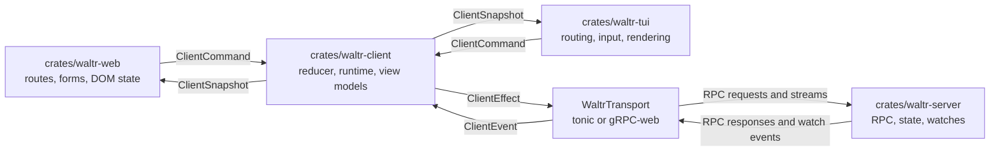
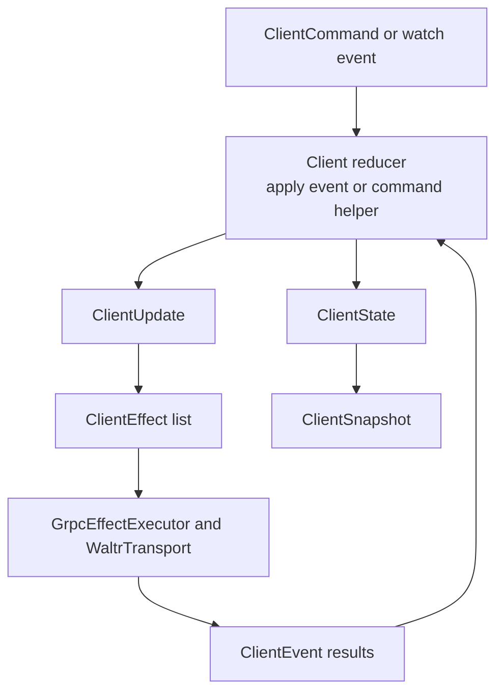
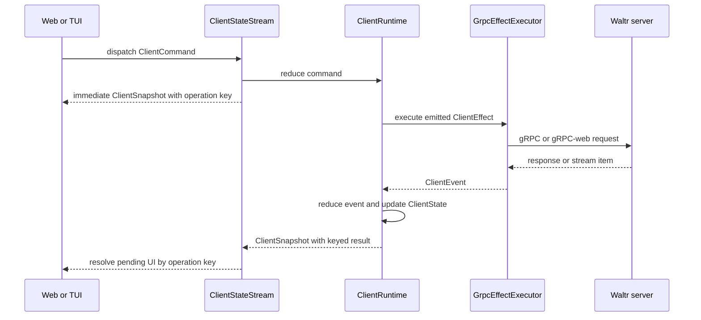

# Clients

Waltr client architecture keeps server data coordination in `crates/waltr-client/` so web and TUI clients can share behavior while keeping platform-specific routing, forms, rendering, and transient UI state local.

## Responsibilities

| Layer | Owns |
| --- | --- |
| `crates/waltr-server/` | Shared server state, RPC services, persistence, watches, validation, and concurrency checks. |
| `crates/waltr-client/` | Shell-neutral reducer state, server-facing commands, effect intents, transport adapters, stable view models, and runtime orchestration. |
| `crates/waltr-web/` | Browser routes, forms, transitions, DOM state, and browser-specific command dispatch. |
| `crates/waltr-tui/` | Terminal routes, input handling, rendering, snapshots, and terminal-specific command dispatch. |

Web and TUI should not duplicate server data state machines. They should consume `waltr-client` snapshots and dispatch `waltr-client` commands, then adapt the resulting state to their UI surfaces.

## Server RPC Boundary

The client talks to the server through generated gRPC contracts under `proto/waltr/`.

Config traffic uses `waltr.config.v1.ConfigService`:

| RPC | Client Use |
| --- | --- |
| `GetConfig` | Load the current config snapshot. |
| `PatchConfig` | Submit sparse top-level config patches with an expected ETag. |
| `WatchConfig` | Receive an initial config snapshot and subsequent config change events. |

Status traffic uses the status service to watch system readiness. Config watch maintenance depends on the status watch because the reducer only opens or reopens config watches after the server reports ready.

`crates/waltr-client/src/transport/mod.rs` defines the runtime-neutral `WaltrTransport` trait and the default transports:

| Runtime | Transport |
| --- | --- |
| Native | `NativeGrpcTransport`, backed by tonic channels. |
| Browser/WASM | `WasmGrpcTransport`, backed by gRPC-web over `fetch`. |

Transport code converts server RPC messages into client domain types such as `Configuration`, `ConfigWatchUpdate`, and `SystemStatus`. UI implementations should not call generated service clients directly when a shared client command or runtime path exists.

## Reducer State Machine

`crates/waltr-client/src/client.rs` exposes the shell-neutral `Client` reducer. It owns a `ClientState` and accepts `ClientEvent` values. Applying an event mutates state and returns a `ClientUpdate` containing zero or more `ClientEffect` intents.

The reducer is intentionally split from side effects:

| Concept | Role |
| --- | --- |
| `ClientState` | Current access, config, status, stream state, operation status, watch status, errors, watch interest counts, and retry attempts. |
| `ClientEvent` | Facts that already happened, such as access changed, config loaded, patch failed, watch changed, or reconnect delay elapsed. |
| `ClientEffect` | Work that must happen outside the reducer, such as load config, patch config, open a watch, or sleep before reconnecting. |
| `ClientUpdate` | Reducer output containing side-effect intents for the runtime to execute. |

Operation state uses shared statuses: `Idle`, `Loading`, `Ready`, `Opened`, `Received`, `Waiting`, and `Failed`. UI clients should render from these statuses instead of deriving separate server-data state.

Command operations that complete asynchronously also receive a runtime-local operation key. The immediate command snapshot records that key on the operation-specific snapshot, such as `snapshot.config.patch.key` or `snapshot.sessions.create.key`, and `snapshot.operations.current[key]` carries the keyed result. Shells that need command completion should keep their UI pending until the matching keyed result reaches `ready` or `failed`; they should not treat the immediate dispatch snapshot or the latest global operation status as completion for a specific command.

## Runtime Orchestration

`ClientRuntime` and `ClientStateStream` connect the reducer to `GrpcEffectExecutor`.

The runtime loop:

1. Receives a shell command or watch event.
2. Applies the corresponding reducer event or command helper.
3. Executes emitted effects through the transport executor.
4. Applies returned events back into the reducer.
5. Publishes a stable `ClientSnapshot` for shells.

The stream form coordinates startup and long-lived watches. It waits for status readiness, maintains watch streams, applies watch events as they arrive, and dispatches shell commands into the same reducer-owned state.

The runtime keeps one cancellation-safe in-flight effect slot. Command preemption does not drop or restart that future; it resumes and completes exactly once. When access is denied and queued/in-flight work is drained, the stream parks until a command or credential generation change instead of publishing an unchanged busy loop.

## Access Lifecycle

Waltr access authentication is separate from provider and upstream-MCP credential management. `AccessStatus` is `UnknownChecking`, `LoginRequired`, `LoginInProgress`, `Authenticated`, or `LoginFailed`. Outbound authentication failures remain ordinary operation or failed-session results with structured `AuthenticationFailure` data; they do not change access state or create pending authorization state.

Shared access commands are `StartWaltrLogin`, `CompleteWaltrLogin`, `FailWaltrLogin`, `CancelWaltrLogin`, `LogoutWaltr`, and `WaltrAccessExpired`. `AccessEvent` applies the corresponding facts to deterministic reducer state while browser navigation, OIDC exchange, loopback listeners, token refresh, and cookie logout stay in platform runtimes.

The transport decodes version-1 `AuthenticationFailure` protobuf status details. A valid outbound-provider or outbound-MCP failure preserves its domain, reason, nonempty `AuthTarget`, safe message, and sanitized MCP context on the ordinary operation error. Failed session status carries the same optional structure for asynchronous and queued failures. Only an `Unauthenticated` response explicitly classified as the `WALTR_ACCESS` domain becomes Waltr login required and clears the current native bearer lease. Missing, malformed, unknown-version, or otherwise unmatched details remain ordinary errors rather than guessing an authentication domain.

Expiry or failed native refresh clears protected config, status, sessions, timelines, streams, and in-flight protected operation state. It preserves watch interests and reload intent, but invalidates the status watch epoch so late events from an old credential cannot reauthenticate the client. Login completion starts a new status epoch. A current-epoch protected status event establishes authentication, then child watches reopen according to interest and config/session collections reload. Explicit logout also clears watch interests.

Native transports attach the current in-memory bearer credential to each unary request and newly opened stream. Credential leases are monotonic generations: stale login and refresh tasks cannot overwrite or clear credentials owned by a newer flow. Browser gRPC-web relies on same-origin cookie behavior and does not inject bearer tokens.

Native HTTPS uses rustls-backed tonic channels with normal certificate and hostname verification. Explicit logout clears the credential and performs an anonymous status reprobe so access-disabled servers can return to `Authenticated`; credential generations prevent results from the prior lease from mutating the new state.

The web route sends the browser to `/oidc/login` with a validated local return path and calls `/oidc/logout` with same-origin credentials. The TUI owns protected-resource discovery, public-client PKCE, loopback callback handling, and in-memory refresh/expiry. See [Access Authentication](access-authentication.md).

Outbound provider/MCP authorization remains separate from Waltr access and begins only through an explicit Config action. One generic target-scoped command family lists and reads sanitized status, begins and completes authorization, inspects or cancels attempts, forces refresh, and resets credentials for either target kind. The shared reducer exports statuses and keyed operation results alongside only an opaque attempt ID, authorization URL, expiry, completion mode, registration method, lifecycle, and sanitized failure reason. For server-callback attempts the shared runtime polls `PollAuthAttempt`; shells render snapshots and may cancel the explicit attempt. Manual attempts submit the final redirect URL or code. Web and TUI never receive provider or MCP access tokens, refresh tokens, PKCE verifiers, registration responses, or callback state. Session surfaces render outbound failures with Config navigation and require an explicit resend or rerun after authentication; they never begin OAuth or replay work automatically.

## Client Implementation Contract

Web and TUI implementations should follow these rules:

- Use `ClientRuntime`, `ClientStateStream`, `ClientCommand`, `ClientSnapshot`, and stable view models from `waltr-client` for server-backed state.
- Keep form drafts, focus, route params, modal state, animation state, and terminal/browser rendering concerns local to the implementation.
- Dispatch shared commands for server data mutations instead of constructing RPC requests in UI code.
- Treat snapshots as the source of truth for loaded config, patch/load/watch status, status readiness, and operation errors.
- For async command completion, capture the operation key from the immediate command snapshot and observe `snapshot.operations.current[key]` until it reaches `ready` or `failed`.
- Register config watch interest while a UI surface needs live config updates, and release interest when that surface no longer needs them.
- Preserve feature parity between web and TUI by changing shared reducer behavior in `waltr-client` when behavior is not platform-specific.
- Keep Waltr access state distinct from provider/upstream-MCP `AuthTarget` state, and ignore stale login attempts, credential leases, and watch epochs.
- Keep provider and MCP catalog loading, mutation commands, operation keys, and snapshots in the shared reducer; browser bindings must not construct direct catalog transports.
- Keep outbound OAuth attempt state in shared commands/snapshots while credentials, refresh claims, callback validation, discovery, and registration remain server/agent concerns.
- Render provider and MCP credential status from the shared auth snapshot and reconcile authorize, refresh, and reset through their keyed operation results.
- Start outbound OAuth only from explicit Config actions. Session operation and status failures may link to the target's Config editor but must not create attempt state or replay work.

## References

| Path | Purpose |
| --- | --- |
| [../../crates/waltr-client/src/client.rs](../../crates/waltr-client/src/client.rs) | Reducer entry point and command helpers. |
| [../../crates/waltr-client/src/coordination/state.rs](../../crates/waltr-client/src/coordination/state.rs) | Shared client state and operation statuses. |
| [../../crates/waltr-client/src/coordination/event.rs](../../crates/waltr-client/src/coordination/event.rs) | Client events, effects, and config patch shape. |
| [../../crates/waltr-client/src/coordination/runtime.rs](../../crates/waltr-client/src/coordination/runtime.rs) | Runtime and state-stream orchestration. |
| [../../crates/waltr-client/src/transport/mod.rs](../../crates/waltr-client/src/transport/mod.rs) | RPC transport boundary. |
| [../../crates/waltr-client/src/view/mod.rs](../../crates/waltr-client/src/view/mod.rs) | Stable shell-facing view models. |
| [../../proto/waltr/config/v1/config_service.proto](../../proto/waltr/config/v1/config_service.proto) | Config RPC contract. |
| [config.md](config.md) | Config patch, ETag, and watch behavior. |
| [access-authentication.md](access-authentication.md) | Access boundaries and browser, native, and MCP authentication flows. |
