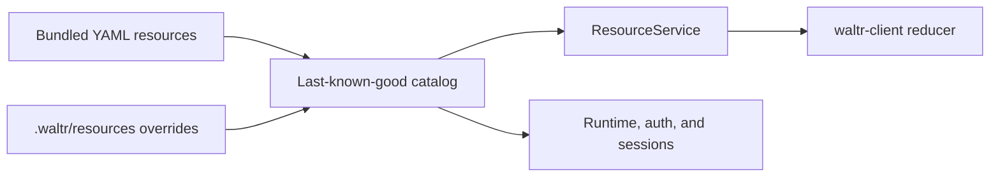

# Resource Catalog

Waltr uses one server-owned YAML resource catalog. The catalog defines seven kinds: agents, features, permissions, providers, MCP servers, inference defaults, and routines.



## Catalog Layout

The persisted catalog root is `.waltr/resources`. It accepts these canonical paths:

| Path | Kind |
| --- | --- |
| `agents/<name>.yaml` | `Agent` |
| `features/<name>.yaml` | `FeatureSet` |
| `permissions/<name>.yaml` | `PermissionSet` |
| `providers/<name>.yaml` | `Provider` |
| `mcp-servers/<name>.yaml` | `McpServer` |
| `defaults/default.yaml` | `Defaults` |
| `routines/<name>.yaml` | `Routine` |

Each file contains one strict YAML document. The category fixes `kind`. The filename stem must equal `metadata.name`.

The catalog accepts direct, regular, nonsymlink files with the exact `.yaml` suffix. It rejects nested paths, unknown categories, and extra defaults names.

Bundled resources supply the base catalog. A persisted file replaces the bundled resource at the same exact path. A reset removes that override and reveals the bundle.

A persisted path without a bundled counterpart adds a resource. Reset removes that resource from the effective catalog.

Waltr does not merge resource fields. Waltr does not support aggregate patches, TOML configuration, automatic import, or compatibility configuration APIs.

## Resource Schemas

All resources use `apiVersion: waltr.dev/v1alpha1`. The catalog rejects unknown fields and invalid path, kind, or name identities.

Agent, feature, and permission syntax is documented in [Agent Architecture](agent.md#agent-definitions).

`Provider` selects an inference or speech transport and URL. Inference providers can define headers, OAuth metadata, explicit models, and a models.dev catalog selector. Speech providers use the separate explicit-only contract below.

A provider catalog selector names a models.dev provider and an `include` list. Optional `keyPrefix` and `aliases` alter materialized model keys. Waltr uses the materialized key as the session and upstream model identifier, so prefixes are functional routing identifiers rather than presentation-only namespaces.

`McpServer` uses `spec.transport: streamableHttp` with a URL, or `spec.transport: stdio` with a command. Both forms belong to the ordinary catalog schema in every host build.

`Defaults` exists only at `defaults/default.yaml`. Its `spec.inference` value selects a provider, model, and optional `reasoningEffort`.
Optional `spec.sessionDictation` selects the session composer's default interaction Routine and ports:

```yaml
spec:
  inference:
    provider: codex
    model: gpt-5.3
  sessionDictation:
    routine: audio-transcribe
    trigger: dictate
    input: audio
    output: transcript
```

These names illustrate a configured Routine; Waltr supplies no global dictation default.
Absent or null `sessionDictation` disables the composer's microphone action.
Identifiers contain 1–128 ASCII letters, digits, underscores, or hyphens.
Catalog validation requires an interaction trigger, PCM s16le 24 kHz mono input, and text output.
The trigger cannot require another audio port or a scalar input without a default.
The catalog validates references atomically; invalid edits retain the last-known-good snapshot.
Routine changes that break this default also reject the candidate catalog.
`Configuration.session_dictation` and shared `ConfigView.sessionDictation` expose the selection through the ordinary catalog snapshot and watch path.
Explicit interaction APIs and desktop keybind selections remain independent.

`Routine` defines a server-owned event, manual, `sessionLifecycle.runCompleted`, or interaction workflow. Each trigger declares exactly one form. The interaction runtime and RPC service support audio/text execution. See [Routines](routines.md#interaction-catalog-and-runtime). Conditions support `In`, `NotIn`, numeric `GreaterThanOrEqual`, nested `any` OR groups, and top-level AND semantics.

Parameters use closed string or boolean scalars. String parameters support required use, `validation.minLength`, and bounded Rust regex patterns. Manual triggers expose declared parameters with session scope.

Event/manual tasks form a validated `runAfter` DAG that the sequential executor processes. Each task contains a generic agent template or one supported action; speech and collector tasks require the interaction runtime and are rejected before sequential admission. Both executors interpret `runAfter` as requiring completion: succeeded and skipped prerequisites permit successors, while failed or interrupted prerequisites block them. Interaction definitions also validate live stream dependencies. The separate interaction runtime schedules live components concurrently; it does not extend action support. Standalone `sessionTemplate.model` helpers resolve inference against the admission-pinned configuration in either executor; interaction helpers retain their one-turn, no-tools restrictions.

Agent tasks require replacement prompts, explicit feature, tool, and permission lists, `maxTurns`, and text output. They inherit provider settings from a source session, with reasoning disabled.

Every source-backed `sessionTemplate` atomically creates a durable helper with rollback-aware provider-neutral inference history through the latest completed turn. The helper stores that history followed by its task prompt. The history preserves provider-replay prompts, assistant text, tool calls and results, and inline images. It excludes lifecycle, middleware, status, usage and cost, request audit, provider metadata, provider-native thinking payloads, rollback barriers, and active partial work.

Provider requests derive only from durable helper state. The history persists across restart and storage backends under ordinary session retention rules. The history is not a byte-for-byte HTTP wire archive. Provider adapters apply their normal encoding rules. An inherited-inference or standalone-model `sessionTemplate` starts with only its task prompt.

The metadata action supports one scalar `set` mutation with `ifAbsent: true`. The implemented `sessionCreate` subset requires exact inference and agent-definition inheritance, metadata, one first prompt, and immediate start.

Top-level `spec.sourceSession` supports manual triggers and `runCompleted` lifecycle triggers. A paused source queues submissions; manual acquisition requires `onBusy: reject`, while lifecycle admission claims the source completion barrier. Inference-only event Routines remain supported.

`sourceSession.snapshot` admits a manual raw latest-completed capture. `sourceSession.pause` admits a mask-effective completed-turn capture pinned to an exclusive process-local boundary. Implemented compaction actions atomically subtract overlapping prefix replacement masks, add one keyed prefix replacement, and optionally continue from the committed mask cursor.

The implemented mask subset is persistent replacement masks with completed-prefix selectors, opaque IDs, stable keys, overlap subtraction and rejection, explicit removal, and effective replay. Filter, truncation, annotation, exact item-set, and category-oriented masks remain unsupported. Other unsupported fields, operators, actions, task types, and substitutions fail strict validation.

The server bundles [`title`](../../crates/waltr-server/resources/routines/title.yaml), [`compact-and-continue`](../../crates/waltr-server/resources/routines/compact-and-continue.yaml), and [`fork`](../../crates/waltr-server/resources/routines/fork.yaml). Their matching [documentation examples](../examples/routines/README.md) use identical source. The examples index separates the implemented subset from proposed fixture syntax.

The catalog materializes providers, MCP servers, and defaults into `waltr.config.v1.Configuration`. Runtime, auth, catalog search, and clients use this projection. The server retains routines separately, so routine resources never enter agent-definition bundles.

## Speech Provider Contract

The catalog accepts `googleSpeechV2` and `googleTextToSpeechV1` transports. These additive `ProviderType` values are 5 and 6; current inference values and model fields retain their meanings. `waltr-audio` implements unary and duplex speech adapters. The internal interaction runtime connects those adapters through explicit model resolution. The application registers interaction RPCs under common authentication and shared admission. Local implementation does not establish deployment availability or real upstream compatibility.

Speech providers require explicit model definitions. They reject `catalog`, `oauth`, headers, endpoint userinfo, query strings, and fragments. Unknown speech model and option fields fail validation. The adapter adds no models.dev discovery, ADC, ambient credentials, OAuth, or upstream authentication. An explicit `http` endpoint uses plaintext. An `https` endpoint requires hostname verification and bundled public roots, without insecure TLS or plaintext fallback. The library adds no retries, device I/O, resampling, or codec conversion.

The existing protobuf-backed `models` map uses snake_case fields and numeric `type` values. Resource envelope fields remain camelCase. For STT:

```yaml
apiVersion: waltr.dev/v1alpha1
kind: Provider
metadata:
  name: speech
spec:
  transport: googleSpeechV2
  url: http://localhost:50051
  models:
    dictation:
      name: Dictation
      type: 3 # STT
      speech_capabilities:
        unary: true
        streaming: true
      recognition:
        recognizer: projects/example/locations/global/recognizers/_
        model: chirp_3
        language_codes: [en-US]
        sample_rate_hz: 24000
        channels: 1
        interim_results: true
        automatic_punctuation: true
```

For TTS, use `transport: googleTextToSpeechV1`, `type: 4`, and `synthesis` instead of `recognition`:

```yaml
models:
  reader:
    name: Reader
    type: 4 # TTS
    speech_capabilities:
      unary: true
      streaming: true
    synthesis:
      voice: en-US-Chirp3-HD-Aoede
      language_code: en-US
      sample_rate_hz: 24000
      channels: 1
      speaking_rate: 1.0 # optional, 0.25–2.0
      pitch: 0.0 # optional, -20–20
```

Model keys, recognition model IDs, recognizers, languages, and voices are explicit operator configuration, not discovery or a guarantee that an upstream endpoint supports them. At least one capability must be true. Recognition accepts 1–3 nonempty language codes, 8–48 kHz PCM, and 1–8 channels. Synthesis accepts 8–48 kHz mono PCM. Capability declarations are checked locally; they do not probe upstream support. The interaction adapter maps speaking rate, requires streaming capability, and rejects nonzero pitch. It never substitutes unary speech calls.

Recognition supports the optional boolean `recognition.diarization`, which defaults to `false` when absent. For an endpoint with cumulative diarization support, `true` sends an empty Google `RecognitionFeatures.diarization_config`; no speaker-count constraints accompany it. The Routine adapter expects provisional cumulative text followed by one final cumulative response with attributed words. This opt-in does not probe backend support or enable diarization on current models. See the [Routine transcript contract](routines.md#speech-and-text) for text output and limits.

The [conversation-notes example](../examples/routines/audio-conversation-notes.yaml) selects a separate `speech/diarized-dictation` model with `recognition.diarization: true`. Keep the ordinary `speech/dictation` model disabled for diarization to preserve plain transcription and cleanup behavior.

Speech models reject inference options, token limits, LLM capabilities, cost/catalog matching fields, wrong transport/model kinds, and mismatched option families. Inference providers cannot contain STT/TTS models or speech options. Inference defaults cannot select a speech provider. Existing LLM resources need no new fields.

`resource_catalog::speech::resolve_speech_model(configuration, provider_key, model_key, expected_kind, streaming)` returns owned `ResolvedSpeechModel { provider_key, model_key, endpoint, capabilities, settings }`. `SpeechSettings` is `Recognition(SpeechRecognitionOptions)` or `Synthesis(SpeechSynthesisOptions)`. Resolution uses a pinned snapshot and performs no network calls. The interaction runtime constructs adapters from those resolved settings. Complete catalog validation checks Routine selections and exact model/port PCM compatibility before publication.

See [Routines](routines.md#interaction-catalog-and-runtime) for runtime bounds and ownership. See [Routine audio interactions](../examples/routines/audio-interactions.md) for YAML and the implemented public RPC contract.

## Build Capabilities

Environment-owned servers and embedded desktop and Android servers load one ordinary bundled catalog plus persisted overrides. There is no host-specific catalog variant or alternate Android resource tree.

Models.dev loading remains network-first. A failed network request uses a valid configured disk cache and marks the catalog stale. If the cache file is absent, an embedding host may explicitly opt into the curated catalog seed bundled under `crates/waltr-server/resources`; that result is also stale. A malformed or unreadable configured cache fails closed before the seed is considered. Standalone server composition does not opt into the seed.

Shell-bearing agent, feature, and permission resources remain valid, inspectable, and loadable when the server is compiled without the `shell` feature. Runtime construction then omits the unavailable shell tool and any permissions derived by selecting the shell feature. Shell-enabled builds install the configured shell tool and its applicable permissions normally.

The Tauri host passes app config `server` as the catalog root. Persisted overrides therefore live exactly at app config `server/.waltr/resources`.

Stdio MCP resources materialize in every build and use ordinary runtime process behavior when selected. Build capability handling controls server-side agent tools; it does not describe Tauri WebView capabilities. The WebView keeps its separate minimal IPC capability set.

Embedded startup prebinds its loopback listener, then atomically overwrites app config `server/.waltr/resources/mcp-servers/waltr.yaml` with that generation's exact `/mcp` URL before loading the catalog. The file is an ordinary persisted resource with filesystem origin and is refreshed on every server generation.

Embedded self-MCP therefore uses the same bundled-plus-persisted load, inspection, replacement, watcher, reset, and ETag behavior as every other resource. It needs no `WALTR_PUBLIC_URL` while the provisioned file replaces the bundled resource. Reset still validates the ordinary candidate catalog before deletion and can fail when the bundled fallback cannot expand `${env:WALTR_PUBLIC_URL}`; there is no embedded reset rule.

## Environment Templates

Resource string templates use `${env:NAME}`. Provider header values support whole-value or embedded templates.

URL templates require uppercase ASCII environment names with digits or underscores. A missing required URL value fails catalog validation.

The environment-owned bundled [`mcp-servers/waltr.yaml`](../../crates/waltr-server/resources/mcp-servers/waltr.yaml) requires `${env:WALTR_PUBLIC_URL}`. Waltr joins its `/mcp` path through URL parsing.

The join preserves a deployment path prefix and avoids duplicate separators. The public URL must meet the security rules in [Deployment](../deployment.md#oidc-access-domains).

A missing or invalid required value fails initial catalog load. An invalid value during reload records an error and preserves the last-known-good snapshot.

## Snapshots

The server validates the complete candidate catalog before publication. One immutable snapshot contains every effective resource and its effective configuration projection.

`GetResourceCatalog` returns the complete snapshot. `WatchResourceCatalog` sends a complete initial snapshot and a complete snapshot for every later event.

Each snapshot includes a catalog ETag and the current reload error. Each resource includes its path, kind, name, origin, source ETag, and effective value.

The watcher publishes successful catalog changes and rejected reload errors. Readiness depends on watcher health, not invalid candidate content alone.

Invalid persisted state fails initial load. Invalid direct edits after startup remain on disk and preserve the active snapshot.

## Administration

`waltr.resource.v1.ResourceService` provides resource-native administration:

| RPC | Behavior |
| --- | --- |
| `GetResourceCatalog` | Returns the complete active catalog. |
| `WatchResourceCatalog` | Streams complete catalog snapshots. |
| `InspectResource` | Lists slots or inspects one canonical path. |
| `ReplaceResource` | Replaces one complete strict YAML resource. |
| `ResetResource` | Removes one persisted override. |

Inspection reports persisted source, persisted-slot ETag, active source, active value, and reload errors. An absent slot also has a stable ETag.

Replace and reset require the current persisted-slot ETag. A stale ETag returns gRPC `failed_precondition`.

Replace validates the resource and complete candidate catalog before an atomic file replacement. Reset validates the complete fallback catalog before deletion.

The public Waltr MCP server exposes the `waltr://resources` collection and item/source templates through MCP resources.
Items include canonical URIs, persisted/effective/active source metadata, and guarded revisions.
Uniform tools expose `create/resource.create`, direct `edit` arguments, and `destroy/resource.destroy`; ordinary reads are not tools.
Text edits preserve source, validate the complete candidate catalog, and publish one atomic replacement.
Persisted revisions equal persisted-slot ETags; absent-slot revisions also guard the effective bundled source hash.
Destroy removes only a persisted override and restores bundled fallback when present.
See the embedded [resource contract](../../crates/waltr-server/resources/skills/resource-administration/references/resources.md) for URI encoding and edit inputs.

`waltr.routine.v1.RoutineService` provides global definition snapshots, durable manual admission, history, detail, and lifecycle replay.

See [Routines](routines.md) for revision pinning, validation, detached starts, persistence, replay, and restart behavior.

Resource writes serialize through Waltr. They do not isolate `.waltr` from another local writer. Restrict resource-tree writes to trusted processes.

## Client Contract

The shared client loads and watches `ResourceCatalog` values through `ResourceService`. Web and TUI clients render the effective configuration from that snapshot.

Provider, MCP server, and defaults edits follow one flow:

1. Capture the resource source and persisted-slot ETag from the watched catalog when editing begins.
2. Build one complete strict YAML document from that captured source.
3. Replace it with the captured persisted-slot ETag.
4. Wait for the complete catalog watch snapshot.

Reset uses the captured persisted-slot ETag and then waits for the authoritative catalog snapshot. Clients preserve the current catalog while a write fails or a reload error remains active.

Provider and upstream-MCP credentials remain durable SQL state outside the resource catalog. The embedded self-MCP generation credential is host-owned and memory-only. Resource reset never resets credentials.

Each session stores a self-contained inference snapshot. Catalog changes do not alter that durable session snapshot.

## Desktop Client Configuration

Desktop client configuration stays separate from the server resource catalog, app-private server roots, credentials, and browser preferences.
[`waltr-desktop::config`](../../crates/waltr-desktop/src/config.rs) resolves `$XDG_CONFIG_HOME/waltr/client.yaml`, or `$HOME/.config/waltr/client.yaml` when XDG is empty or absent.
This XDG rule also applies on macOS; it does not use `Library/Application Support`.
The selected root must be absolute.
The native desktop app reads one startup snapshot, with no reload or server-side resource administration.
A missing file disables all shortcuts. Malformed or unreadable configuration causes a sanitized startup failure without a fallback.
Android chat dictation loads no XDG client file; its frontend uses the server's `Defaults.spec.sessionDictation` selection.
Desktop registration remains process-owned across runtime and credential changes.

The strict version-1 schema rejects unknown fields and duplicate IDs or chords.
It permits at most 64 keybinds and a 256 KiB YAML file.
Each keybind requires `id`, `key`, `mode`, `routine`, `audio`, and exactly one output action: `command` or `typing`.
Absent actions, explicit nulls, unknown action fields, and both actions together are invalid.
Version 1 retains the legacy `command: { argv, stdin, timeoutSeconds }` syntax without implicit defaults between actions.
Only `mode: hold` exists.
An optional keybind-level `maxCaptureSeconds` accepts 1–3,600 seconds.
At that deadline, the hold uses normal release: stop capture, drain accepted audio, close input, and continue receiving the Routine result.
It does not cancel finalization or run the output action before successful completion.
Earlier release still finishes normally; a later release causes no second output action.
Without this option, native capture retains its existing five-minute safety limit.
The [conversation-notes client example](../examples/client-conversation-notes.yaml) selects 3,600 seconds and copies only the final notes.
This schema configures the current audio hold adapter, not arbitrary native hooks or device context.
Chords use unique modifiers in `Ctrl`, `Alt`, `Shift`, `Super` order, followed by a supported key.
Native registration still depends on platform capabilities and user approval.

The [client example](../examples/client.yaml) selects the real [cleanup Routine](../examples/routines/audio-transcribe-cleanup.yaml):
`audio-transcribe-cleanup`, trigger `dictate`, input `audio`, output `clean-text`, with 24 kHz mono PCM.
`dictate` names this speech example's ordinary typed interaction trigger; the server assigns it no special dictation semantics.
The server must contain that Routine and compatible providers; the client file neither installs nor discovers them.
The example selects `typing: {}` for live external text.
That Routine collects its transcript before cleanup, so output need not appear while the shortcut remains down.
Native backend capability and consent remain separate from schema validation.

For legacy clipboard output, replace `typing: {}` with this command action:

```yaml
command:
  argv: [pbcopy]
  stdin: '{{ text }}'
  timeoutSeconds: 10
```

On Wayland, use `argv: [wl-copy]` for the equivalent command example.
These explicit commands copy final text; neither command inserts text into another application.
Waltr never selects either command as a fallback for unavailable external typing.

| Section | Fields and contract |
| --- | --- |
| `routine` | Exact `name`, `trigger`, `input`, and `output` identifiers. |
| `audio` | `device`, `sampleRateHz`, and `channels`; version 1 uses S16LE PCM. |
| `command` | Fixed `argv`, optional `stdin`, and optional `timeoutSeconds`; final successful text only. |
| `typing` | Empty mapping `{}`; live hypotheses to current keyboard focus, with Backspace suffix replacement where supported. |

### External Text Action

`typing: {}` accepts no options and grants no focus lock.
Focus changes can redirect later batches to another application.
The action delivers interim hypotheses immediately; identical updates and final text add no duplicate output.
Revisions replace the changed suffix through Backspace events, with common-prefix and deletion counts at extended grapheme boundaries.
The action permits 128 KiB of cumulative work per hold: inserted UTF-8 bytes plus deleted graphemes.
Each awaited write contains at most 1 KiB.
The source state retains 256 KiB by default, or 512 KiB when `maxCaptureSeconds` is configured; the separate 128 KiB typing-work limit is unchanged.

CR, LF, tab, and Unicode line/paragraph separators become spaces; CRLF becomes one space.
All other control characters, including DEL and C0/C1 controls, reject the complete hypothesis before any deletion or replacement.
The action adds no Enter, Tab, clipboard, paste, shortcut, or automatic submission.
It offers no retry, replay, rollback, or draft controls.
Prior effects remain after failure, including any partial revision deletion.
macOS supports Backspace revisions; target applications need not delete exactly one Unicode grapheme per key pair.
Wayland remains append-only and returns `Unsupported` on revisions before any replacement effect.
See [Clients](clients.md#live-external-text) for lifecycle guarantees and [Deployment](../deployment.md#desktop-tray-and-external-text) for platform requirements.

### Audio Selection

Device syntax accepts `default`, `name:<exact-name>`, or `id:<backend-id>`.
Schema validation accepts 8–192 kHz and one or two channels.
Native preflight supports only 8–48 kHz mono and rejects IDs without fallback.
Exact names must resolve uniquely on desktop. Android capture supports only the default device.
Schema acceptance therefore does not establish native device or format support.
Actual-format preflight also rejects otherwise supported formats when conservative library/host retained-audio capacity exceeds one target-rate second.
See the [pre-admission contract](clients.md#desktop-host-and-shortcuts) for the bound and its driver/device-buffer exclusions.

### Local Command Trust Boundary

The client file represents trusted local executable configuration, not untrusted Routine output.
The executor starts a fixed executable with separate argv values; it constructs no shell command.
Only exact `{{ text }}` and `{{ invocationId }}` templates exist in arguments and stdin.
Substitution stays literal and nonrecursive; argv[0] accepts no template.
The executor expands no environment variables, shell syntax, or tildes.
An explicitly configured shell still grants arbitrary local code execution.

The default command timeout is ten seconds; valid values span 1–300 seconds.
Limits permit 64 argv items, 16 KiB per template, 512 KiB final text, and 1 MiB total expanded argv plus stdin.
Each output pipe permits 64 KiB. Diagnostics exclude command values, text, and output contents.
Timeout and cancellation kill and wait for the direct child.
The host must await that result; kill-on-drop does not acknowledge shutdown.
No descendant-process containment or side-effect rollback guarantee exists.

See [Clients](clients.md#desktop-host-and-shortcuts) for hold ownership and shortcut lifecycle.
See [Deployment](../deployment.md#client-audio-host-prerequisites) for platform prerequisites.

## References

| Path | Purpose |
| --- | --- |
| [../../proto/waltr/resource/v1/resource_service.proto](../../proto/waltr/resource/v1/resource_service.proto) | Resource RPC messages and service contract. |
| [../../proto/waltr/routine/v1/routine_service.proto](../../proto/waltr/routine/v1/routine_service.proto) | Generic manual Routine discovery and invocation contract. |
| [../../proto/waltr/config/v1/config_service.proto](../../proto/waltr/config/v1/config_service.proto) | Effective configuration projection types. |
| [../../crates/waltr-server/src/resource_catalog/](../../crates/waltr-server/src/resource_catalog/) | Catalog state, materialization, persistence, ETags, and watcher lifecycle. |
| [../../crates/waltr-server/src/resource_catalog/routine.rs](../../crates/waltr-server/src/resource_catalog/routine.rs) | Strict Routine schema and validation. |
| [../../crates/waltr-server/src/routine/](../../crates/waltr-server/src/routine/) | Routine event, admission, task, and lifecycle runtime. |
| [../../crates/waltr-server/src/agent_definition.rs](../../crates/waltr-server/src/agent_definition.rs) | Agent-facing resource catalog exports. |
| [../../crates/waltr-server/src/config_service.rs](../../crates/waltr-server/src/config_service.rs) | `ResourceService` implementation. |
| [../../crates/waltr-server/src/mcp_service.rs](../../crates/waltr-server/src/mcp_service.rs) | Public resource administration actions. |
| [../../crates/waltr-server/resources/](../../crates/waltr-server/resources/) | Bundled resource catalog. |
| [../../crates/waltr-client/src/transport/config.rs](../../crates/waltr-client/src/transport/config.rs) | Client ResourceService transport. |
| [../../crates/waltr-client/src/resource.rs](../../crates/waltr-client/src/resource.rs) | Source-preserving provider, MCP server, and defaults YAML edits. |
| [../../crates/waltr-client/src/coordination/config.rs](../../crates/waltr-client/src/coordination/config.rs) | Client catalog load and watch reducer. |
| [clients.md](clients.md) | Shared client reducer and RPC architecture. |
| [routines.md](routines.md) | Canonical Routine lifecycle and persistence contract. |
