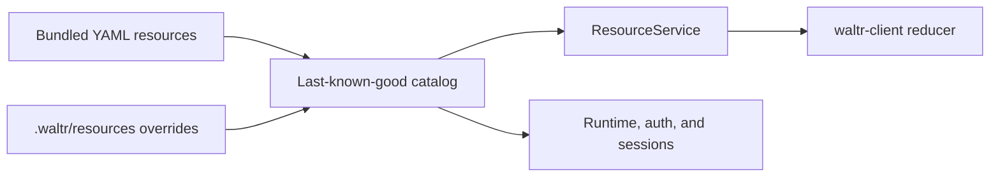

# Resource Catalog

Waltr uses one server-owned YAML resource catalog. The catalog defines seven kinds: agents, features, permissions, providers, MCP servers, inference defaults, and routines.

## Catalog Layout

The persisted catalog root is `.waltr/resources`. It accepts these canonical paths:

| Path | Kind |
| --- | --- |
| `agents/<name>.yaml` | `Agent` |
| `features/<name>.yaml` | `FeatureSet` |
| `permissions/<name>.yaml` | `PermissionSet` |
| `providers/<name>.yaml` | `Provider` |
| `mcp-servers/<name>.yaml` | `McpServer` |
| `defaults/default.yaml` | `Defaults` |
| `routines/<name>.yaml` | `Routine` |

Each file contains one strict YAML document. The category fixes `kind`. The filename stem must equal `metadata.name`.

The catalog accepts direct, regular, nonsymlink files with the exact `.yaml` suffix. It rejects nested paths, unknown categories, and extra defaults names.

Bundled resources supply the base catalog. A persisted file replaces the bundled resource at the same exact path. A reset removes that override and reveals the bundle.

A persisted path without a bundled counterpart adds a resource. Reset removes that resource from the effective catalog.

Waltr does not merge resource fields. Waltr does not support aggregate patches, TOML configuration, automatic import, or compatibility configuration APIs.

## Resource Schemas

All resources use `apiVersion: waltr.dev/v1alpha1`. The catalog rejects unknown fields and invalid path, kind, or name identities.

Agent, feature, and permission syntax is documented in [Agent Architecture](agent.md#agent-definitions).

`Provider` selects one inference transport and URL. It can define headers, OAuth metadata, explicit models, and a models.dev catalog selector.

A provider catalog selector names a models.dev provider and an `include` list. Optional `keyPrefix` and `aliases` alter materialized model keys. Waltr uses the materialized key as the session and upstream model identifier, so prefixes are functional routing identifiers rather than presentation-only namespaces.

`McpServer` uses `spec.transport: streamableHttp` with a URL, or `spec.transport: stdio` with a command.

`Defaults` exists only at `defaults/default.yaml`. Its `spec.inference` value selects a provider, model, and optional `reasoningEffort`.

`Routine` defines a server-owned event, manual, or `sessionLifecycle.runCompleted` workflow. Each trigger declares exactly one form. Conditions support `In`, `NotIn`, numeric `GreaterThanOrEqual`, nested `any` OR groups, and top-level AND semantics.

Parameters use closed string or boolean scalars. String parameters support required use, `minLength`, and bounded Rust regex patterns. Manual triggers expose declared parameters with session scope.

Routine tasks form a validated `runAfter` DAG, which the server executes sequentially. A task contains either a generic agent template or one implemented action.

Agent tasks require replacement prompts, explicit feature, tool, and permission lists, `maxTurns`, and text output. They inherit provider settings from a source session, with reasoning disabled.

Every source-backed `sessionTemplate` atomically creates a durable helper with rollback-aware provider-neutral inference history through the latest completed turn. The helper stores that history followed by its task prompt. The history preserves provider-replay prompts, assistant text, tool calls and results, and inline images. It excludes lifecycle, middleware, status, usage and cost, request audit, provider metadata, provider-native thinking payloads, rollback barriers, and active partial work.

Provider requests derive only from durable helper state. The history persists across restart and storage backends under ordinary session retention rules. The history is not a byte-for-byte HTTP wire archive. Provider adapters apply their normal encoding rules. An inference-only `sessionTemplate` starts with only its task prompt.

The metadata action supports one scalar `set` mutation with `ifAbsent: true`. The implemented `sessionCreate` subset requires exact inference and agent-definition inheritance, metadata, one first prompt, and immediate start.

Top-level `spec.sourceSession` supports manual triggers and `runCompleted` lifecycle triggers. A paused source queues submissions; manual acquisition requires `onBusy: reject`, while lifecycle admission claims the source completion barrier. Inference-only event Routines remain supported.

`sourceSession.snapshot` admits a manual raw latest-completed capture. `sourceSession.pause` admits a mask-effective completed-turn capture pinned to an exclusive process-local boundary. Implemented compaction actions atomically subtract overlapping prefix replacement masks, add one keyed prefix replacement, and optionally continue from the committed mask cursor.

The implemented mask subset is persistent replacement masks with completed-prefix selectors, opaque IDs, stable keys, overlap subtraction and rejection, explicit removal, and effective replay. Filter, truncation, annotation, exact item-set, and category-oriented masks remain unsupported. Other unsupported fields, operators, actions, task types, and substitutions fail strict validation.

The server bundles [`title`](../../crates/waltr-server/resources/routines/title.yaml), [`compact-and-continue`](../../crates/waltr-server/resources/routines/compact-and-continue.yaml), and [`fork`](../../crates/waltr-server/resources/routines/fork.yaml). Their matching [documentation examples](../examples/routines/README.md) use identical source. The examples index separates the implemented subset from proposed fixture syntax.

The catalog materializes providers, MCP servers, and defaults into `waltr.config.v1.Configuration`. Runtime, auth, catalog search, and clients use this projection. The server retains routines separately, so routine resources never enter agent-definition bundles.

## Environment Templates

Resource string templates use `${env:NAME}`. Provider header values support whole-value or embedded templates.

URL templates require uppercase ASCII environment names with digits or underscores. A missing required URL value fails catalog validation.

The bundled [`mcp-servers/waltr.yaml`](../../crates/waltr-server/resources/mcp-servers/waltr.yaml) requires `${env:WALTR_PUBLIC_URL}`. Waltr joins its `/mcp` path through URL parsing.

The join preserves a deployment path prefix and avoids duplicate separators. The public URL must meet the security rules in [Deployment](../deployment.md#oidc-access-domains).

A missing or invalid required value fails initial catalog load. An invalid value during reload records an error and preserves the last-known-good snapshot.

## Snapshots

The server validates the complete candidate catalog before publication. One immutable snapshot contains every effective resource and its effective configuration projection.

`GetResourceCatalog` returns the complete snapshot. `WatchResourceCatalog` sends a complete initial snapshot and a complete snapshot for every later event.

Each snapshot includes a catalog ETag and the current reload error. Each resource includes its path, kind, name, origin, source ETag, and effective value.

The watcher publishes successful catalog changes and rejected reload errors. Readiness depends on watcher health, not invalid candidate content alone.

Invalid persisted state fails initial load. Invalid direct edits after startup remain on disk and preserve the active snapshot.

## Administration

`waltr.resource.v1.ResourceService` provides resource-native administration:

| RPC | Behavior |
| --- | --- |
| `GetResourceCatalog` | Returns the complete active catalog. |
| `WatchResourceCatalog` | Streams complete catalog snapshots. |
| `InspectResource` | Lists slots or inspects one canonical path. |
| `ReplaceResource` | Replaces one complete strict YAML resource. |
| `ResetResource` | Removes one persisted override. |

Inspection reports persisted source, persisted-slot ETag, active source, active value, and reload errors. An absent slot also has a stable ETag.

Replace and reset require the current persisted-slot ETag. A stale ETag returns gRPC `failed_precondition`.

Replace validates the resource and complete candidate catalog before an atomic file replacement. Reset validates the complete fallback catalog before deletion.

The public Waltr MCP server exposes equivalent `resources.inspect`, `resources.replace`, and `resources.reset` actions. These actions use canonical relative paths and persisted-slot ETags.

`waltr.routine.v1.RoutineService` provides global definition snapshots, durable manual admission, history, detail, and lifecycle replay.

See [Routines](routines.md) for revision pinning, validation, detached starts, persistence, replay, and restart behavior.

Resource writes serialize through Waltr. They do not isolate `.waltr` from another local writer. Restrict resource-tree writes to trusted processes.

## Client Contract

The shared client loads and watches `ResourceCatalog` values through `ResourceService`. Web and TUI clients render the effective configuration from that snapshot.

Provider, MCP server, and defaults edits follow one flow:

1. Capture the resource source and persisted-slot ETag from the watched catalog when editing begins.
2. Build one complete strict YAML document from that captured source.
3. Replace it with the captured persisted-slot ETag.
4. Wait for the complete catalog watch snapshot.

Reset uses the captured persisted-slot ETag and then waits for the authoritative catalog snapshot. Clients preserve the current catalog while a write fails or a reload error remains active.

Provider and MCP credentials remain durable SQL state outside the resource catalog. Resource reset never resets credentials.

Each session stores a self-contained inference snapshot. Catalog changes do not alter that durable session snapshot.

## References

| Path | Purpose |
| --- | --- |
| [../../proto/waltr/resource/v1/resource_service.proto](../../proto/waltr/resource/v1/resource_service.proto) | Resource RPC messages and service contract. |
| [../../proto/waltr/routine/v1/routine_service.proto](../../proto/waltr/routine/v1/routine_service.proto) | Generic manual Routine discovery and invocation contract. |
| [../../proto/waltr/config/v1/config_service.proto](../../proto/waltr/config/v1/config_service.proto) | Effective configuration projection types. |
| [../../crates/waltr-server/src/resource_catalog/](../../crates/waltr-server/src/resource_catalog/) | Catalog state, materialization, persistence, ETags, and watcher lifecycle. |
| [../../crates/waltr-server/src/resource_catalog/routine.rs](../../crates/waltr-server/src/resource_catalog/routine.rs) | Strict Routine schema and validation. |
| [../../crates/waltr-server/src/routine/](../../crates/waltr-server/src/routine/) | Routine event, admission, task, and lifecycle runtime. |
| [../../crates/waltr-server/src/agent_definition.rs](../../crates/waltr-server/src/agent_definition.rs) | Agent-facing resource catalog exports. |
| [../../crates/waltr-server/src/config_service.rs](../../crates/waltr-server/src/config_service.rs) | `ResourceService` implementation. |
| [../../crates/waltr-server/src/mcp_service.rs](../../crates/waltr-server/src/mcp_service.rs) | Public resource administration actions. |
| [../../crates/waltr-server/resources/](../../crates/waltr-server/resources/) | Bundled resource catalog. |
| [../../crates/waltr-client/src/transport/config.rs](../../crates/waltr-client/src/transport/config.rs) | Client ResourceService transport. |
| [../../crates/waltr-client/src/resource.rs](../../crates/waltr-client/src/resource.rs) | Source-preserving provider, MCP server, and defaults YAML edits. |
| [../../crates/waltr-client/src/coordination/config.rs](../../crates/waltr-client/src/coordination/config.rs) | Client catalog load and watch reducer. |
| [clients.md](clients.md) | Shared client reducer and RPC architecture. |
| [routines.md](routines.md) | Canonical Routine lifecycle and persistence contract. |
