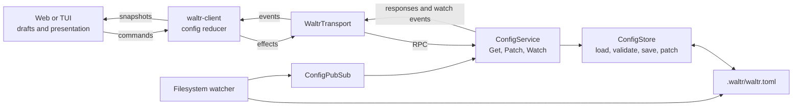
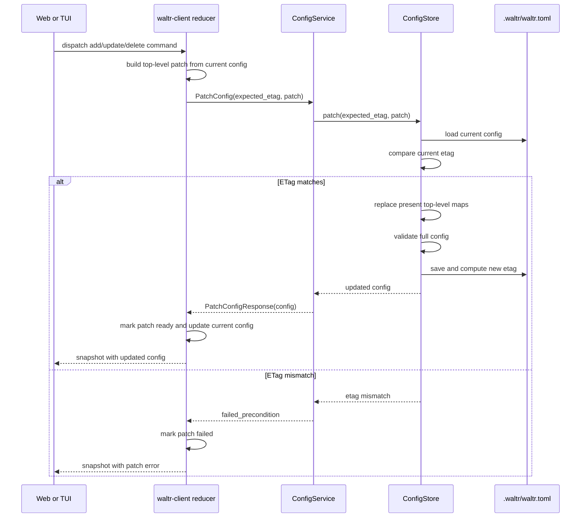
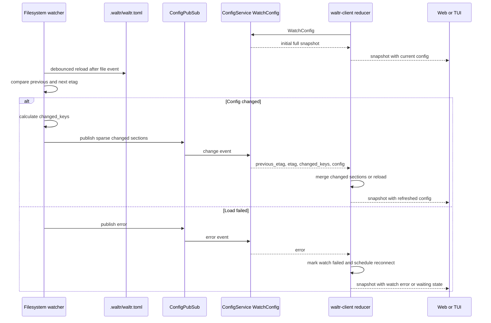
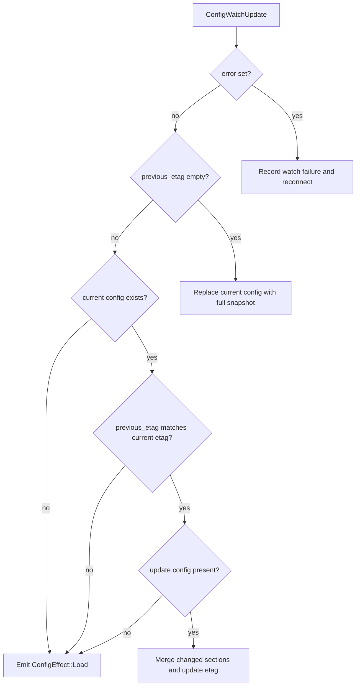

# Config

Waltr config architecture is server-owned and client-coordinated. The server persists and validates configuration, exposes RPCs, protects writes with ETags, and publishes watch events. Clients use the shared reducer in `crates/waltr-client/` to load, patch, watch, merge, and recover from config changes.

## Responsibilities

| Layer | Owns |
| --- | --- |
| Server config store | Loading, saving, validating, hashing, and patching config. |
| Server config service | `GetConfig`, `PatchConfig`, and `WatchConfig` RPC behavior. |
| Server config watcher | Filesystem change detection, debounce, changed-key calculation, and pubsub publication. |
| Client reducer | Config load/patch/watch state, ETag-aware watch merging, retry state, and reload decisions. |
| Web and TUI | Local drafts and presentation of shared client snapshots. |

## Data Model

The config RPC model is `waltr.config.v1.Configuration`:

| Field | Purpose |
| --- | --- |
| `providers` | Configured model providers keyed by provider name. |
| `mcp_servers` | Configured MCP servers keyed by server name. |
| `runtime_defaults` | Optional default provider, model, MCP servers, and provider parameters resolved for new agent sessions. |
| `etag` | Server-generated version hash used for optimistic concurrency. |

The filesystem store persists `.waltr/waltr.toml`. ETags are not persisted as authoritative data. On load or save, the store clears `etag`, serializes the config, hashes the serialized content with SHA-256, and returns an `etag` prefixed with `sha256:`.

## Partial Updates

`PatchConfig` accepts a sparse top-level patch:

| Patch Field | Behavior |
| --- | --- |
| `providers` absent | Leave existing providers unchanged. |
| `providers` present | Replace the entire providers map. |
| `mcp_servers` absent | Leave existing MCP servers unchanged. |
| `mcp_servers` present | Replace the entire MCP servers map. |
| `runtime_defaults` absent | Leave existing runtime defaults unchanged. |
| `runtime_defaults` present | Replace the complete runtime-defaults message. |

Patches are partial at the top-level section boundary only. They do not patch individual providers, provider fields, individual MCP servers, runtime-default fields, or nested model data in place. Shared client helpers build full replacement sections from the latest loaded config for operations like add, update, delete, rename, and setting runtime defaults.

The server validates the resulting full config before saving. Invalid provider names, provider key/name mismatches, unspecified model types, invalid MCP server types, and missing required MCP command or URL values are rejected.

## ETag Behavior

`PatchConfigRequest.expected_etag` must match the current server config `etag`.

Write flow:

1. Client loads or watches a config snapshot and stores its `etag`.
2. Client builds a patch from that snapshot and sends `expected_etag` with the patch.
3. Server loads the current config under the write lock.
4. Server rejects the patch if the current `etag` differs from `expected_etag`.
5. Server applies present top-level patch sections, validates, saves, computes the new `etag`, and returns the updated config.

An ETag mismatch is returned as gRPC `failed_precondition`. Validation errors are returned as `invalid_argument`. Other config failures are returned as `internal`.

Clients should treat ETag failures as stale-edit conflicts, not as successful writes. The shared reducer records the patch error in `state.config.patch.error` and leaves the last known config in place until a watch event or explicit reload provides a fresher snapshot.

## Watching

`WatchConfig` returns a stream. On subscription, the server first sends a full config snapshot with `etag` and `config` populated. After that, filesystem changes are published through pubsub as watch responses.

Watch change responses include:

| Field | Meaning |
| --- | --- |
| `previous_etag` | ETag observed before the change. Empty on initial snapshots. |
| `etag` | ETag after the change. |
| `changed_keys` | Top-level sections that changed: `providers`, `mcp_servers`, and/or `runtime_defaults`. |
| `config` | Full initial snapshot, or a sparse config containing only changed sections plus the new ETag for later changes. |
| `error` | Server-reported watch/load error when a change could not be loaded. |

The filesystem watcher debounces changes, ignores unchanged config, reports changed top-level keys, and publishes sparse changed config sections. If loading the changed file fails, it publishes an error watch event instead of a config patch.

## Client Watch Handling

The shared client reducer applies config watch updates in `crates/waltr-client/src/coordination/config.rs`.

Client merge rules:

- If a watch update has a non-empty `error`, record the watch failure and schedule a reconnect when watch maintenance is permitted.
- If `previous_etag` is empty, treat the update as a full snapshot and replace the current config with `config`.
- If `previous_etag` is non-empty but the client has no current config, request a full reload.
- If `previous_etag` does not match the client's current `etag`, request a full reload because the client missed an intermediate change.
- If `config` is absent on a changed update, request a full reload.
- Otherwise merge only the sections named in `changed_keys` and update the current `etag`.

Config watch maintenance is gated by status readiness. When a UI registers config watch interest before the server is ready, config watch state becomes `Waiting`; once status reports ready, the reducer opens the config watch. Watch failures use capped reconnect delays and retry through reducer effects.

## Client Reaction Contract

Client implementations should react to config coordination through `waltr-client` snapshots and commands:

- On ETag patch errors, keep the user's local draft visible if appropriate, show the patch error, and let the shared client receive a watch update or dispatch a config reload before retrying.
- For config patch commands, keep save/delete UI pending until the keyed `ConfigPatch` result in `snapshot.operations.current` is `ready` or `failed`; the immediate dispatch snapshot only identifies the operation.
- Do not blindly resubmit a stale patch with the same `expected_etag`.
- After a stale-edit conflict, rebuild the patch from the latest `state.config.current` before retrying.
- On watch updates, render from the updated `state.config.current`; do not maintain a second server config cache in web or TUI code.
- On watch error or `Waiting` status, preserve local UI state while the shared reducer reconnects or waits for system readiness.
- Register watch interest for screens that need live config data and release it when they no longer do.

## References

| Path | Purpose |
| --- | --- |
| [../../proto/waltr/config/v1/config_service.proto](../../proto/waltr/config/v1/config_service.proto) | Config RPC messages and service contract. |
| [../../crates/waltr-server/src/config_service.rs](../../crates/waltr-server/src/config_service.rs) | Server RPC implementation. |
| [../../crates/waltr-server/src/config/traits.rs](../../crates/waltr-server/src/config/traits.rs) | Config store/pubsub traits and server patch shape. |
| [../../crates/waltr-server/src/config/filesystem/store.rs](../../crates/waltr-server/src/config/filesystem/store.rs) | Filesystem persistence, validation, patch, and ETag hashing. |
| [../../crates/waltr-server/src/config/filesystem/watcher.rs](../../crates/waltr-server/src/config/filesystem/watcher.rs) | Filesystem watch publication and changed-section calculation. |
| [../../crates/waltr-client/src/coordination/config.rs](../../crates/waltr-client/src/coordination/config.rs) | Client config reducer, watch merge, reload, and retry behavior. |
| [../../crates/waltr-client/src/coordination/event.rs](../../crates/waltr-client/src/coordination/event.rs) | Client config events, effects, and client patch shape. |
| [clients.md](clients.md) | Shared client reducer and RPC architecture. |
